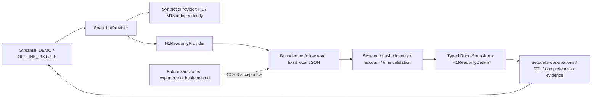

# Архитектура Control Center — CC-02

Основание: [Issue #524 / roadmap v1.0](https://github.com/alkospacer123/market-pattern-discovery/issues/524#issuecomment-6198924792).
База разработки — фактический GitHub main `2695cd3fce6f2241608d1d43d2b7c693ecaba32d`.
#529 merged; проверен новый checkpoint #530. Intel pinned code `3a18c8c…` известен
только из документации, не из физического чтения хоста. Frozen T3/H1/TRAIL1 неизменна.
Фактический текущий runtime UNKNOWN; последний документированный — HALTED/Disabled.

`h1_contract.py` — строгий wire allowlist и fixture policy; `readonly_file.py` —
единственный receiving I/O boundary; `h1_readonly.py` — проверка и конверсия.
Ни один модуль не импортирует/запускает TradingSystemLab, IntradayLab, StateStore,
FINAM, SQLite, shell или OS task control. Производящая сторона не изменяется.

`SnapshotProvider.snapshot(robot_id, scenario, now)` сохранён. H1 provider реализует
этот интерфейс; принимает только H1, игнорирует demo scenario. UI выбирает его только
фиксированным documented selector OFFLINE_FIXTURE. M15 остаётся отдельным provider;
H1 error не затрагивает второй монитор. Нет last-good cache или общего risk/account.

Миграция моделей обратно совместима: trailing optional source_kind/TTL в provenance,
optional side позиции и `RobotSnapshot.h1_readonly=None`, новый UNHEALTHY. Прежние
позиционные конструкторы/115 тестов работают. SYNTHETIC defaults/DEMO 10s policy
сохранены. VERIFIED_LIVE_READONLY enum зарезервирован, создание запрещено в CC-02.

Атомарный provenance envelope сохраняется для всех display records. Реальные времена
групп не заменяются envelope timestamp: `H1ReadonlyDetails.observations` хранит runtime,
heartbeat, успешный цикл, reconciliation, bars/signals/orders/positions/stops/finances.
UI выводит их рядом с receiving данными. Validator проверяет time ordering, а converter
маскирует numeric поля без свежей complete authority/evidence. Неутверждённые H1 calendar
и signal-current TTL дают UNKNOWN. HALTED не требует работающего heartbeat.

INTENT/REQUESTED/ACK/POSITION_OBSERVED не повышаются до fill; неподтверждённый fill —
UNRESOLVED. Planned stop не означает broker protection. Пустые неизвестные данные
не равны нулю. Finances требуют полного согласованного экспорта с cashflows/fees;
PnL из equity/ACK не выводится. T3 в панели не пересчитывается.

[Полный контракт](H1_READONLY_SNAPSHOT_CONTRACT.md) описывает схему, правила, лимиты,
atomic publication, будущий exporter и CC-03 blockers. Фиксированный packaged fixture
исторический: реальный rerun ожидаемо показывает STALE, а не передатирует его.
На Windows без безопасных no-follow primitives provider возвращает UNKNOWN;
физическая Windows handle/ACL/transport приёмка — отдельная CC-03 зависимость.

Streamlit fragment по-прежнему 2s только при открытой сессии; чтение локального файла
ограничено 128 KiB. Нет фонового polling брокера или нагрузки на trading runner.
Управляющие кнопки disabled без callbacks. Будущий control plane отдельный (CC-06/07),
auth/RBAC/privileged gateway/команды в этой поставке отсутствуют.
