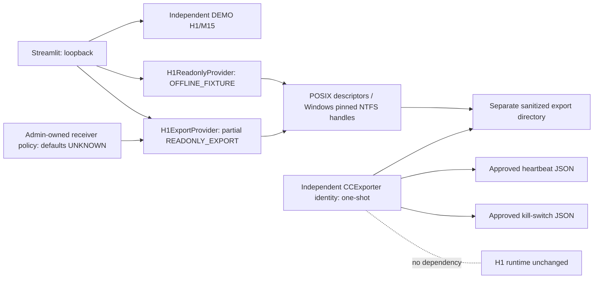

# Архитектура Control Center — CC-03

Base `52e167d7b36170f1f639827eb875a57d52175491`; [#531 merged](https://github.com/alkospacer123/market-pattern-discovery/pull/531). Intel pinned `3a18c8c…` — отдельная историческая identity из CURRENT_STATE, не текущий main и не полученное нами измерение. Frozen T3/H1/TRAIL1 без изменений. [Roadmap v1.0](https://github.com/alkospacer123/market-pattern-discovery/issues/524#issuecomment-6198924792) сохранён.

Panel imports only `cc/`, Streamlit/Plotly и stdlib. `exporter/` — отдельный entrypoint с единственной записью в CC export, не импортируется app. Он не запускает/import H1, не читает SQLite/token и не делает broker calls. Windows reader worker — отдельный ограниченный процесс Kernel32 read, без shell/Task/service. При ошибке нет last-good cache; новый пустой UNKNOWN. M15 остаётся независимым SyntheticProvider/NOT_DEPLOYED.

CC-02 wire schema/fixtures/conversion остаются самостоятельными и сохраняют тестовые TTL. CC-03 `source_contract.py` — отдельная строгая частичная схема, без financial/execution/position records. Приёмник связывает её с независимой trusted receiver policy; policy ACL проверяется WinAPI, не флагом самого JSON. New `READONLY_EXPORT` provenance явно не synthetic и не VERIFIED_LIVE_READONLY. Account-unbound → UNBOUND-H1; FIXTURE-H1 никогда не допускается для этого источника.

Windows backend проверяет каждый ancestor/leaf no-reparse path/type/identity; удерживает directories, разрешает atomic replacement leaf без блокировки producer и отвергает замеченную замену. Bounded read 128KiB, native worker timeout 2s (ограничения OS timing описаны отдельно). POSIX fixture path не ослаблен. Exporter production sources только Windows local NTFS с independently pinned root IDs, нет POSIX production fallback.

`RobotSnapshot.readonly_observations` содержит per-group время/качество/source-status; `readonly_identity` содержит только safe identity/reference и предупреждение broker authority UNKNOWN. Overall state не создаётся из наличия файла или сервера. HALTED/UNRESOLVED/UNHEALTHY/STALE/UNKNOWN различаются; HEALTHY требует независимый свежий Task source, которого current exporter не имеет. Candles/finance/execution остаются UNKNOWN до отдельного approved source/calendar. Planned stop, ACK и position не считаются fill/protection. No strategy recomputation.

В текущей поставке нет active source/receiver policies: READONLY_EXPORT по умолчанию UNKNOWN. Установка/ACL/binding/cadence и physical before-after проверяются только по [отдельному плану](CC03_PHYSICAL_ACCEPTANCE_PLAN.md) после разрешения. Hosted Windows validation выполняется в Draft #534; [актуальные результаты](CC03_WINDOWS_HOSTED_ACCEPTANCE.md). Legacy live source compatibility BLOCKED, чтение запрещено. CC-owned transport использует immutable completed files и независимый NTFS export_root_id; stopped-source evidence не доказывает continuous monitoring. Экспортёр или UI могут отсутствовать/аварийно завершиться без H1/M15 side effects.
