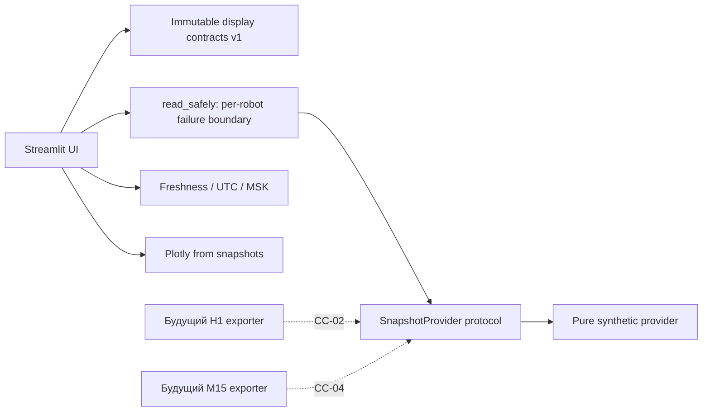

# Архитектура и изоляция

CC-00 / CC-01 следуют [Issue #524](https://github.com/alkospacer123/market-pattern-discovery/issues/524)
и [roadmap v1.0 от 15.10.2026](https://github.com/alkospacer123/market-pattern-discovery/issues/524#issuecomment-6198924792).
Работа основана на актуальном `main = 15e96cea2c252a2dfac1b61a070e8505c97c4d77`.
Установленный Intel commit `5bf1fe0…` не обновлялся и не использовался как checkout разработки.

## Компоненты

| Файл | Ответственность |
| --- | --- |
| `app.py` | Навигация, выбор двух независимых сценариев, `st.fragment(run_every=2)` |
| `cc/models.py` | Frozen dataclasses, enum, runtime-валидация типов/инвариантов, schema v1 |
| `cc/providers/base.py` | Контракт чтения готового RobotSnapshot; методов команд нет |
| `cc/providers/synthetic.py` | Чистые детерминированные сценарии и изоляция ошибок |
| `cc/freshness.py` | Свежесть, запрет stale-green, UTC/MSK, явный UNKNOWN |
| `cc/charts.py` | Свечи/маркеры/DEMO-линия/стоп из переданных полей; без расчёта стратегии |
| `cc/analytics.py` | Месячная группировка только внутри account scope |
| `cc/ui.py` | Русские представления; disabled-кнопки без callback |

Модели: RobotStatus, InstrumentStatus, SignalEvent, OrderEvent, PositionSnapshot,
RiskSnapshot, PortfolioSnapshot, SystemAlert, DataProvenance; дополнительно Candle,
Trade и RobotSnapshot. У каждой записи есть provenance с robot_id, account_scope,
source, observed_at, received_at, synthetic, schema_version. Все записи CC-01 обязаны иметь одинаковый provenance внутри RobotSnapshot;
это не позволяет освежить старое дочернее поле новым timestamp. Наборы скалярных
полей status/risk/portfolio атомарны и имеют общий timestamp своего provenance.
Неодновременные реальные поля в будущем потребуют отдельных provenance/наборов,
их нельзя освежать временем соседнего поля. None = UNKNOWN; пустой tuple позиций
означает наблюдённое отсутствие, None — отсутствующую authority.

Контракты отвергают wrong-account записи, нечисловые/NaN/Infinity цены, naive timestamps,
некорректный OHLC, отрицательные количества, unsupported schema, выдуманные fill/stop
без evidence. В CC-01 разрешены исключительно synthetic provenance и DEMO account scopes.
Реальные scopes/authority будут добавляться в CC-02 отдельной проверенной миграцией контракта.
Не создаётся конфигурационный путь, превращающий synthetic provider в live.

## Состояния и достоверность

Разделены заявленное состояние, свежесть снимка и торговое разрешение. HALTED не
сбрасывается при обновлении страницы. Если источник старый или пропал, крупный статус
становится STALE/UNKNOWN, а последнее заявленное HALTED/NOT_DEPLOYED остаётся контекстом.
HEALTHY требует свежий provenance и heartbeat; он никогда не выдаёт trading permission.
Торговое разрешение в моделях CC-01 может быть только False/None.

`MAX_SNAPSHOT_AGE=10s`, clock skew 2s — **демонстрационные** пороги. Будущие TTL не
копируют production safety gate 900s автоматически. Время последнего успешного
producer observation не равно времени перерисовки UI. При ошибке provider старый
HEALTHY не кэшируется: только для затронутого робота создаётся пустой UNKNOWN.
В M15 сохранён NOT_DEPLOYED, нет production identity/heartbeat/финансов/R15.

OrderEvent хранит отдельные уровни INTENT, REQUESTED, ACK, POSITION_OBSERVED,
FILL_CONFIRMED, UNRESOLVED. Первые четыре не имеют fill_price/filled_quantity.
FILL_CONFIRMED требует цену, количество и явное evidence. Это контракт отображения,
не reconciliation engine и не автомат переходов реальной заявки.

## Обновление и будущие адаптеры

Fragment обновляется каждые 2 секунды только в открытой browser session. Вычисление
ограничено 72 свечами на инструмент и короткой историей; нет infinite-loop, sleep,
threads, subprocess, polling FINAM или чтения БД в приложении. Отключение автообновления
останавливает fragment timer; навигация/виджеты выполняют обычный rerun.

CC-02 должен получать готовый ограниченный **экспортированный** снимок по allowlist:
версия схемы, exact robot/account/identity, атомарная публикация, предел размера,
source observation time, bounded timeout, redaction, независимая freshness каждого
набора. Ни exporter, ни read-only адаптер **сейчас не реализованы**.
Производящий торговый процесс не должен ждать интерфейс. UI не должен запускать
сервис, импортировать engine или самостоятельно воспроизводить стратегию.

Для SQLite предпочтителен согласованный разрешённый snapshot, не открытие live БД
из Streamlit. Если отдельная задача санкционирует SQLite-reader: `mode=ro`, query-only,
ограничения времени/размера, проверенная WAL/locking безопасность. `immutable=1` не
применяется к активному WAL по предположению. Не копировать только `.sqlite3` без
учёта WAL. Raw БД, broker account IDs и токены не нужны UI.

## Будущий control plane

Отдельный процесс/identity и отдельный аудит: auth/RBAC, per-robot allowlist команд,
idempotency, предусловия и подтверждённые postconditions. Таймаут = UNKNOWN.
Никакого универсального shell, implicit REARM, сброса fill-gate или выдачи trading
permission. CC-01 содержит только disabled UI, без endpoint, клиента или command handler.
