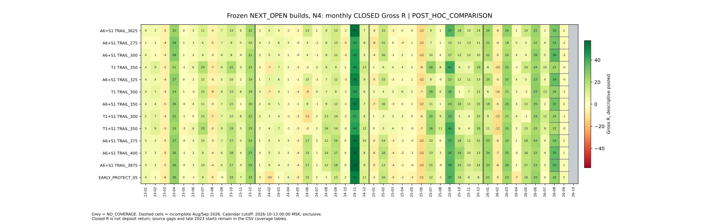

# IntradayLab — полное сравнение T3/M15 2023–2026 YTD

**POST_HOC_COMPARISON / GROSS_ONLY / NOT_LIVE_READY.** Срез источников: 14.10.2026 MSK. Итоговая классификация: **NO_ROBUST_WINNER** — один бесспорный победитель одновременно по годам, месяцам, просадке и независимости от рынка не обнаружен. Это вывод о доказательствах, без нового механического порога PASS для 2026.

## Три результата выбора

1. **Наиболее регулярная N4 по зафиксированному порядку — A6+S1 NEXT_OPEN TRAIL_3625.** 36 положительных месяцев из 45 покрытых (46 месяцев календарного YTD-окна), не менее 9/12 в каждом полном году; максимальная серия отрицательных месяцев — 2. Но PF2024 **1,648640 <1,70**: обязательный ежегодный ориентир roadmap не выполнен. Это исследовательский лидер регулярности, а не замена действующей сборки.
2. **Лидер совокупного Gross PF среди причинных N4 — действующая TRAIL_375:** PF **1,845936**, +418,142777R. В этой же группе максимум Gross R — **TRAIL_3875 N4**, +420,015962R: всего +1,873184R (+0,448%) при DD 30,790357R вместо 28,637394R, 34 вместо 35 положительных месяцев и 6/12 вместо 7/12 в 2025. Единого максимума PF и R нет. Дополнительная прибыль 3875 не компенсирует ухудшение устойчивости.
3. **Лучший компромисс для сохранения исследовательского ориентира — TRAIL_375 N4.** Среди существующих NEXT_OPEN, выполняющих PF>=1,70 отдельно в 2023/2024, он лидирует по месячной регулярности, меньшей DD и общему PF. Слабый 2025 и концентрация остаются. Параметры и состав инструментов автоматически не применяются.

| Сборка N4 | PF 2023 | PF 2024 | PF 2025 | PF 2026 YTD | +месяцы | DD R | CLOSED |
| --- | --- | --- | --- | --- | --- | --- | --- |
| A6+S1_NEXT_OPEN_TRAIL_3625 | 2,1515 | 1,6486 | 1,5698 | 2,0560 | 36/46 | 27,103 | 1041 |
| A6+S1_NEXT_OPEN_TRAIL_375 | 2,2073 | 1,7721 | 1,5813 | 2,0621 | 35/46 | 28,637 | 1026 |
| A6+S1_NEXT_OPEN_TRAIL_3875 | 2,1579 | 1,7760 | 1,5618 | 2,0955 | 34/46 | 30,790 | 1021 |

## Три первых по стабильности против действующей сборки

Здесь показаны именно первые три зафиксированного рейтинга, включая отрицательный статус ежегодного критерия. Рейтинг не переопределён после просмотра PF2026. Самостоятельный контроль по ежегодному критерию ниже.

| Сборка N4 | PF 2023 | PF 2024 | PF 2025 | PF 2026 YTD | +месяцы | DD R | CLOSED |
| --- | --- | --- | --- | --- | --- | --- | --- |
| A6+S1_NEXT_OPEN_TRAIL_3625 | 2,1515 | 1,6486 | 1,5698 | 2,0560 | 36/46 | 27,103 | 1041 |
| A6+S1_NEXT_OPEN_TRAIL_275 | 1,9221 | 1,5213 | 1,3298 | 1,9290 | 35/46 | 24,263 | 1101 |
| A6+S1_NEXT_OPEN_TRAIL_300 | 2,0087 | 1,5111 | 1,3959 | 2,0154 | 35/46 | 23,517 | 1084 |
| A6+S1_NEXT_OPEN_TRAIL_375 | 2,2073 | 1,7721 | 1,5813 | 2,0621 | 35/46 | 28,637 | 1026 |

| Сборка | R общий | Худший месяц R | Отрицательные месяцы подряд | Мин. годовой PF | Минимум 2023/2024 |
| --- | --- | --- | --- | --- | --- |
| A6+S1_NEXT_OPEN_TRAIL_3625 | 395,995 | -12,041 | 2 | 1,5698 | False |
| A6+S1_NEXT_OPEN_TRAIL_275 | 302,327 | -11,709 | 1 | 1,3298 | False |
| A6+S1_NEXT_OPEN_TRAIL_300 | 326,872 | -11,928 | 1 | 1,3959 | False |
| A6+S1_NEXT_OPEN_TRAIL_375 | 418,143 | -12,111 | 4 | 1,5813 | True |

275 и 300 уменьшают DD и серию отрицательных месяцев, но дают существенно меньше Gross R и не проходят PF2024. 3625 добавляет один положительный месяц и сокращает серию 2025 с четырёх до двух, однако уступает 375 по обоим DEVELOPMENT PF и совокупной прибыли. 375 не является лидером по всем метрикам; выбор компромисса сохраняет ежегодный ориентир и более сильную исходную доказательность.

## Происхождение и допуск

Фактический main при запуске: `d6946056332ce71658a6ca933cefa0740a7570a2`; все #490–#512 проверены. #509 закрыт без merge и содержит только архивную чувствительность, raw replay/свежие полные повторы там NOT_RUN. #492/#493/#502 относятся к execution/production-документам, не к новым IntradayLab сборкам. #494/#501/#511 — политика/дизайн без новых исполняемых комбинаций. #491/#503/#507/#510 — диагностика дублирующих замороженных сборок. PR #513 — read-only Draft на `c17709a748f6247e8bd6bf85c9b4f20fac14a4dd`, не база новой ветки.

В main найдены 17 каталогов T3/M15, плюс отдельный источник #513. 51 уникальная конфигурация: 38 SIGNAL_CLOSE и 13 NEXT_OPEN; повторяющиеся CONTROL/A6/A7/S1/T1/C1/COMBINED/TRAIL_300/350/375 объединены по config_identity с сохранением всех исходных PR. Полный [BUILD_REGISTRY.csv](BUILD_REGISTRY.csv), [CONFIG_FILTER_MATRIX.csv](CONFIG_FILTER_MATRIX.csv) и [SOURCE_MANIFEST.json](SOURCE_MANIFEST.json) содержат пути, commit/blob/SHA256, точные параметры и аудиты. Отсутствующие комбинации имеют NOT_TESTED. Разрезы SAME_DATE/CROSS_MIDNIGHT, haircut 0,05/0,10R и удаление победителей — DIAGNOSTIC_ONLY, не отдельные стратегии. SESSION force-flat/новый holding protocol не был замороженным исполняемым тестом; его PF не изобретается.

**Исполнение:** SIGNAL_CLOSE использует уже известный Close и остаётся идеализированной моделью. Его цифры не конкурируют за причинного победителя с NEXT_OPEN. NEXT_OPEN принимает Open только непосредственно смежной наблюдаемой M15; пропуск смежной свечи означает SKIP, а не ожидание выгодного позднего входа. Stop действует на execution bar. Индикаторы и позиции продолжаются от исходного начала истории; на границах года нет принудительных закрытий, сброса Stop/S1/pending или рекурсий.

**R:** signed(exit-entry)/immutable initial risk исходной сборки. Initial I1/I2/I3 изменяют знаменатель R и риск сделки, поэтому одинаковые суммы R не означают одинаковый capital risk. Gross R не является процентной доходностью депозита. Комиссии FINAM/MOEX, C1, spread/slippage, funding, денежные дивидендные поправки и искусственные штрафы не вычитаются.

## Данные, календарь и честный статус

Source pin `f8486b446cf3d5f9f3cba6dfec32bdef8fd184c8`, только четыре M15 CSV `forever/`. Фактическое покрытие подтвердило заявленные окончания. Сигнальная свеча доступна после завершения M15; H1 — исторический daily ordinal блок четырёх смежных M15, публикация на четвёртом Close; EMA/ATR/ADX/Donchian причинно пересекают дни по замороженным правилам. Это модель исторических экспортов, без независимой сертификации полного календаря MOEX.

| Инструмент | Первый Close | Последний Close | M15 2026 |
| --- | --- | --- | --- |
| USDRUBF | 2023-01-03T09:15:00+03:00 | 2026-08-30T19:00:00+03:00 | 10684 |
| CNYRUBF | 2023-01-03T09:15:00+03:00 | 2026-08-30T19:00:00+03:00 | 10697 |
| GLDRUBF | 2023-07-11T10:15:00+03:00 | 2026-09-16T00:00:00+03:00 | 13337 |
| IMOEXF | 2023-11-14T10:15:00+03:00 | 2026-09-16T00:00:00+03:00 | 13286 |

Cutoff **2026-10-13T00:00:00+03:00 исключительно**; свечи не заполнены и горизонт не подменён полным годом. Август/сентябрь — неполные endpoint-месяцы, октябрь — NO_COVERAGE. Нулевая экономика NO_COVERAGE не считается положительной. В 2023 GLDRUBF начинается в июле, IMOEXF в ноябре.

Первичное FULL_AVAILABLE включает весь доступный период каждого инструмента. COMMON_ENVELOPE использует пересечение фактических начала/конца всех четырёх источников, включая перенос уже открытых позиций; source gaps остаются раскрыты. COMMON_OBSERVED — дополнительный диагностический учёт только exit completions на общих наблюдаемых timestamps, без удаления баров из replay. JAN_JUL_2026 и REMAINING_2026_PREFIX разделяют семь месяцев с данными всех рынков и неполный остаток. На VIEW-границах сделки не ликвидируются; наследованные CLOSED и OPEN раскрыты отдельно.

2023–2024 DEVELOPMENT_EXPOSED. 2025 — ранее замороженный WF только для TRAIL_375, результат WF_MIXED; для остальных здесь это ретроспективная история. PR #513 ранее открыл OOS 2026 YTD для TRAIL_375; его опубликованный статус не переписывается. Новый рейтинг по 2023–2026 — POST_HOC_COMPARISON, не независимо подтверждённый TRUE OOS нового победителя. Будущая независимая оценка требует данных, не участвовавших в этом выборе.

## Все причинные NEXT_OPEN N4: годовой PF

Таблица расположена по рейтингу регулярности. Обязательный минимум PF2023/2024 отдельно отмечен в STABILITY_RANKING.csv; высокий общий PF не исправляет слабый год. Полный аналитический массив — [ANNUAL_COMPARISON.csv](ANNUAL_COMPARISON.csv).

| Сборка N4 | PF 2023 | PF 2024 | PF 2025 | PF 2026 YTD | +месяцы | DD R | CLOSED |
| --- | --- | --- | --- | --- | --- | --- | --- |
| A6+S1_NEXT_OPEN_TRAIL_3625 | 2,1515 | 1,6486 | 1,5698 | 2,0560 | 36/46 | 27,103 | 1041 |
| A6+S1_NEXT_OPEN_TRAIL_275 | 1,9221 | 1,5213 | 1,3298 | 1,9290 | 35/46 | 24,263 | 1101 |
| A6+S1_NEXT_OPEN_TRAIL_300 | 2,0087 | 1,5111 | 1,3959 | 2,0154 | 35/46 | 23,517 | 1084 |
| T1_NEXT_OPEN_TRAIL_350 | 2,3175 | 1,4609 | 1,8563 | 1,8056 | 35/46 | 17,198 | 1114 |
| A6+S1_NEXT_OPEN_TRAIL_325 | 2,0382 | 1,6043 | 1,4113 | 2,0393 | 34/46 | 23,093 | 1066 |
| T1_NEXT_OPEN_TRAIL_300 | 2,1754 | 1,3380 | 1,7121 | 1,7979 | 34/46 | 19,168 | 1154 |
| A6+S1_NEXT_OPEN_TRAIL_350 | 2,0892 | 1,6072 | 1,5034 | 2,0320 | 34/46 | 25,383 | 1049 |
| T1+S1_NEXT_OPEN_TRAIL_300 | 2,0693 | 1,3895 | 1,6663 | 1,7102 | 34/46 | 22,229 | 1137 |
| T1+S1_NEXT_OPEN_TRAIL_350 | 2,2941 | 1,5104 | 1,7598 | 1,7553 | 34/46 | 20,840 | 1105 |
| A6+S1_NEXT_OPEN_TRAIL_375 | 2,2073 | 1,7721 | 1,5813 | 2,0621 | 35/46 | 28,637 | 1026 |
| A6+S1_NEXT_OPEN_TRAIL_400 | 2,1163 | 1,7382 | 1,6090 | 2,0712 | 34/46 | 32,561 | 1016 |
| A6+S1_NEXT_OPEN_TRAIL_3875 | 2,1579 | 1,7760 | 1,5618 | 2,0955 | 34/46 | 30,790 | 1021 |
| A6+S1_EARLY_PROTECT_05_NEXT_OPEN_TRAIL_375 | 2,0796 | 1,5925 | 1,4805 | 1,9238 | 31/46 | 33,960 | 1076 |

Существующий ежегодный минимум DEVELOPMENT выполняют только TRAIL_375, TRAIL_3875 и TRAIL_400. Предпочтительного PF>2 во всех отдельных годах нет. Среди этих трёх по зафиксированным метрикам впереди 375; новые гипотезы или пороги 2026 не добавлялись.

## Полная годовая экономика выбранных и CONTROL

Средняя LOSS показана со знаком минус. CLOSED распределены один раз по собственному замороженному exit label; перенос через год не делится на две сделки. OPEN не включён в PF/R.

| Сборка | Год | PF | Gross R | Expectancy R | WIN R | LOSS R | Win % | CLOSED | OPEN конец | +месяцы | −месяцы |
| --- | --- | --- | --- | --- | --- | --- | --- | --- | --- | --- | --- |
| A6+S1_NEXT_OPEN_TRAIL_3625 | 2023 | 2,151527 | 86,288267 | 0,5136 | 2,0938 | -0,8420 | 45,83 | 168 | 0 | 10/12 | 2 |
| A6+S1_NEXT_OPEN_TRAIL_3625 | 2024 | 1,648640 | 105,644262 | 0,3271 | 1,9318 | -0,8852 | 43,03 | 323 | 1 | 9/12 | 3 |
| A6+S1_NEXT_OPEN_TRAIL_3625 | 2025 | 1,569772 | 85,766829 | 0,2840 | 1,8317 | -0,8701 | 42,72 | 302 | 1 | 9/12 | 3 |
| A6+S1_NEXT_OPEN_TRAIL_3625 | 2026 | 2,056031 | 118,295247 | 0,4770 | 1,9354 | -0,8684 | 47,98 | 248 | 0 | 8/10 | 1 |
| A6+S1_NEXT_OPEN_TRAIL_375 | 2023 | 2,207278 | 90,390672 | 0,5478 | 2,2333 | -0,8319 | 44,85 | 165 | 0 | 9/12 | 3 |
| A6+S1_NEXT_OPEN_TRAIL_375 | 2024 | 1,772134 | 122,131984 | 0,3877 | 2,0312 | -0,8936 | 43,81 | 315 | 1 | 11/12 | 1 |
| A6+S1_NEXT_OPEN_TRAIL_375 | 2025 | 1,581308 | 86,876613 | 0,2896 | 1,9531 | -0,8349 | 40,33 | 300 | 1 | 7/12 | 5 |
| A6+S1_NEXT_OPEN_TRAIL_375 | 2026 | 2,062109 | 118,743507 | 0,4827 | 1,9373 | -0,8803 | 48,37 | 246 | 0 | 8/10 | 1 |
| A6+S1_NEXT_OPEN_TRAIL_3875 | 2023 | 2,157943 | 88,760252 | 0,5412 | 2,3631 | -0,8242 | 42,68 | 164 | 0 | 9/12 | 3 |
| A6+S1_NEXT_OPEN_TRAIL_3875 | 2024 | 1,775958 | 123,611332 | 0,3924 | 2,0501 | -0,9000 | 43,81 | 315 | 1 | 11/12 | 1 |
| A6+S1_NEXT_OPEN_TRAIL_3875 | 2025 | 1,561825 | 84,323727 | 0,2820 | 1,9534 | -0,8385 | 40,13 | 299 | 1 | 6/12 | 6 |
| A6+S1_NEXT_OPEN_TRAIL_3875 | 2026 | 2,095545 | 123,320651 | 0,5075 | 1,9990 | -0,9005 | 48,56 | 243 | 0 | 8/10 | 1 |

| Сборка | Год | Худший месяц R | Худший квартал R | Месяцев убытка подряд | DD R | Убытков сделок подряд | Лучший месяц %R | Top3 месяца %R | R без top10 сделок | R без top3 месяцев |
| --- | --- | --- | --- | --- | --- | --- | --- | --- | --- | --- |
| A6+S1_NEXT_OPEN_TRAIL_3625 | 2023 | -4,747 | 2023-Q1 / 2,292 | 1 | 6,362 | 5 | 28,84 | 70,72 | 26,140 | 25,263 |
| A6+S1_NEXT_OPEN_TRAIL_3625 | 2024 | -2,119 | 2024-Q2 / 9,941 | 2 | 17,293 | 10 | 52,13 | 77,40 | 32,730 | 23,874 |
| A6+S1_NEXT_OPEN_TRAIL_3625 | 2025 | -12,041 | 2025-Q2 / -11,810 | 1 | 27,103 | 11 | 43,12 | 81,75 | 6,560 | 15,653 |
| A6+S1_NEXT_OPEN_TRAIL_3625 | 2026 | -5,770 | 2026-Q3 / 33,372 | 1 | 12,302 | 8 | 25,54 | 68,53 | 54,477 | 37,229 |
| A6+S1_NEXT_OPEN_TRAIL_375 | 2023 | -4,944 | 2023-Q1 / 1,664 | 1 | 6,017 | 5 | 29,78 | 74,27 | 30,654 | 23,262 |
| A6+S1_NEXT_OPEN_TRAIL_375 | 2024 | -2,873 | 2024-Q1 / 9,934 | 1 | 12,628 | 10 | 44,01 | 72,95 | 45,964 | 33,036 |
| A6+S1_NEXT_OPEN_TRAIL_375 | 2025 | -12,111 | 2025-Q2 / -12,843 | 4 | 28,637 | 11 | 42,30 | 80,51 | 4,505 | 16,933 |
| A6+S1_NEXT_OPEN_TRAIL_375 | 2026 | -6,068 | 2026-Q3 / 33,839 | 1 | 12,738 | 8 | 24,24 | 65,22 | 54,615 | 41,294 |
| A6+S1_NEXT_OPEN_TRAIL_3875 | 2023 | -5,140 | 2023-Q1 / 1,018 | 1 | 6,677 | 5 | 29,54 | 77,51 | 22,938 | 19,962 |
| A6+S1_NEXT_OPEN_TRAIL_3875 | 2024 | -3,598 | 2024-Q1 / 9,926 | 1 | 13,015 | 10 | 46,59 | 74,64 | 46,630 | 31,346 |
| A6+S1_NEXT_OPEN_TRAIL_3875 | 2025 | -12,205 | 2025-Q2 / -14,028 | 4 | 30,790 | 11 | 43,25 | 82,73 | 1,549 | 14,565 |
| A6+S1_NEXT_OPEN_TRAIL_3875 | 2026 | -6,381 | 2026-Q3 / 39,301 | 1 | 13,251 | 8 | 28,43 | 68,67 | 59,577 | 38,637 |

Удаление top1/top5/top10 сделок и top1/top3 месяцев — sensitivity, не оценка новой стратегии. В первичных PF/R все исходы сохранены. Для неполного Q3/Q4 2026 и общего VIEW используются явные coverage flags; результат неполного квартала нельзя выдавать за полный календарный квартал. Полные месячные данные, включая нули и NO_COVERAGE, — [MONTHLY_COMPARISON.csv](MONTHLY_COMPARISON.csv).

[PNG для экспорта](MONTHLY_HEATMAP.png). Серый — NO_COVERAGE; пунктир — неполные август/сентябрь 2026. Цвет и подписи — descriptive pooled Gross R, не доходность депозита.

## Состав инструментов: 15 вариантов действующей TRAIL_375

Это **descriptive pooled Gross R** независимых инструментальных сделок. Общего распределения капитала, ГО, лимитов экспозиции или конкурентных входов нет; таблицы не представляют исполнимый портфель с доходностью счёта.

| Состав | PF23 | PF24 | PF25 | PF26 YTD | PF весь | Gross R | +месяцы/покрытые | DD R | CLOSED |
| --- | --- | --- | --- | --- | --- | --- | --- | --- | --- |
| USDRUBF | 3,2618 | 1,8839 | 2,0842 | 2,3002 | 2,3501 | 161,156 | 32/44 | 14,588 | 265 |
| CNYRUBF | 1,7971 | 1,8773 | 2,0507 | 2,4480 | 2,0200 | 119,413 | 27/44 | 11,822 | 258 |
| GLDRUBF | 1,1531 | 1,8276 | 1,2549 | 1,8643 | 1,5813 | 78,319 | 27/39 | 17,004 | 257 |
| IMOEXF | 1,6828 | 1,5240 | 1,2005 | 1,8475 | 1,4813 | 59,255 | 25/35 | 10,356 | 246 |
| USDRUBF+CNYRUBF | 2,6073 | 1,8806 | 2,0675 | 2,3774 | 2,1867 | 280,569 | 30/44 | 26,404 | 523 |
| USDRUBF+GLDRUBF | 2,4426 | 1,8547 | 1,6301 | 2,0208 | 1,9424 | 239,474 | 31/45 | 25,933 | 522 |
| USDRUBF+IMOEXF | 3,1157 | 1,6927 | 1,5526 | 2,0337 | 1,9090 | 220,411 | 37/45 | 15,848 | 511 |
| CNYRUBF+GLDRUBF | 1,5137 | 1,8520 | 1,6139 | 2,0861 | 1,7852 | 197,732 | 29/45 | 19,812 | 515 |
| CNYRUBF+IMOEXF | 1,7843 | 1,6932 | 1,5382 | 2,1077 | 1,7439 | 178,668 | 30/45 | 15,720 | 504 |
| GLDRUBF+IMOEXF | 1,2264 | 1,6720 | 1,2247 | 1,8568 | 1,5335 | 137,574 | 30/39 | 14,275 | 503 |
| USDRUBF+CNYRUBF+GLDRUBF | 2,2292 | 1,8622 | 1,7607 | 2,1413 | 1,9669 | 358,888 | 31/45 | 32,043 | 780 |
| USDRUBF+CNYRUBF+IMOEXF | 2,5579 | 1,7533 | 1,6940 | 2,1623 | 1,9451 | 339,824 | 31/45 | 24,054 | 769 |
| USDRUBF+GLDRUBF+IMOEXF | 2,3980 | 1,7380 | 1,4558 | 1,9620 | 1,7919 | 298,729 | 35/45 | 19,938 | 768 |
| CNYRUBF+GLDRUBF+IMOEXF | 1,5248 | 1,7378 | 1,4459 | 2,0069 | 1,6854 | 256,987 | 34/45 | 19,925 | 761 |
| USDRUBF+CNYRUBF+GLDRUBF+IMOEXF | 2,2073 | 1,7721 | 1,5813 | 2,0621 | 1,8459 | 418,143 | 35/45 | 28,637 | 1026 |

По регулярности среди составов текущей TRAIL_375 впереди **USDRUBF+IMOEXF: 37 положительных месяцев, DD 15,847580R, серия 1 отрицательный месяц**. Но PF2024 **1,692727 <1,70**, а USDRUBF даёт почти весь R2023; критической зависимости от одного рынка такая пара не устраняет. Тройка USDRUBF+GLDRUBF+IMOEXF даёт 35 положительных месяцев и DD 19,938446R, проходит DEVELOPMENT PF2023/2024, но PF2025 1,455775 и остаётся слабее N4 по общему R. N2 имеет более высокий PF, но меньше положительных месяцев и коррелирующие валютные просадки. Универсального состава, улучшающего все критерии, нет.

| Период | N2 PF | N4 PF | N2 R | N4 R | N2 +мес | N4 +мес | N2 DD | N4 DD |
| --- | --- | --- | --- | --- | --- | --- | --- | --- |
| 2023 | 2,6073 | 2,2073 | 85,481 | 90,391 | 9 | 9 | 5,515 | 6,017 |
| 2024 | 1,8806 | 1,7721 | 66,860 | 122,132 | 8 | 11 | 12,383 | 12,628 |
| 2025 | 2,0675 | 1,5813 | 67,504 | 86,877 | 7 | 7 | 26,404 | 28,637 |
| 2026 | 2,3774 | 2,0621 | 60,723 | 118,744 | 6 | 8 | 13,473 | 12,738 |
| ALL | 2,1867 | 1,8459 | 280,569 | 418,143 | 30 | 35 | 26,404 | 28,637 |

| Месяц | N2 R | GLDRUBF R | IMOEXF R | N4 R | Изменение знака |
| --- | --- | --- | --- | --- | --- |
| 2024-03 | -2,2476 | 6,2209 | -0,3331 | 3,6402 | NEGATIVE→POSITIVE |
| 2024-04 | -0,1316 | 5,1771 | -2,1785 | 2,8670 | NEGATIVE→POSITIVE |
| 2024-07 | -5,0000 | 0,7109 | 5,8311 | 1,5420 | NEGATIVE→POSITIVE |
| 2025-01 | 0,4401 | -4,7322 | -0,5324 | -4,8245 | POSITIVE→NEGATIVE |
| 2025-08 | -0,5537 | 0,5357 | 0,4502 | 0,4323 | NEGATIVE→POSITIVE |
| 2026-04 | -7,6110 | 0,8918 | 7,9554 | 1,2363 | NEGATIVE→POSITIVE |

Пять спасённых месяцев — март/апрель/июль 2024, август 2025, апрель 2026; один испорченный — январь 2025. Эти изменения сохраняются в общей временной области; в январе–июле 2026 спасён апрель. Сентябрь 2026 у N2 NO_COVERAGE, поэтому дополнительный положительный сентябрь GD/IMOEX не называется улучшением при одинаковом покрытии. N4 действительно добавляет положительные месяцы, но в 2025 углубляет DD; «больше сделок» само по себе не считается улучшением. **Все четыре инструмента имеет смысл сохранять как замороженный исследовательский CONTROL и диверсификационный ориентир, но доказательств автоматического применения N4 в реальном капитале нет.**

## Общая область покрытия и 2026 январь–июль

Сравнение сохраняет всю исходную причинную траекторию. Общая область начинается с фактического старта IMOEXF в ноябре 2023 и заканчивается общим окончанием Si/CNY 30.08.2026 19:00 MSK. Она не заменяет полный DEVELOPMENT 2023.

| Сборка | VIEW | PF | Gross R | +мес/покрытые | DD R | CLOSED |
| --- | --- | --- | --- | --- | --- | --- |
| A6+S1_NEXT_OPEN_TRAIL_3625 | COMMON_ENVELOPE | 1,7717 | 337,834 | 27/34 | 27,103 | 905 |
| A6+S1_NEXT_OPEN_TRAIL_3625 | COMMON_OBSERVED | 1,7227 | 311,134 | 26/34 | 26,892 | 883 |
| A6+S1_NEXT_OPEN_TRAIL_3625 | JAN_JUL_2026 | 1,9092 | 86,320 | 6/7 | 12,302 | 196 |
| A6+S1_NEXT_OPEN_TRAIL_3625 | REMAINING_2026_PREFIX | 2,8722 | 31,975 | 2/2 | 4,890 | 52 |
| A6+S1_NEXT_OPEN_TRAIL_375 | COMMON_ENVELOPE | 1,8277 | 356,783 | 27/34 | 28,637 | 892 |
| A6+S1_NEXT_OPEN_TRAIL_375 | COMMON_OBSERVED | 1,7837 | 332,091 | 26/34 | 28,427 | 869 |
| A6+S1_NEXT_OPEN_TRAIL_375 | JAN_JUL_2026 | 1,9397 | 88,500 | 6/7 | 12,738 | 194 |
| A6+S1_NEXT_OPEN_TRAIL_375 | REMAINING_2026_PREFIX | 2,7160 | 30,243 | 2/2 | 5,075 | 52 |
| A6+S1_NEXT_OPEN_TRAIL_3875 | COMMON_ENVELOPE | 1,8343 | 362,120 | 26/34 | 30,790 | 887 |
| A6+S1_NEXT_OPEN_TRAIL_3875 | COMMON_OBSERVED | 1,8076 | 344,582 | 26/34 | 30,580 | 868 |
| A6+S1_NEXT_OPEN_TRAIL_3875 | JAN_JUL_2026 | 1,9212 | 87,085 | 6/7 | 13,251 | 193 |
| A6+S1_NEXT_OPEN_TRAIL_3875 | REMAINING_2026_PREFIX | 3,0091 | 36,236 | 2/2 | 5,260 | 50 |

## Фильтры и механика относительно собственного CONTROL

A1 — выход на следующем Open после возврата за breakout level на первой пережитой свече. A2 — два последовательных возврата в первые четыре свечи, выход на следующем Open. Это exits, не входные фильтры. A3 — направленное тело >=половины диапазона, A4 — рост H1 ADX, A5 — усиление signed/absolute slope по замороженной стороне, A6 — рост H1 ATRRatio, A7 — рост M15 ATR. T1 ограничивает часы входа, T2 пропускает первую свечу после gap. S1 включает trailing после +1 initial R на пережитой свече, S2 добавляет BE после +1R, S3 — lock +1R после +2R. I1/I2/I3 — исходные экстремум, уровень Donchian и tighter of 2ATR/extreme без новых buffers. EARLY_PROTECT_05 — защита −0,5R после +0,5R.

Исходные EMA/ADX/ATRRatio/Donchian одновременно присутствуют во всех CONTROL. Их отдельные ablation-контроли не заморожены: изолированный PF-вклад каждого не заявляется. Новые пороги и сочетания отсутствуют. NEXT_OPEN A6+S1 без замороженных standalone A6/S1 при той же настройке не допускает оценки отдельного причинного вклада A6 и S1; это MISSING_CAUSALLY_COMPARABLE_CONTROL. Разницу SIGNAL_CLOSE→NEXT_OPEN трактуем как отдельное изменение исполнения.

| Сборка | Эффект | ΔPF23 | ΔPF24 | ΔPF25 | ΔPF26 | ΔCLOSED | Δвходов | Δ+месяцев | ΔDD R | >=2R сохранены |
| --- | --- | --- | --- | --- | --- | --- | --- | --- | --- | --- |
| A1_SIGNAL_CLOSE_TRAIL_350 | single_mechanism | -0,0644 | -0,0943 | -0,0170 | 0,0718 | 167 | 167 | 1 | 1,527 | 163/192 |
| A2_SIGNAL_CLOSE_TRAIL_350 | single_mechanism | 0,1603 | -0,0794 | -0,0962 | -0,0517 | 150 | 150 | 0 | 3,176 | 160/192 |
| A3_SIGNAL_CLOSE_TRAIL_350 | single_mechanism | 0,0312 | -0,0039 | -0,0174 | 0,2579 | -145 | -145 | 0 | 1,972 | 148/192 |
| A4_SIGNAL_CLOSE_TRAIL_350 | single_mechanism | 0,6324 | 0,0258 | 0,1558 | -0,1467 | -393 | -393 | 0 | 4,867 | 125/192 |
| A5_SIGNAL_CLOSE_TRAIL_350 | single_mechanism | -0,0596 | 0,0016 | 0,0801 | 0,0124 | -206 | -206 | 1 | 0,820 | 136/192 |
| A6_SIGNAL_CLOSE_TRAIL_350 | single_mechanism | 0,1548 | 0,1942 | 0,0050 | 0,1452 | -413 | -413 | 2 | -4,112 | 130/192 |
| A7_SIGNAL_CLOSE_TRAIL_350 | single_mechanism | 0,1006 | 0,0578 | -0,0732 | -0,1055 | -133 | -133 | -1 | -1,356 | 164/192 |
| S1_SIGNAL_CLOSE_TRAIL_350 | single_mechanism | -0,0364 | 0,0612 | -0,0254 | 0,0937 | -33 | -33 | 1 | 2,345 | 188/192 |
| S2_SIGNAL_CLOSE_TRAIL_350 | single_mechanism | 0,0056 | 0,0067 | -0,0161 | 0,1186 | 38 | 38 | -2 | 0,925 | 175/192 |
| S3_SIGNAL_CLOSE_TRAIL_350 | single_mechanism | -0,0428 | -0,0086 | -0,0299 | -0,0770 | 30 | 30 | 1 | -3,504 | 172/192 |
| I1_SIGNAL_CLOSE_TRAIL_350 | single_mechanism | -0,1762 | -0,1828 | -0,1417 | -0,0726 | 227 | 227 | -2 | 64,469 | 135/192 |
| I2_SIGNAL_CLOSE_TRAIL_350 | single_mechanism | -0,7452 | -0,0175 | -0,0464 | 3,0152 | 763 | 763 | -5 | 120,271 | 79/192 |
| I3_SIGNAL_CLOSE_TRAIL_350 | single_mechanism | -0,1892 | -0,1829 | -0,1420 | -0,0910 | 235 | 235 | -2 | 66,579 | 140/192 |
| T1_SIGNAL_CLOSE_TRAIL_350 | single_mechanism | 0,1835 | 0,1069 | 0,3507 | -0,0191 | -371 | -371 | 3 | -8,527 | 146/192 |
| T2_SIGNAL_CLOSE_TRAIL_350 | single_mechanism | -0,0291 | -0,0109 | -0,0078 | -0,0193 | -13 | -13 | 1 | -0,441 | 186/192 |
| T1+S1_NEXT_OPEN_TRAIL_350 | exit_S1 | -0,0234 | 0,0494 | -0,0964 | -0,0503 | -9 | -9 | -1 | 3,642 | 151/153 |
| A6+S1_EARLY_PROTECT_05_NEXT_OPEN_TRAIL_375 | early_protection | -0,1277 | -0,1796 | -0,1008 | -0,1383 | 50 | 50 | -4 | 5,323 | 140/165 |

На собственной SIGNAL_CLOSE TRAIL_350 базе **A6** повышает общий PF на 0,121799, добавляет два положительных месяца и уменьшает DD на 4,111976R, но теряет 413 CLOSED и 61,046762R; суммарный R снижается на каждом из четырёх рынков. **T1** добавляет три положительных месяца и уменьшает DD на 8,526560R, но PF2024 остаётся слабым, а R уменьшается. **S1** добавляет 33,406102R с положительным R-вкладом на всех четырёх рынках, одновременно увеличивая DD на 2,345387R. A3/A4 повышают PF ценой сделок и R без увеличения числа положительных месяцев; A7 ухудшает PF/R и регулярность. BE/LOCK S2/S3 не дают общего улучшения.

Initial I2 показывает очень большой идеализированный R после 2024, но прирост преимущественно GLDRUBF и сопровождается ростом DD примерно на 120R и потерей пяти положительных месяцев относительно собственного CONTROL. Это результат другого initial-risk знаменателя и известного Close, не основание объявить его прибыльным причинным победителем. Все эти наблюдения относятся к точно указанным контролям; из SIGNAL_CLOSE не выводится новый standalone NEXT_OPEN фильтр.

Каждая строка получена из полного replay, включая изменение занятости и повторных входов; проигравшие строки не удалялись. В [FILTER_CONTRIBUTION.csv](FILTER_CONTRIBUTION.csv) также есть годовой funnel, потерянные сигналы/входы, вклад по всем четырём рынкам и большие победители по точной исходной signal/entry identity. Matched winner retention — описательная диагностика, не причинная декомпозиция всей разницы R. Положительный эффект на одном рынке не переносится автоматически на остальные. Все отрицательные опыты сохранены.

## Слабые режимы и концентрация

Самый выраженный наблюдаемый провал действующей сборки — **2025 Q2**, особенно июнь: −12,111285R; весь квартал −12,842903R. Четыре отрицательных месяца подряд и DD 28,637394R против 12,628056R в 2024 показывают, почему PF2026 выше двух нельзя использовать для сглаживания слабого 2025. Currency co-loss ограничивает N2; дополнительные рынки не всегда компенсируют его.

Историческая #507 выявила SHORT continuation failures 0,5–1R до первоначального Stop, но причинного общего входного изменения не обосновала. Ранний защитный Stop в #508 и текущем продолжении повреждает крупный трендовый хвост и не даёт общего выигрыша регулярности/PF. MFE/MAE, итог сделки и будущие экстремумы не используются в новых входных правилах. Новые рыночные regime thresholds по этой истории не подбирались.

У TRAIL_375 USDRUBF даёт 73,608559% R2023; без него PF2023 1,524816 и только 6/12 положительных месяцев. Ноябрь 2024 — 44,005603% годового R. Это сохраняет NO_ROBUST_WINNER, хотя все полные годовые pooled R положительны. Соседние 3,625/3,875/4,00 подтверждают положительность результатов, но не одинаковую регулярность и не независимость от ключевого рынка.

## Все идеализированные SIGNAL_CLOSE — отдельная диагностика

Эти 38 сборок воспроизводимы, но вход по уже известному Close не подтверждён как исполнение. Их высокий PF/R, особенно при узком initial risk I1/I2/I3, не назначает исполнимого победителя.

| Сборка N4 | PF 2023 | PF 2024 | PF 2025 | PF 2026 YTD | +месяцы | DD R | CLOSED |
| --- | --- | --- | --- | --- | --- | --- | --- |
| A6+S1_SIGNAL_CLOSE_TRAIL_300 | 1,9185 | 1,5023 | 1,4186 | 2,0275 | 35/46 | 23,283 | 1086 |
| A6_SIGNAL_CLOSE_TRAIL_350 | 2,0799 | 1,5573 | 1,5173 | 1,9802 | 34/46 | 22,014 | 1072 |
| T1_SIGNAL_CLOSE_TRAIL_350 | 2,1086 | 1,4699 | 1,8630 | 1,8159 | 35/46 | 17,600 | 1114 |
| T1+S1_SIGNAL_CLOSE_TRAIL_350 | 2,1373 | 1,5199 | 1,7974 | 1,7789 | 35/46 | 21,340 | 1104 |
| T1_SIGNAL_CLOSE_TRAIL_300 | 1,9768 | 1,3434 | 1,7208 | 1,8058 | 34/46 | 18,638 | 1154 |
| A6+S1_SIGNAL_CLOSE_TRAIL_350 | 2,0058 | 1,6073 | 1,5140 | 2,0418 | 34/46 | 24,795 | 1052 |
| T1+S1_SIGNAL_CLOSE_TRAIL_300 | 1,9279 | 1,4224 | 1,7023 | 1,7342 | 34/46 | 20,922 | 1135 |
| A1_SIGNAL_CLOSE_TRAIL_350 | 1,8608 | 1,2687 | 1,4953 | 1,9068 | 33/46 | 27,653 | 1652 |
| S3_SIGNAL_CLOSE_TRAIL_350 | 1,8823 | 1,3544 | 1,4824 | 1,7580 | 33/46 | 22,622 | 1515 |
| T2_SIGNAL_CLOSE_TRAIL_350 | 1,8960 | 1,3521 | 1,5045 | 1,8156 | 33/46 | 25,685 | 1472 |
| A7+S1_SIGNAL_CLOSE_TRAIL_350 | 1,9706 | 1,4758 | 1,3978 | 1,7732 | 33/46 | 30,166 | 1325 |
| S1_SIGNAL_CLOSE_TRAIL_300 | 1,8385 | 1,3180 | 1,4113 | 1,9618 | 33/46 | 26,740 | 1513 |
| S1_SIGNAL_CLOSE_TRAIL_350 | 1,8888 | 1,4243 | 1,4869 | 1,9287 | 33/46 | 28,471 | 1452 |
| A4_SIGNAL_CLOSE_TRAIL_350 | 2,5576 | 1,3888 | 1,6681 | 1,6883 | 32/46 | 30,993 | 1092 |
| A2_SIGNAL_CLOSE_TRAIL_350 | 2,0855 | 1,2836 | 1,4161 | 1,7833 | 32/46 | 29,302 | 1635 |
| A7+S1_SIGNAL_CLOSE_TRAIL_300 | 1,9032 | 1,3369 | 1,3201 | 1,7724 | 32/46 | 27,166 | 1381 |
| CONTROL_SIGNAL_CLOSE_TRAIL_350 | 1,9252 | 1,3631 | 1,5123 | 1,8350 | 32/46 | 26,126 | 1485 |
| A3_SIGNAL_CLOSE_TRAIL_350 | 1,9564 | 1,3591 | 1,4949 | 2,0929 | 32/46 | 28,098 | 1340 |
| A7_SIGNAL_CLOSE_TRAIL_350 | 2,0257 | 1,4208 | 1,4391 | 1,7295 | 31/46 | 24,770 | 1352 |
| A5_SIGNAL_CLOSE_TRAIL_350 | 1,8655 | 1,3646 | 1,5924 | 1,8474 | 33/46 | 26,946 | 1279 |
| A7_SIGNAL_CLOSE_TRAIL_300 | 2,0429 | 1,2408 | 1,3296 | 1,7152 | 30/46 | 24,358 | 1428 |
| S2_SIGNAL_CLOSE_TRAIL_350 | 1,9307 | 1,3698 | 1,4961 | 1,9536 | 30/46 | 27,051 | 1523 |
| A6_SIGNAL_CLOSE_TRAIL_300 | 2,0509 | 1,4271 | 1,4297 | 1,9295 | 31/46 | 19,813 | 1116 |
| S3_SIGNAL_CLOSE_TRAIL_300 | 1,8693 | 1,2186 | 1,4095 | 1,7763 | 31/46 | 22,006 | 1587 |
| A5_SIGNAL_CLOSE_TRAIL_300 | 1,8918 | 1,2087 | 1,5016 | 1,8270 | 31/46 | 29,585 | 1345 |
| CONTROL_SIGNAL_CLOSE_TRAIL_300 | 1,9482 | 1,2296 | 1,4206 | 1,8385 | 31/46 | 23,677 | 1568 |
| I1_SIGNAL_CLOSE_TRAIL_300 | 1,6629 | 1,0518 | 1,3501 | 1,8128 | 31/46 | 88,645 | 1781 |
| A2_SIGNAL_CLOSE_TRAIL_300 | 1,9554 | 1,1719 | 1,3144 | 1,7497 | 30/46 | 34,799 | 1723 |
| T2_SIGNAL_CLOSE_TRAIL_300 | 1,9206 | 1,2295 | 1,4159 | 1,8406 | 30/46 | 25,044 | 1548 |
| A3_SIGNAL_CLOSE_TRAIL_300 | 2,0406 | 1,2121 | 1,3813 | 2,0421 | 30/46 | 28,986 | 1413 |
| I1_SIGNAL_CLOSE_TRAIL_350 | 1,7490 | 1,1802 | 1,3705 | 1,7624 | 30/46 | 90,595 | 1712 |
| I3_SIGNAL_CLOSE_TRAIL_350 | 1,7359 | 1,1802 | 1,3702 | 1,7440 | 30/46 | 92,705 | 1720 |
| S2_SIGNAL_CLOSE_TRAIL_300 | 2,0138 | 1,2099 | 1,4211 | 1,9230 | 29/46 | 24,984 | 1592 |
| I2_SIGNAL_CLOSE_TRAIL_300 | 1,2332 | 1,3668 | 1,5627 | 5,1169 | 28/46 | 129,590 | 2316 |
| I2_SIGNAL_CLOSE_TRAIL_350 | 1,1800 | 1,3455 | 1,4658 | 4,8502 | 27/46 | 146,398 | 2248 |
| A1_SIGNAL_CLOSE_TRAIL_300 | 1,8637 | 1,1308 | 1,3738 | 1,8765 | 31/46 | 30,118 | 1743 |
| I3_SIGNAL_CLOSE_TRAIL_300 | 1,6534 | 1,0521 | 1,3442 | 1,7765 | 30/46 | 90,803 | 1789 |
| A4_SIGNAL_CLOSE_TRAIL_300 | 2,5233 | 1,2039 | 1,5769 | 1,6858 | 29/46 | 37,134 | 1156 |

## Проверки и завершение

Canonical TRAIL_375 до сравнения: PF **2,207278 / 1,772134 / 1,581308 / 2,062109**, Gross R **90,390672 / 122,131984 / 86,876613 / 118,743507**, CLOSED **165 / 315 / 300 / 246**. Полные опубликованные WF журналы/индикаторы/Stops/OPEN воспроизведены двумя реализациями, свежий независимый auditor #513 PASS.

Новые replay: 58937191 сравнённых полей независимых features/position machines, max delta 5.4569682106375694e-12, tolerance 1e−8. Независимая арифметика всех annual/monthly/instrument/subset/paired-effect/ranking таблиц: 5879028 полей PASS. Дополнительная прямая проверка всех 13 NEXT_OPEN против оригинальных trades/Stops/signals/gaps 2023–2024 и terminal OPEN против расширенного boundary state: **7 162 987 полей, 0 расхождений**; legitimately resolved pending boundary decisions не переписывают старый архив. Численная коррекция концентрации раскрыта в REPORTING_CORRECTION.json; правила, сделки и tolerance не изменены. Исторические файлы и четыре pinned Git blobs неизменны. **261 frozen synthetic tests и 2 новых cutoff/read-spy теста PASS**; спецификации исходных PR и main сверены побайтно.

Первый полный запуск и два свежих полных повтора: **PASS**, каждый включает canonical CONTROL, все 51 replay, scalar и арифметику; каждый result CSV/JSON/gzip совпал direct bytes и SHA256. Репорт рендерится отдельно из результатов каждого полного запуска и проходит presentation audit.

[Полный аудит](AUDIT.json) · [Повторы](REPEATABILITY.json) · [Полные журналы](journals/) · [Источники](SOURCE_MANIFEST.json) · [Сверка исторических журналов](supplemental/HISTORICAL_REFERENCE_AUDIT.json). Алгоритмическая независимость обеспечена отдельными реализациями, автор один; внешний аудит ChatGPT/пользователя PENDING. Изменения только в новом каталоге IntradayLab. TradingSystemLab, робот, broker authorities, исходные данные и #513 не изменяются.

**STOP после одного нового Draft PR для независимого аудита ChatGPT и решения пользователя. NO MERGE / NO AUTO-MERGE / NO LIVE.**
