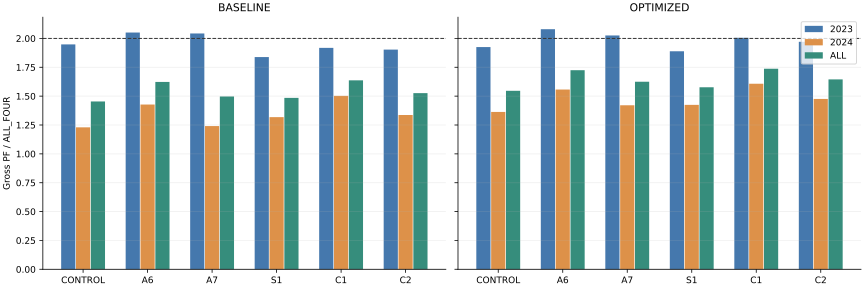
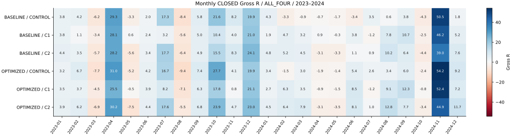
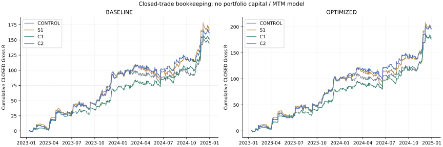

# IntradayLab — T3/M15 Combined v1

**GROSS_ONLY / COSTS_DEFERRED / NOT_LIVE_READY. 2023–2024 development-exposed. Draft PR; STOP для внешней проверки, без Merge и Auto-Merge.**

Цель полного Gross PF ≥2 не достигнута ни одной из четырёх конфигураций C1/C2. Дополнительной подгонки нет.

PR #496 слит до начала: фактический GitHub main `bf703671dca481d0451a9eb822de143b96a80037`. Источники #490/#495/#496 неизменны. Данные `market-pattern-data` @ `f8486b446cf3d5f9f3cba6dfec32bdef8fd184c8`. Спецификация и весь исполняемый код заморожены до результатов в `81b5538d53e28055fdbc1aea2a0b5fb364e6b837`. Подробности: [PREREGISTRATION](PREREGISTRATION.json), [START_GATE](START_GATE.json), [SPEC](EXPERIMENT_SPECS.json).

| Инструмент | Первый M15 Close MSK | Последний M15 Close MSK | Свечей |
|---|---|---|---|
| USDRUBF | 2023-01-03T09:15:00+03:00 | 2024-12-31T00:00:00+03:00 | 29890 |
| CNYRUBF | 2023-01-03T09:15:00+03:00 | 2024-12-31T00:00:00+03:00 | 29633 |
| GLDRUBF | 2023-07-11T10:15:00+03:00 | 2024-12-31T00:00:00+03:00 | 22189 |
| IMOEXF | 2023-11-14T10:15:00+03:00 | 2024-12-31T00:00:00+03:00 | 16593 |

## Механика и определения

C1 = A6 H1_ATR_EXPANSION + S1 TRAIL_AFTER_1R. C2 = A7 M15_ATR_RISING + S1. BASELINE trailing 3.0, OPTIMIZED trailing 3.5; initial Stop 2 ATR. A6 требует строго растущий H1 ATR/ATRMean по двум завершённым H1; A7 — строго растущий M15 ATR. Missing predecessor / равенство не проходят. EMA75, slope5, ADX14>20, ATR14, H1 ATRMean20 и Donchian20 сохранены.

Каждый вариант выполняет полный причинный replay. Сначала действует прежний Stop: неблагоприятный Open gap, затем adverse intrabar extreme. Exit candle не даёт новый favorable extreme, активацию или MFE. После пережитой завершённой свечи с ≥1 initial R S1 разрешает оригинальный trailing по накопленному post-entry extreme; новый Stop действует только на следующей наблюдаемой свече. SHORT зеркален, риск неизменен, Stop монотонен. Signal-candle extremes исключены. Состояние переносится через сессии, выходные и годы.

Сохранена историческая модель Close-входов и same-Close re-entry после выхода. Protective exit имеет метку Close свечи, фактический intrabar момент неизвестен; adverse Open заполняет gap. Terminal OPEN не ликвидируются и исключены из CLOSED PF/R; в годовых/месячных OPEN-графах указано время входа терминальных позиций, это не исторические снимки.

Gross PF = сумма положительных R / модуль суммы отрицательных R. Год и месяц CLOSED определяются по метке выхода MSK. Нулевые доступные месяцы включены, до поздних стартов искусственных месяцев нет. DD — последовательность CLOSED R с нулевым начальным equity, сортировка exit_time/instrument/trade_id; сумма R не является портфельной доходностью или MTM. Top5/top10 делятся на все положительные R. Удаление top/ноября — фиксированная отчётная чувствительность, не повторный replay или отбор.

Занятость = число M15-свечей с позицией при Open / число фактически наблюдавшихся eligible свечей (первая свеча каждого инструмента исключена). Частота = принятые входы на 1000 observed bars. Отдельно сохранены raw signals, filter rejects и passes blocked by occupancy. Holding minutes используют исторические Close-метки и включают календарные разрывы.

## Полный период и каждый год

| Версия | Вариант | Gross PF | Gross R | CLOSED | terminal OPEN |
|---|---|---|---|---|---|
| BASELINE | CONTROL | 1.454 | 144.411 | 741 | 1 |
| BASELINE | A6 | 1.623 | 135.967 | 522 | 1 |
| BASELINE | A7 | 1.497 | 142.260 | 669 | 1 |
| BASELINE | S1 | 1.485 | 166.721 | 718 | 1 |
| BASELINE | C1 | 1.637 | 151.065 | 512 | 1 |
| BASELINE | C2 | 1.526 | 161.227 | 647 | 1 |
| OPTIMIZED | CONTROL | 1.546 | 178.720 | 701 | 1 |
| OPTIMIZED | A6 | 1.725 | 164.854 | 501 | 1 |
| OPTIMIZED | A7 | 1.625 | 182.472 | 631 | 1 |
| OPTIMIZED | S1 | 1.577 | 196.708 | 689 | 1 |
| OPTIMIZED | C1 | 1.738 | 176.340 | 497 | 1 |
| OPTIMIZED | C2 | 1.645 | 195.914 | 619 | 1 |

| Версия | Вариант | Год | Gross PF | Gross R | CLOSED | terminal OPEN |
|---|---|---|---|---|---|---|
| BASELINE | CONTROL | 2023 | 1.948 | 94.205 | 256 | 0 |
| BASELINE | CONTROL | 2024 | 1.230 | 50.206 | 485 | 1 |
| BASELINE | A6 | 2023 | 2.051 | 72.025 | 179 | 0 |
| BASELINE | A6 | 2024 | 1.427 | 63.942 | 343 | 1 |
| BASELINE | A7 | 2023 | 2.043 | 95.421 | 238 | 0 |
| BASELINE | A7 | 2024 | 1.241 | 46.838 | 431 | 1 |
| BASELINE | S1 | 2023 | 1.839 | 92.589 | 253 | 0 |
| BASELINE | S1 | 2024 | 1.318 | 74.132 | 465 | 1 |
| BASELINE | C1 | 2023 | 1.919 | 70.617 | 178 | 0 |
| BASELINE | C1 | 2024 | 1.502 | 80.448 | 334 | 1 |
| BASELINE | C2 | 2023 | 1.903 | 92.425 | 235 | 0 |
| BASELINE | C2 | 2024 | 1.337 | 68.802 | 412 | 1 |
| OPTIMIZED | CONTROL | 2023 | 1.925 | 98.618 | 243 | 0 |
| OPTIMIZED | CONTROL | 2024 | 1.363 | 80.102 | 458 | 1 |
| OPTIMIZED | A6 | 2023 | 2.080 | 78.729 | 171 | 0 |
| OPTIMIZED | A6 | 2024 | 1.557 | 86.125 | 330 | 1 |
| OPTIMIZED | A7 | 2023 | 2.026 | 101.019 | 225 | 0 |
| OPTIMIZED | A7 | 2024 | 1.421 | 81.453 | 406 | 1 |
| OPTIMIZED | S1 | 2023 | 1.889 | 99.678 | 241 | 0 |
| OPTIMIZED | S1 | 2024 | 1.424 | 97.030 | 448 | 1 |
| OPTIMIZED | C1 | 2023 | 2.006 | 78.689 | 171 | 0 |
| OPTIMIZED | C1 | 2024 | 1.607 | 97.651 | 326 | 1 |
| OPTIMIZED | C2 | 2023 | 1.971 | 100.920 | 223 | 0 |
| OPTIMIZED | C2 | 2024 | 1.476 | 94.993 | 396 | 1 |

## Сравнение с CONTROL и отдельными компонентами

Каждая комбинация сравнивается с CONTROL, соответствующим A6/A7 и S1. Полный набор по годам, месяцам, инструментам и направлениям: [component_comparisons.csv](results/component_comparisons.csv).

| Версия | Комбинация | Основа | Период таблицы | Год | Метрика | Комбинация | Основа | Δ |
|---|---|---|---|---|---|---|---|---|
| BASELINE | C1 | CONTROL | overall_report.csv | — | gross_PF | 1.637 | 1.454 | 0.183 |
| BASELINE | C1 | CONTROL | overall_report.csv | — | gross_R | 151.065 | 144.411 | 6.653 |
| BASELINE | C1 | CONTROL | overall_report.csv | — | closed_trades | 512.000 | 741.000 | -229.000 |
| BASELINE | C1 | CONTROL | overall_report.csv | — | max_drawdown_R | 11.337 | 23.677 | -12.340 |
| BASELINE | C1 | CONTROL | overall_report.csv | — | positive_months | 19.000 | 15.000 | 4.000 |
| OPTIMIZED | C1 | CONTROL | overall_report.csv | — | gross_PF | 1.738 | 1.546 | 0.192 |
| OPTIMIZED | C1 | CONTROL | overall_report.csv | — | gross_R | 176.340 | 178.720 | -2.380 |
| OPTIMIZED | C1 | CONTROL | overall_report.csv | — | closed_trades | 497.000 | 701.000 | -204.000 |
| OPTIMIZED | C1 | CONTROL | overall_report.csv | — | max_drawdown_R | 15.809 | 26.126 | -10.317 |
| OPTIMIZED | C1 | CONTROL | overall_report.csv | — | positive_months | 17.000 | 17.000 | 0.000 |
| BASELINE | C1 | A6 | overall_report.csv | — | gross_PF | 1.637 | 1.623 | 0.014 |
| BASELINE | C1 | A6 | overall_report.csv | — | gross_R | 151.065 | 135.967 | 15.098 |
| BASELINE | C1 | A6 | overall_report.csv | — | closed_trades | 512.000 | 522.000 | -10.000 |
| BASELINE | C1 | A6 | overall_report.csv | — | max_drawdown_R | 11.337 | 15.872 | -4.535 |
| BASELINE | C1 | A6 | overall_report.csv | — | positive_months | 19.000 | 18.000 | 1.000 |
| OPTIMIZED | C1 | A6 | overall_report.csv | — | gross_PF | 1.738 | 1.725 | 0.013 |
| OPTIMIZED | C1 | A6 | overall_report.csv | — | gross_R | 176.340 | 164.854 | 11.486 |
| OPTIMIZED | C1 | A6 | overall_report.csv | — | closed_trades | 497.000 | 501.000 | -4.000 |
| OPTIMIZED | C1 | A6 | overall_report.csv | — | max_drawdown_R | 15.809 | 14.250 | 1.560 |
| OPTIMIZED | C1 | A6 | overall_report.csv | — | positive_months | 17.000 | 18.000 | -1.000 |
| BASELINE | C1 | S1 | overall_report.csv | — | gross_PF | 1.637 | 1.485 | 0.152 |
| BASELINE | C1 | S1 | overall_report.csv | — | gross_R | 151.065 | 166.721 | -15.657 |
| BASELINE | C1 | S1 | overall_report.csv | — | closed_trades | 512.000 | 718.000 | -206.000 |
| BASELINE | C1 | S1 | overall_report.csv | — | max_drawdown_R | 11.337 | 26.510 | -15.173 |
| BASELINE | C1 | S1 | overall_report.csv | — | positive_months | 19.000 | 17.000 | 2.000 |
| OPTIMIZED | C1 | S1 | overall_report.csv | — | gross_PF | 1.738 | 1.577 | 0.161 |
| OPTIMIZED | C1 | S1 | overall_report.csv | — | gross_R | 176.340 | 196.708 | -20.368 |
| OPTIMIZED | C1 | S1 | overall_report.csv | — | closed_trades | 497.000 | 689.000 | -192.000 |
| OPTIMIZED | C1 | S1 | overall_report.csv | — | max_drawdown_R | 15.809 | 28.471 | -12.662 |
| OPTIMIZED | C1 | S1 | overall_report.csv | — | positive_months | 17.000 | 17.000 | 0.000 |
| BASELINE | C2 | CONTROL | overall_report.csv | — | gross_PF | 1.526 | 1.454 | 0.072 |
| BASELINE | C2 | CONTROL | overall_report.csv | — | gross_R | 161.227 | 144.411 | 16.816 |
| BASELINE | C2 | CONTROL | overall_report.csv | — | closed_trades | 647.000 | 741.000 | -94.000 |
| BASELINE | C2 | CONTROL | overall_report.csv | — | max_drawdown_R | 20.940 | 23.677 | -2.736 |
| BASELINE | C2 | CONTROL | overall_report.csv | — | positive_months | 18.000 | 15.000 | 3.000 |
| OPTIMIZED | C2 | CONTROL | overall_report.csv | — | gross_PF | 1.645 | 1.546 | 0.099 |
| OPTIMIZED | C2 | CONTROL | overall_report.csv | — | gross_R | 195.914 | 178.720 | 17.194 |
| OPTIMIZED | C2 | CONTROL | overall_report.csv | — | closed_trades | 619.000 | 701.000 | -82.000 |
| OPTIMIZED | C2 | CONTROL | overall_report.csv | — | max_drawdown_R | 22.028 | 26.126 | -4.098 |
| OPTIMIZED | C2 | CONTROL | overall_report.csv | — | positive_months | 18.000 | 17.000 | 1.000 |
| BASELINE | C2 | A7 | overall_report.csv | — | gross_PF | 1.526 | 1.497 | 0.029 |
| BASELINE | C2 | A7 | overall_report.csv | — | gross_R | 161.227 | 142.260 | 18.967 |
| BASELINE | C2 | A7 | overall_report.csv | — | closed_trades | 647.000 | 669.000 | -22.000 |
| BASELINE | C2 | A7 | overall_report.csv | — | max_drawdown_R | 20.940 | 24.358 | -3.418 |
| BASELINE | C2 | A7 | overall_report.csv | — | positive_months | 18.000 | 16.000 | 2.000 |
| OPTIMIZED | C2 | A7 | overall_report.csv | — | gross_PF | 1.645 | 1.625 | 0.020 |
| OPTIMIZED | C2 | A7 | overall_report.csv | — | gross_R | 195.914 | 182.472 | 13.441 |
| OPTIMIZED | C2 | A7 | overall_report.csv | — | closed_trades | 619.000 | 631.000 | -12.000 |
| OPTIMIZED | C2 | A7 | overall_report.csv | — | max_drawdown_R | 22.028 | 21.622 | 0.406 |
| OPTIMIZED | C2 | A7 | overall_report.csv | — | positive_months | 18.000 | 17.000 | 1.000 |
| BASELINE | C2 | S1 | overall_report.csv | — | gross_PF | 1.526 | 1.485 | 0.041 |
| BASELINE | C2 | S1 | overall_report.csv | — | gross_R | 161.227 | 166.721 | -5.494 |
| BASELINE | C2 | S1 | overall_report.csv | — | closed_trades | 647.000 | 718.000 | -71.000 |
| BASELINE | C2 | S1 | overall_report.csv | — | max_drawdown_R | 20.940 | 26.510 | -5.569 |
| BASELINE | C2 | S1 | overall_report.csv | — | positive_months | 18.000 | 17.000 | 1.000 |
| OPTIMIZED | C2 | S1 | overall_report.csv | — | gross_PF | 1.645 | 1.577 | 0.068 |
| OPTIMIZED | C2 | S1 | overall_report.csv | — | gross_R | 195.914 | 196.708 | -0.794 |
| OPTIMIZED | C2 | S1 | overall_report.csv | — | closed_trades | 619.000 | 689.000 | -70.000 |
| OPTIMIZED | C2 | S1 | overall_report.csv | — | max_drawdown_R | 22.028 | 28.471 | -6.444 |
| OPTIMIZED | C2 | S1 | overall_report.csv | — | positive_months | 18.000 | 17.000 | 1.000 |
| BASELINE | C1 | CONTROL | yearly_report.csv | 2023 | gross_PF | 1.919 | 1.948 | -0.030 |
| BASELINE | C1 | CONTROL | yearly_report.csv | 2023 | gross_R | 70.617 | 94.205 | -23.588 |
| BASELINE | C1 | CONTROL | yearly_report.csv | 2023 | closed_trades | 178.000 | 256.000 | -78.000 |
| BASELINE | C1 | CONTROL | yearly_report.csv | 2023 | max_drawdown_R | 9.136 | 13.204 | -4.068 |
| BASELINE | C1 | CONTROL | yearly_report.csv | 2023 | positive_months | 10.000 | 9.000 | 1.000 |
| BASELINE | C1 | CONTROL | yearly_report.csv | 2024 | gross_PF | 1.502 | 1.230 | 0.273 |
| BASELINE | C1 | CONTROL | yearly_report.csv | 2024 | gross_R | 80.448 | 50.206 | 30.242 |
| BASELINE | C1 | CONTROL | yearly_report.csv | 2024 | closed_trades | 334.000 | 485.000 | -151.000 |
| BASELINE | C1 | CONTROL | yearly_report.csv | 2024 | max_drawdown_R | 11.337 | 23.677 | -12.340 |
| BASELINE | C1 | CONTROL | yearly_report.csv | 2024 | positive_months | 9.000 | 6.000 | 3.000 |
| OPTIMIZED | C1 | CONTROL | yearly_report.csv | 2023 | gross_PF | 2.006 | 1.925 | 0.081 |
| OPTIMIZED | C1 | CONTROL | yearly_report.csv | 2023 | gross_R | 78.689 | 98.618 | -19.929 |
| OPTIMIZED | C1 | CONTROL | yearly_report.csv | 2023 | closed_trades | 171.000 | 243.000 | -72.000 |
| OPTIMIZED | C1 | CONTROL | yearly_report.csv | 2023 | max_drawdown_R | 10.992 | 14.644 | -3.652 |
| OPTIMIZED | C1 | CONTROL | yearly_report.csv | 2023 | positive_months | 9.000 | 9.000 | 0.000 |
| OPTIMIZED | C1 | CONTROL | yearly_report.csv | 2024 | gross_PF | 1.607 | 1.363 | 0.244 |
| OPTIMIZED | C1 | CONTROL | yearly_report.csv | 2024 | gross_R | 97.651 | 80.102 | 17.549 |
| OPTIMIZED | C1 | CONTROL | yearly_report.csv | 2024 | closed_trades | 326.000 | 458.000 | -132.000 |
| OPTIMIZED | C1 | CONTROL | yearly_report.csv | 2024 | max_drawdown_R | 15.809 | 26.126 | -10.317 |
| OPTIMIZED | C1 | CONTROL | yearly_report.csv | 2024 | positive_months | 8.000 | 8.000 | 0.000 |
| BASELINE | C1 | A6 | yearly_report.csv | 2023 | gross_PF | 1.919 | 2.051 | -0.132 |
| BASELINE | C1 | A6 | yearly_report.csv | 2023 | gross_R | 70.617 | 72.025 | -1.408 |
| BASELINE | C1 | A6 | yearly_report.csv | 2023 | closed_trades | 178.000 | 179.000 | -1.000 |
| BASELINE | C1 | A6 | yearly_report.csv | 2023 | max_drawdown_R | 9.136 | 7.132 | 2.004 |
| BASELINE | C1 | A6 | yearly_report.csv | 2023 | positive_months | 10.000 | 10.000 | 0.000 |
| BASELINE | C1 | A6 | yearly_report.csv | 2024 | gross_PF | 1.502 | 1.427 | 0.075 |
| BASELINE | C1 | A6 | yearly_report.csv | 2024 | gross_R | 80.448 | 63.942 | 16.506 |
| BASELINE | C1 | A6 | yearly_report.csv | 2024 | closed_trades | 334.000 | 343.000 | -9.000 |
| BASELINE | C1 | A6 | yearly_report.csv | 2024 | max_drawdown_R | 11.337 | 15.872 | -4.535 |
| BASELINE | C1 | A6 | yearly_report.csv | 2024 | positive_months | 9.000 | 8.000 | 1.000 |
| OPTIMIZED | C1 | A6 | yearly_report.csv | 2023 | gross_PF | 2.006 | 2.080 | -0.074 |
| OPTIMIZED | C1 | A6 | yearly_report.csv | 2023 | gross_R | 78.689 | 78.729 | -0.040 |
| OPTIMIZED | C1 | A6 | yearly_report.csv | 2023 | closed_trades | 171.000 | 171.000 | 0.000 |
| OPTIMIZED | C1 | A6 | yearly_report.csv | 2023 | max_drawdown_R | 10.992 | 10.124 | 0.868 |
| OPTIMIZED | C1 | A6 | yearly_report.csv | 2023 | positive_months | 9.000 | 9.000 | 0.000 |
| OPTIMIZED | C1 | A6 | yearly_report.csv | 2024 | gross_PF | 1.607 | 1.557 | 0.050 |
| OPTIMIZED | C1 | A6 | yearly_report.csv | 2024 | gross_R | 97.651 | 86.125 | 11.526 |
| OPTIMIZED | C1 | A6 | yearly_report.csv | 2024 | closed_trades | 326.000 | 330.000 | -4.000 |
| OPTIMIZED | C1 | A6 | yearly_report.csv | 2024 | max_drawdown_R | 15.809 | 14.250 | 1.560 |
| OPTIMIZED | C1 | A6 | yearly_report.csv | 2024 | positive_months | 8.000 | 9.000 | -1.000 |
| BASELINE | C1 | S1 | yearly_report.csv | 2023 | gross_PF | 1.919 | 1.839 | 0.080 |
| BASELINE | C1 | S1 | yearly_report.csv | 2023 | gross_R | 70.617 | 92.589 | -21.973 |
| BASELINE | C1 | S1 | yearly_report.csv | 2023 | closed_trades | 178.000 | 253.000 | -75.000 |
| BASELINE | C1 | S1 | yearly_report.csv | 2023 | max_drawdown_R | 9.136 | 14.659 | -5.523 |
| BASELINE | C1 | S1 | yearly_report.csv | 2023 | positive_months | 10.000 | 9.000 | 1.000 |
| BASELINE | C1 | S1 | yearly_report.csv | 2024 | gross_PF | 1.502 | 1.318 | 0.184 |
| BASELINE | C1 | S1 | yearly_report.csv | 2024 | gross_R | 80.448 | 74.132 | 6.316 |
| BASELINE | C1 | S1 | yearly_report.csv | 2024 | closed_trades | 334.000 | 465.000 | -131.000 |
| BASELINE | C1 | S1 | yearly_report.csv | 2024 | max_drawdown_R | 11.337 | 26.510 | -15.173 |
| BASELINE | C1 | S1 | yearly_report.csv | 2024 | positive_months | 9.000 | 8.000 | 1.000 |
| OPTIMIZED | C1 | S1 | yearly_report.csv | 2023 | gross_PF | 2.006 | 1.889 | 0.117 |
| OPTIMIZED | C1 | S1 | yearly_report.csv | 2023 | gross_R | 78.689 | 99.678 | -20.989 |
| OPTIMIZED | C1 | S1 | yearly_report.csv | 2023 | closed_trades | 171.000 | 241.000 | -70.000 |
| OPTIMIZED | C1 | S1 | yearly_report.csv | 2023 | max_drawdown_R | 10.992 | 14.173 | -3.181 |
| OPTIMIZED | C1 | S1 | yearly_report.csv | 2023 | positive_months | 9.000 | 9.000 | 0.000 |
| OPTIMIZED | C1 | S1 | yearly_report.csv | 2024 | gross_PF | 1.607 | 1.424 | 0.183 |
| OPTIMIZED | C1 | S1 | yearly_report.csv | 2024 | gross_R | 97.651 | 97.030 | 0.620 |
| OPTIMIZED | C1 | S1 | yearly_report.csv | 2024 | closed_trades | 326.000 | 448.000 | -122.000 |
| OPTIMIZED | C1 | S1 | yearly_report.csv | 2024 | max_drawdown_R | 15.809 | 28.471 | -12.662 |
| OPTIMIZED | C1 | S1 | yearly_report.csv | 2024 | positive_months | 8.000 | 8.000 | 0.000 |
| BASELINE | C2 | CONTROL | yearly_report.csv | 2023 | gross_PF | 1.903 | 1.948 | -0.045 |
| BASELINE | C2 | CONTROL | yearly_report.csv | 2023 | gross_R | 92.425 | 94.205 | -1.780 |
| BASELINE | C2 | CONTROL | yearly_report.csv | 2023 | closed_trades | 235.000 | 256.000 | -21.000 |
| BASELINE | C2 | CONTROL | yearly_report.csv | 2023 | max_drawdown_R | 11.535 | 13.204 | -1.669 |
| BASELINE | C2 | CONTROL | yearly_report.csv | 2023 | positive_months | 9.000 | 9.000 | 0.000 |
| BASELINE | C2 | CONTROL | yearly_report.csv | 2024 | gross_PF | 1.337 | 1.230 | 0.107 |
| BASELINE | C2 | CONTROL | yearly_report.csv | 2024 | gross_R | 68.802 | 50.206 | 18.596 |
| BASELINE | C2 | CONTROL | yearly_report.csv | 2024 | closed_trades | 412.000 | 485.000 | -73.000 |
| BASELINE | C2 | CONTROL | yearly_report.csv | 2024 | max_drawdown_R | 20.940 | 23.677 | -2.736 |
| BASELINE | C2 | CONTROL | yearly_report.csv | 2024 | positive_months | 9.000 | 6.000 | 3.000 |
| OPTIMIZED | C2 | CONTROL | yearly_report.csv | 2023 | gross_PF | 1.971 | 1.925 | 0.045 |
| OPTIMIZED | C2 | CONTROL | yearly_report.csv | 2023 | gross_R | 100.920 | 98.618 | 2.303 |
| OPTIMIZED | C2 | CONTROL | yearly_report.csv | 2023 | closed_trades | 223.000 | 243.000 | -20.000 |
| OPTIMIZED | C2 | CONTROL | yearly_report.csv | 2023 | max_drawdown_R | 12.788 | 14.644 | -1.855 |
| OPTIMIZED | C2 | CONTROL | yearly_report.csv | 2023 | positive_months | 9.000 | 9.000 | 0.000 |
| OPTIMIZED | C2 | CONTROL | yearly_report.csv | 2024 | gross_PF | 1.476 | 1.363 | 0.113 |
| OPTIMIZED | C2 | CONTROL | yearly_report.csv | 2024 | gross_R | 94.993 | 80.102 | 14.891 |
| OPTIMIZED | C2 | CONTROL | yearly_report.csv | 2024 | closed_trades | 396.000 | 458.000 | -62.000 |
| OPTIMIZED | C2 | CONTROL | yearly_report.csv | 2024 | max_drawdown_R | 22.028 | 26.126 | -4.098 |
| OPTIMIZED | C2 | CONTROL | yearly_report.csv | 2024 | positive_months | 9.000 | 8.000 | 1.000 |
| BASELINE | C2 | A7 | yearly_report.csv | 2023 | gross_PF | 1.903 | 2.043 | -0.140 |
| BASELINE | C2 | A7 | yearly_report.csv | 2023 | gross_R | 92.425 | 95.421 | -2.996 |
| BASELINE | C2 | A7 | yearly_report.csv | 2023 | closed_trades | 235.000 | 238.000 | -3.000 |
| BASELINE | C2 | A7 | yearly_report.csv | 2023 | max_drawdown_R | 11.535 | 10.681 | 0.854 |
| BASELINE | C2 | A7 | yearly_report.csv | 2023 | positive_months | 9.000 | 9.000 | 0.000 |
| BASELINE | C2 | A7 | yearly_report.csv | 2024 | gross_PF | 1.337 | 1.241 | 0.096 |
| BASELINE | C2 | A7 | yearly_report.csv | 2024 | gross_R | 68.802 | 46.838 | 21.964 |
| BASELINE | C2 | A7 | yearly_report.csv | 2024 | closed_trades | 412.000 | 431.000 | -19.000 |
| BASELINE | C2 | A7 | yearly_report.csv | 2024 | max_drawdown_R | 20.940 | 24.358 | -3.418 |
| BASELINE | C2 | A7 | yearly_report.csv | 2024 | positive_months | 9.000 | 7.000 | 2.000 |
| OPTIMIZED | C2 | A7 | yearly_report.csv | 2023 | gross_PF | 1.971 | 2.026 | -0.055 |
| OPTIMIZED | C2 | A7 | yearly_report.csv | 2023 | gross_R | 100.920 | 101.019 | -0.099 |
| OPTIMIZED | C2 | A7 | yearly_report.csv | 2023 | closed_trades | 223.000 | 225.000 | -2.000 |
| OPTIMIZED | C2 | A7 | yearly_report.csv | 2023 | max_drawdown_R | 12.788 | 12.177 | 0.612 |
| OPTIMIZED | C2 | A7 | yearly_report.csv | 2023 | positive_months | 9.000 | 9.000 | 0.000 |
| OPTIMIZED | C2 | A7 | yearly_report.csv | 2024 | gross_PF | 1.476 | 1.421 | 0.055 |
| OPTIMIZED | C2 | A7 | yearly_report.csv | 2024 | gross_R | 94.993 | 81.453 | 13.540 |
| OPTIMIZED | C2 | A7 | yearly_report.csv | 2024 | closed_trades | 396.000 | 406.000 | -10.000 |
| OPTIMIZED | C2 | A7 | yearly_report.csv | 2024 | max_drawdown_R | 22.028 | 21.622 | 0.406 |
| OPTIMIZED | C2 | A7 | yearly_report.csv | 2024 | positive_months | 9.000 | 8.000 | 1.000 |
| BASELINE | C2 | S1 | yearly_report.csv | 2023 | gross_PF | 1.903 | 1.839 | 0.065 |
| BASELINE | C2 | S1 | yearly_report.csv | 2023 | gross_R | 92.425 | 92.589 | -0.164 |
| BASELINE | C2 | S1 | yearly_report.csv | 2023 | closed_trades | 235.000 | 253.000 | -18.000 |
| BASELINE | C2 | S1 | yearly_report.csv | 2023 | max_drawdown_R | 11.535 | 14.659 | -3.125 |
| BASELINE | C2 | S1 | yearly_report.csv | 2023 | positive_months | 9.000 | 9.000 | 0.000 |
| BASELINE | C2 | S1 | yearly_report.csv | 2024 | gross_PF | 1.337 | 1.318 | 0.019 |
| BASELINE | C2 | S1 | yearly_report.csv | 2024 | gross_R | 68.802 | 74.132 | -5.330 |
| BASELINE | C2 | S1 | yearly_report.csv | 2024 | closed_trades | 412.000 | 465.000 | -53.000 |
| BASELINE | C2 | S1 | yearly_report.csv | 2024 | max_drawdown_R | 20.940 | 26.510 | -5.569 |
| BASELINE | C2 | S1 | yearly_report.csv | 2024 | positive_months | 9.000 | 8.000 | 1.000 |
| OPTIMIZED | C2 | S1 | yearly_report.csv | 2023 | gross_PF | 1.971 | 1.889 | 0.082 |
| OPTIMIZED | C2 | S1 | yearly_report.csv | 2023 | gross_R | 100.920 | 99.678 | 1.243 |
| OPTIMIZED | C2 | S1 | yearly_report.csv | 2023 | closed_trades | 223.000 | 241.000 | -18.000 |
| OPTIMIZED | C2 | S1 | yearly_report.csv | 2023 | max_drawdown_R | 12.788 | 14.173 | -1.385 |
| OPTIMIZED | C2 | S1 | yearly_report.csv | 2023 | positive_months | 9.000 | 9.000 | 0.000 |
| OPTIMIZED | C2 | S1 | yearly_report.csv | 2024 | gross_PF | 1.476 | 1.424 | 0.051 |
| OPTIMIZED | C2 | S1 | yearly_report.csv | 2024 | gross_R | 94.993 | 97.030 | -2.037 |
| OPTIMIZED | C2 | S1 | yearly_report.csv | 2024 | closed_trades | 396.000 | 448.000 | -52.000 |
| OPTIMIZED | C2 | S1 | yearly_report.csv | 2024 | max_drawdown_R | 22.028 | 28.471 | -6.444 |
| OPTIMIZED | C2 | S1 | yearly_report.csv | 2024 | positive_months | 9.000 | 8.000 | 1.000 |

## Календарь, риск, концентрация

| Версия | Вариант | +месяцев | Всего | Худший месяц | R худшего | DD R | Top5/+R | Top10/+R | PF без top10 |
|---|---|---|---|---|---|---|---|---|---|
| BASELINE | CONTROL | 15 | 24 | 2023-08 | -8.443 | 23.677 | 0.081 | 0.143 | 1.246 |
| BASELINE | A6 | 18 | 24 | 2024-02 | -7.489 | 15.872 | 0.103 | 0.181 | 1.330 |
| BASELINE | A7 | 16 | 24 | 2023-08 | -6.920 | 24.358 | 0.087 | 0.154 | 1.266 |
| BASELINE | S1 | 17 | 24 | 2023-08 | -9.028 | 26.510 | 0.078 | 0.140 | 1.278 |
| BASELINE | C1 | 19 | 24 | 2023-08 | -5.610 | 11.337 | 0.094 | 0.165 | 1.367 |
| BASELINE | C2 | 18 | 24 | 2023-08 | -6.356 | 20.940 | 0.086 | 0.152 | 1.294 |
| OPTIMIZED | CONTROL | 17 | 24 | 2023-08 | -9.407 | 26.126 | 0.096 | 0.161 | 1.297 |
| OPTIMIZED | A6 | 18 | 24 | 2023-08 | -6.446 | 14.250 | 0.109 | 0.184 | 1.407 |
| OPTIMIZED | A7 | 17 | 24 | 2023-08 | -7.076 | 21.622 | 0.103 | 0.172 | 1.345 |
| OPTIMIZED | S1 | 17 | 24 | 2023-08 | -8.325 | 28.471 | 0.092 | 0.157 | 1.330 |
| OPTIMIZED | C1 | 17 | 24 | 2023-08 | -7.144 | 15.809 | 0.103 | 0.174 | 1.435 |
| OPTIMIZED | C2 | 18 | 24 | 2023-05 | -7.487 | 22.028 | 0.099 | 0.169 | 1.367 |

## Победители ≥2R

Когорты фиксированы по исходной CLOSED сделке каждой основы; совпадение по version/instrument/direction/exact entry_time. Fully preserved означает variant R ≥ reference R −1e−8. Reduced / lost-entry / terminal OPEN раздельны; ниже 2R и неположительные исходы дополнительно. Совпадение входов — диагностическая связь, не рыночный контрфактуал.

| Версия | Комбинация | Основа | Исходных ≥2R | Полностью сохранены | Сокращены | Нет входа | OPEN | Ниже 2R | R≤0 |
|---|---|---|---|---|---|---|---|---|---|
| BASELINE | C1 | CONTROL | 81 | 60 | 0 | 21 | 0 | 0 | 0 |
| BASELINE | C1 | A6 | 69 | 68 | 0 | 1 | 0 | 0 | 0 |
| BASELINE | C1 | S1 | 88 | 63 | 0 | 25 | 0 | 0 | 0 |
| BASELINE | C2 | CONTROL | 81 | 68 | 0 | 13 | 0 | 0 | 0 |
| BASELINE | C2 | A7 | 73 | 70 | 0 | 3 | 0 | 0 | 0 |
| BASELINE | C2 | S1 | 88 | 77 | 0 | 11 | 0 | 0 | 0 |
| OPTIMIZED | C1 | CONTROL | 90 | 63 | 0 | 27 | 0 | 0 | 0 |
| OPTIMIZED | C1 | A6 | 74 | 74 | 0 | 0 | 0 | 0 | 0 |
| OPTIMIZED | C1 | S1 | 93 | 64 | 0 | 29 | 0 | 0 | 0 |
| OPTIMIZED | C2 | CONTROL | 90 | 76 | 0 | 14 | 0 | 0 | 0 |
| OPTIMIZED | C2 | A7 | 82 | 80 | 0 | 2 | 0 | 0 | 0 |
| OPTIMIZED | C2 | S1 | 93 | 80 | 0 | 13 | 0 | 0 | 0 |

Полная связь каждой исходной сделки: [component_trade_lineage](results/component_trade_lineage.csv). Когорты по каждому году и инструменту: [component_winner_retention](results/component_winner_retention.csv). Все исходные победители/убытки CONTROL, top5/top10 и точная декомпозиция ΔR: [winner_loss_changes](results/winner_loss_changes.csv), [large_winners](results/large_winners.csv), [gross_R_attribution](results/gross_R_attribution.csv).

## Ноябрь 2024

| Версия | Вариант | R 2024 | R ноября | Ноябрь/+R | R без ноября | PF без ноября | DD без ноября |
|---|---|---|---|---|---|---|---|
| BASELINE | CONTROL | 50.206 | 50.529 | 0.234 | -0.322 | 0.998 | 23.677 |
| BASELINE | A6 | 63.942 | 47.238 | 0.260 | 16.704 | 1.118 | 15.872 |
| BASELINE | A7 | 46.838 | 40.025 | 0.224 | 6.814 | 1.038 | 24.358 |
| BASELINE | S1 | 74.132 | 49.249 | 0.207 | 24.883 | 1.114 | 26.510 |
| BASELINE | C1 | 80.448 | 46.231 | 0.231 | 34.217 | 1.227 | 11.337 |
| BASELINE | C2 | 68.802 | 38.971 | 0.200 | 29.831 | 1.158 | 20.940 |
| OPTIMIZED | CONTROL | 80.102 | 54.186 | 0.214 | 25.916 | 1.123 | 26.126 |
| OPTIMIZED | A6 | 86.125 | 53.049 | 0.248 | 33.076 | 1.223 | 14.250 |
| OPTIMIZED | A7 | 81.453 | 45.931 | 0.209 | 35.522 | 1.195 | 21.622 |
| OPTIMIZED | S1 | 97.030 | 53.073 | 0.200 | 43.958 | 1.203 | 28.471 |
| OPTIMIZED | C1 | 97.651 | 52.397 | 0.231 | 45.253 | 1.295 | 15.809 |
| OPTIMIZED | C2 | 94.993 | 44.856 | 0.197 | 50.137 | 1.269 | 22.028 |

## Частота и занятость

| Версия | Вариант | Входы | CLOSED | Входов/1000 | Занятость | Средн. M15 held | Не прошли фильтр | Pass/занято |
|---|---|---|---|---|---|---|---|---|
| BASELINE | CONTROL | 742 | 741 | 7.548 | 0.129 | 17.005 | 0 | 1275 |
| BASELINE | A6 | 523 | 522 | 5.320 | 0.093 | 17.326 | 824 | 670 |
| BASELINE | A7 | 670 | 669 | 6.816 | 0.116 | 17.033 | 488 | 859 |
| BASELINE | S1 | 719 | 718 | 7.314 | 0.149 | 20.283 | 0 | 1298 |
| BASELINE | C1 | 513 | 512 | 5.218 | 0.107 | 20.375 | 824 | 680 |
| BASELINE | C2 | 648 | 647 | 6.592 | 0.132 | 19.994 | 488 | 881 |
| OPTIMIZED | CONTROL | 702 | 701 | 7.141 | 0.147 | 20.534 | 0 | 1315 |
| OPTIMIZED | A6 | 502 | 501 | 5.107 | 0.107 | 20.980 | 824 | 691 |
| OPTIMIZED | A7 | 632 | 631 | 6.429 | 0.133 | 20.653 | 488 | 897 |
| OPTIMIZED | S1 | 690 | 689 | 7.019 | 0.164 | 23.357 | 0 | 1327 |
| OPTIMIZED | C1 | 498 | 497 | 5.066 | 0.119 | 23.513 | 824 | 695 |
| OPTIMIZED | C2 | 620 | 619 | 6.307 | 0.147 | 23.221 | 488 | 909 |

Полные изменения по годам и инструментам: [frequency_comparison](results/frequency_comparison.csv).

## Проверки и ограничение независимости аудита

20 причинных tests PASS до market replay. CONTROL, A6, A7, S1 воспроизведены: [REFERENCE_REPRODUCTION](results/REFERENCE_REPRODUCTION.json), [REFERENCE_PATH_REPRODUCTION](results/REFERENCE_PATH_REPRODUCTION.json); CONTROL также проверен относительно #490. Отдельный standard-library auditor независимо пересчитал признаки и все пути: 7447 CLOSED, 12 terminal OPEN, 151669 Stop-решений, 24204 entry decisions; статус PASS. Два свежих детерминированных повтора: PASS, прямое bytes/SHA сравнение каждого generated файла.

Аудит использует отдельный код без импорта primary engine/research/pandas, но написан тем же автором. Это независимая реализация, не независимый человеческий reviewer. Внешний аудит остаётся PENDING; [INDEPENDENT_AUDIT](INDEPENDENT_AUDIT.md) описывает проверенный объём и ограничения.

## Полный пакет и границы

Все шесть полных журналов сделок: [trades](results/trades.csv), отдельные trades_CONTROL/A6/A7/S1/C1/C2. Все входы/occupancy: [entry_opportunities](results/entry_opportunities.csv). Все Stop/активации: [stop_decisions](results/stop_decisions.csv). Terminal OPEN: [OPEN_POSITIONS](results/OPEN_POSITIONS.json). Таблицы overall/yearly/monthly/instrument/direction/monthly_direction_report сохраняют полный набор метрик. Все отрицательные исходы сохранены.

Источник read-only; OHLC 2025+ не парсятся. Полный SHA — непрозрачные байты для проверки целостности. Нет Optimization, Robustness, Walk Forward, TRUE OOS, LIVE, дополнительных сочетаний, порогов или изменения механики. TradingSystemLab, прежние исследования, ROADMAP, market data и робот неизменны. Стоимость, slippage/spread/funding не вычитались по явно заданному gross-only scope; исполнимость Close-входов, tick-safe Stops и net economics не доказаны. 2023–2024 development-exposed, не независимый тест. **STOP на Draft PR для внешней проверки.**
