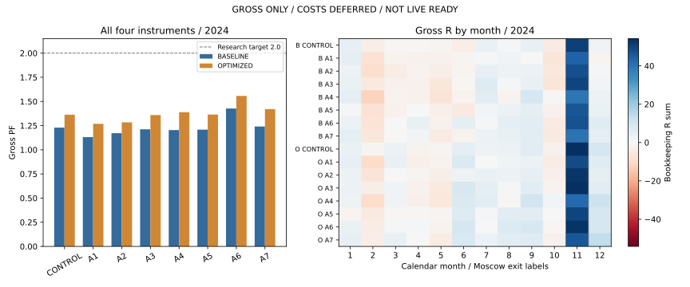

# EXPERIMENT REPORT — T3/M15 Entry & Regime v1

**GROSS_ONLY / COSTS_DEFERRED / NOT_LIVE_READY. Внешний аудит и решение пользователя: PENDING.**

Выполнены семь фиксированных одиночных механизмов на BASELINE trailing 3.0 и OPTIMIZED trailing 3.5. Оптимизацию, комбинации и дополнительный подбор не выполняли. PF ≥2 — исследовательская цель, не критерий PASS. Полная таблица сохраняет отрицательные результаты.

## Контроль и источники

GitHub main перед началом `758a0ac1deda8bfa7aa1bc99d8a97a33a9357f02` содержит объединённый PR #494. Заморозка спецификаций: `64c0a8e49fa6e43df02ad8c8eaac790c20692476`. Данные `f8486b446cf3d5f9f3cba6dfec32bdef8fd184c8`. Только M15 2023–2024; реальные даты начала приведены ниже.

**Контроль механики PASS: 1 442 закрытые сделки (741 BASELINE, 701 OPTIMIZED) и две незакрытые позиции IMOEXF.** Цены, время, направление, Stop, Gross R, последовательность и сопутствующие поля сверены с неизменным PR #490; результаты Gross-only сохранены отдельно от его C1-результатов.

| Инструмент | Первый Close | Последний Close | M15 |
|---|---|---|---|
| USDRUBF | 2023-01-03T09:15:00+03:00 | 2024-12-31T00:00:00+03:00 | 29890 |
| CNYRUBF | 2023-01-03T09:15:00+03:00 | 2024-12-31T00:00:00+03:00 | 29633 |
| GLDRUBF | 2023-07-11T10:15:00+03:00 | 2024-12-31T00:00:00+03:00 | 22189 |
| IMOEXF | 2023-11-14T10:15:00+03:00 | 2024-12-31T00:00:00+03:00 | 16593 |

## Итог всех механизмов и обоих контролей

PF, R и просадка ниже относятся к Gross. Суммы R четырёх инструментов — учётная сумма разных нормированных сделок, **не доходность реального портфеля**. Открытые позиции не ликвидируются и не входят в closed-trade PF/R.

| Контроль | Правило | PF 2023 | R 2023 | PF 2024 | Δ PF 2024 | R 2024 | Сделок 2024 | Плюс месяцев |
|---|---|---|---|---|---|---|---|---|
| BASELINE | CONTROL | 1.948 | 94.205 | 1.230 | 0 | 50.206 | 485 | 6/12 |
| BASELINE | A1 | 1.864 | 81.232 | 1.131 | -0.099 | 28.398 | 546 | 5/12 |
| BASELINE | A2 | 1.955 | 89.035 | 1.172 | -0.058 | 36.285 | 527 | 6/12 |
| BASELINE | A3 | 2.041 | 89.570 | 1.212 | -0.018 | 42.582 | 437 | 6/12 |
| BASELINE | A4 | 2.523 | 92.336 | 1.204 | -0.026 | 34.534 | 361 | 5/12 |
| BASELINE | A5 | 1.892 | 77.348 | 1.209 | -0.021 | 39.997 | 422 | 6/12 |
| BASELINE | A6 | 2.051 | 72.025 | 1.427 | 0.197 | 63.942 | 343 | 8/12 |
| BASELINE | A7 | 2.043 | 95.421 | 1.241 | 0.011 | 46.838 | 431 | 7/12 |
| OPTIMIZED | CONTROL | 1.925 | 98.618 | 1.363 | 0 | 80.102 | 458 | 8/12 |
| OPTIMIZED | A1 | 1.861 | 85.672 | 1.269 | -0.094 | 58.496 | 519 | 8/12 |
| OPTIMIZED | A2 | 2.085 | 103.594 | 1.284 | -0.079 | 60.085 | 503 | 8/12 |
| OPTIMIZED | A3 | 1.956 | 89.644 | 1.359 | -0.004 | 71.966 | 414 | 8/12 |
| OPTIMIZED | A4 | 2.558 | 99.218 | 1.389 | 0.026 | 65.548 | 338 | 8/12 |
| OPTIMIZED | A5 | 1.866 | 78.561 | 1.365 | 0.002 | 70.604 | 400 | 7/12 |
| OPTIMIZED | A6 | 2.080 | 78.729 | 1.557 | 0.194 | 86.125 | 330 | 9/12 |
| OPTIMIZED | A7 | 2.026 | 101.019 | 1.421 | 0.058 | 81.453 | 406 | 8/12 |

## Полный 2023–2024 Gross-результат

| Контроль | Правило | PF | R | Expectancy | Закрыто | Открыто | Win rate | Средний выигрыш | Средний убыток | Max DD R |
|---|---|---|---|---|---|---|---|---|---|---|
| BASELINE | CONTROL | 1.454 | 144.411 | 0.195 | 741 | 1 | 0.393 | 1.589 | -0.710 | 23.677 |
| BASELINE | A1 | 1.352 | 109.630 | 0.132 | 831 | 1 | 0.310 | 1.631 | -0.552 | 30.118 |
| BASELINE | A2 | 1.412 | 125.320 | 0.156 | 803 | 1 | 0.328 | 1.634 | -0.570 | 34.799 |
| BASELINE | A3 | 1.461 | 132.152 | 0.198 | 666 | 1 | 0.392 | 1.605 | -0.710 | 28.986 |
| BASELINE | A4 | 1.552 | 126.870 | 0.236 | 538 | 1 | 0.396 | 1.675 | -0.710 | 37.134 |
| BASELINE | A5 | 1.421 | 117.345 | 0.182 | 644 | 1 | 0.388 | 1.583 | -0.710 | 29.585 |
| BASELINE | A6 | 1.623 | 135.967 | 0.260 | 522 | 1 | 0.389 | 1.745 | -0.689 | 15.872 |
| BASELINE | A7 | 1.497 | 142.260 | 0.213 | 669 | 1 | 0.398 | 1.610 | -0.713 | 24.358 |
| OPTIMIZED | CONTROL | 1.546 | 178.720 | 0.255 | 701 | 1 | 0.385 | 1.874 | -0.763 | 26.126 |
| OPTIMIZED | A1 | 1.455 | 144.169 | 0.182 | 791 | 1 | 0.308 | 1.891 | -0.590 | 27.653 |
| OPTIMIZED | A2 | 1.533 | 163.679 | 0.214 | 764 | 1 | 0.322 | 1.914 | -0.600 | 29.302 |
| OPTIMIZED | A3 | 1.549 | 161.610 | 0.255 | 633 | 1 | 0.385 | 1.868 | -0.756 | 28.098 |
| OPTIMIZED | A4 | 1.709 | 164.767 | 0.326 | 506 | 1 | 0.395 | 1.985 | -0.764 | 30.993 |
| OPTIMIZED | A5 | 1.525 | 149.164 | 0.244 | 612 | 1 | 0.382 | 1.853 | -0.756 | 26.946 |
| OPTIMIZED | A6 | 1.725 | 164.854 | 0.329 | 501 | 1 | 0.391 | 2.002 | -0.751 | 14.250 |
| OPTIMIZED | A7 | 1.625 | 182.472 | 0.289 | 631 | 1 | 0.395 | 1.906 | -0.767 | 21.622 |

## Календарь и концентрация в слабом 2024

| Контроль | Правило | + | − | 0 | Худший месяц | R худшего | Серия − месяцев | Max DD R | Top5 / +R | Top10 / +R |
|---|---|---|---|---|---|---|---|---|---|---|
| BASELINE | CONTROL | 6 | 6 | 0 | 2024-10 | -4.279 | 5 | 23.677 | 0.126 | 0.213 |
| BASELINE | A1 | 5 | 7 | 0 | 2024-02 | -7.829 | 5 | 30.118 | 0.126 | 0.217 |
| BASELINE | A2 | 6 | 6 | 0 | 2024-02 | -9.133 | 5 | 34.799 | 0.132 | 0.224 |
| BASELINE | A3 | 6 | 6 | 0 | 2024-10 | -6.555 | 5 | 28.986 | 0.134 | 0.229 |
| BASELINE | A4 | 5 | 7 | 0 | 2024-02 | -12.165 | 5 | 37.134 | 0.152 | 0.262 |
| BASELINE | A5 | 6 | 6 | 0 | 2024-02 | -7.747 | 5 | 29.585 | 0.137 | 0.235 |
| BASELINE | A6 | 8 | 4 | 0 | 2024-02 | -7.489 | 2 | 15.872 | 0.149 | 0.254 |
| BASELINE | A7 | 7 | 5 | 0 | 2024-02 | -6.271 | 2 | 24.358 | 0.137 | 0.232 |
| OPTIMIZED | CONTROL | 8 | 4 | 0 | 2024-10 | -2.406 | 2 | 26.126 | 0.156 | 0.252 |
| OPTIMIZED | A1 | 8 | 4 | 0 | 2024-02 | -10.134 | 2 | 27.653 | 0.169 | 0.262 |
| OPTIMIZED | A2 | 8 | 4 | 0 | 2024-02 | -7.056 | 2 | 29.302 | 0.156 | 0.256 |
| OPTIMIZED | A3 | 8 | 4 | 0 | 2024-05 | -5.411 | 2 | 28.098 | 0.169 | 0.271 |
| OPTIMIZED | A4 | 8 | 4 | 0 | 2024-02 | -9.378 | 2 | 30.993 | 0.176 | 0.297 |
| OPTIMIZED | A5 | 7 | 5 | 0 | 2024-02 | -4.828 | 5 | 26.240 | 0.170 | 0.274 |
| OPTIMIZED | A6 | 9 | 3 | 0 | 2024-02 | -3.817 | 1 | 14.250 | 0.168 | 0.280 |
| OPTIMIZED | A7 | 8 | 4 | 0 | 2024-05 | -4.210 | 2 | 21.622 | 0.171 | 0.273 |

Все календарные месяцы, включая нулевые, сохранены в `results/monthly_report.csv`; показатели по 2023 и полному периоду в `yearly_report.csv` / `overall_report.csv`. У инструментов до фактического старта месяцы не добавляются. Год и месяц определяются по метке выхода.

## Каждый инструмент: Gross PF 2024

| Контроль | Правило | USDRUBF | CNYRUBF | GLDRUBF | IMOEXF |
|---|---|---|---|---|---|
| BASELINE | CONTROL | 1.072 | 1.312 | 1.196 | 1.341 |
| BASELINE | A1 | 0.937 | 1.217 | 1.097 | 1.286 |
| BASELINE | A2 | 1.058 | 1.231 | 1.186 | 1.208 |
| BASELINE | A3 | 1.077 | 1.405 | 1.093 | 1.293 |
| BASELINE | A4 | 1.156 | 1.253 | 1.127 | 1.289 |
| BASELINE | A5 | 1.190 | 1.146 | 1.210 | 1.287 |
| BASELINE | A6 | 1.514 | 1.490 | 1.345 | 1.380 |
| BASELINE | A7 | 1.167 | 1.307 | 1.319 | 1.181 |
| OPTIMIZED | CONTROL | 1.094 | 1.601 | 1.365 | 1.406 |
| OPTIMIZED | A1 | 1.003 | 1.390 | 1.290 | 1.393 |
| OPTIMIZED | A2 | 1.075 | 1.351 | 1.412 | 1.297 |
| OPTIMIZED | A3 | 1.118 | 1.635 | 1.320 | 1.383 |
| OPTIMIZED | A4 | 1.178 | 1.719 | 1.323 | 1.365 |
| OPTIMIZED | A5 | 1.143 | 1.570 | 1.420 | 1.318 |
| OPTIMIZED | A6 | 1.542 | 1.641 | 1.654 | 1.401 |
| OPTIMIZED | A7 | 1.202 | 1.667 | 1.582 | 1.273 |

Полные R, expectancy, частота, форма выигрыша/убытка, DD, месяцы и концентрация для каждого инструмента — в `instrument_report.csv`, `yearly_report.csv` и `monthly_report.csv`; ни один инструмент не исключён.

## Направления: Gross 2024

| Контроль | Правило | LONG PF | LONG R | LONG n | SHORT PF | SHORT R | SHORT n |
|---|---|---|---|---|---|---|---|
| BASELINE | CONTROL | 1.397 | 43.715 | 255 | 1.060 | 6.491 | 230 |
| BASELINE | A1 | 1.205 | 23.610 | 289 | 1.047 | 4.789 | 257 |
| BASELINE | A2 | 1.367 | 37.825 | 274 | 0.986 | -1.540 | 253 |
| BASELINE | A3 | 1.431 | 43.054 | 229 | 0.995 | -0.473 | 208 |
| BASELINE | A4 | 1.304 | 25.256 | 172 | 1.107 | 9.279 | 189 |
| BASELINE | A5 | 1.456 | 42.839 | 217 | 0.971 | -2.842 | 205 |
| BASELINE | A6 | 1.606 | 46.977 | 181 | 1.235 | 16.964 | 162 |
| BASELINE | A7 | 1.401 | 38.467 | 220 | 1.085 | 8.372 | 211 |
| OPTIMIZED | CONTROL | 1.432 | 49.436 | 244 | 1.288 | 30.666 | 214 |
| OPTIMIZED | A1 | 1.290 | 33.904 | 277 | 1.244 | 24.592 | 242 |
| OPTIMIZED | A2 | 1.450 | 47.029 | 263 | 1.122 | 13.056 | 240 |
| OPTIMIZED | A3 | 1.512 | 52.202 | 219 | 1.201 | 19.765 | 195 |
| OPTIMIZED | A4 | 1.336 | 29.051 | 165 | 1.445 | 36.497 | 173 |
| OPTIMIZED | A5 | 1.453 | 44.353 | 209 | 1.274 | 26.251 | 191 |
| OPTIMIZED | A6 | 1.658 | 53.210 | 175 | 1.447 | 32.914 | 155 |
| OPTIMIZED | A7 | 1.466 | 46.295 | 211 | 1.373 | 35.158 | 195 |

Каждое направление каждого инструмента по каждому году и полному периоду сохранено в `direction_report.csv`.

## Сохранённые тренды и устранённые убытки 2024

Диагностическое определение крупного исходного трендового победителя заморожено: исходный Gross R ≥2. Сопоставление — точные инструмент/направление/время входа внутри соответствующей исходной конфигурации. «Полностью сохранён» означает совпадающий вход и итог не хуже исходного. Эти знания используются только после replay. Потерянный исходный вход не доказывает, что весь рыночный тренд отсутствовал в новых входах.

| Контроль | Правило | Исходных ≥2R | Полностью сохранено | Входов потеряно | Итог уменьшен | Top10 сохранено | Top10 входов потеряно |
|---|---|---|---|---|---|---|---|
| BASELINE | A1 | 47 | 40 | 0 | 7 | 8 | 0 |
| BASELINE | A2 | 47 | 41 | 0 | 6 | 9 | 0 |
| BASELINE | A3 | 47 | 38 | 9 | 0 | 9 | 1 |
| BASELINE | A4 | 47 | 34 | 13 | 0 | 6 | 4 |
| BASELINE | A5 | 47 | 33 | 14 | 0 | 5 | 5 |
| BASELINE | A6 | 47 | 36 | 11 | 0 | 7 | 3 |
| BASELINE | A7 | 47 | 38 | 9 | 0 | 9 | 1 |
| OPTIMIZED | A1 | 56 | 46 | 0 | 10 | 7 | 0 |
| OPTIMIZED | A2 | 56 | 47 | 0 | 9 | 7 | 0 |
| OPTIMIZED | A3 | 56 | 43 | 13 | 0 | 8 | 2 |
| OPTIMIZED | A4 | 56 | 39 | 17 | 0 | 6 | 4 |
| OPTIMIZED | A5 | 56 | 41 | 15 | 0 | 7 | 3 |
| OPTIMIZED | A6 | 56 | 41 | 15 | 0 | 7 | 3 |
| OPTIMIZED | A7 | 56 | 45 | 11 | 0 | 8 | 2 |

| Контроль | Правило | Убыточных входов устранено | Убытков сокращено/обращено | −R устранено | −R сокращено | Новых входов | −R новых входов |
|---|---|---|---|---|---|---|---|
| BASELINE | A1 | 0 | 73 | 0 | 36.811 | 61 | 22.309 |
| BASELINE | A2 | 0 | 74 | 0 | 33.942 | 42 | 13.862 |
| BASELINE | A3 | 60 | 0 | 43.028 | 0 | 46 | 25.194 |
| BASELINE | A4 | 95 | 0 | 69.220 | 0 | 40 | 19.942 |
| BASELINE | A5 | 71 | 0 | 54.009 | 0 | 61 | 27.057 |
| BASELINE | A6 | 120 | 0 | 90.599 | 0 | 48 | 21.699 |
| BASELINE | A7 | 64 | 0 | 43.563 | 0 | 45 | 19.484 |
| OPTIMIZED | A1 | 0 | 75 | 0 | 38.575 | 61 | 24.793 |
| OPTIMIZED | A2 | 0 | 76 | 0 | 37.681 | 45 | 16.455 |
| OPTIMIZED | A3 | 60 | 0 | 46.218 | 0 | 46 | 25.976 |
| OPTIMIZED | A4 | 91 | 0 | 70.622 | 0 | 40 | 18.572 |
| OPTIMIZED | A5 | 67 | 0 | 51.444 | 0 | 57 | 24.437 |
| OPTIMIZED | A6 | 112 | 0 | 87.762 | 0 | 48 | 21.676 |
| OPTIMIZED | A7 | 61 | 0 | 47.157 | 0 | 43 | 20.088 |

Это сопоставление исходных входов, а не аддитивный эффект правила на весь рынок. `trade_lineage.csv` содержит каждую исходную сделку, включая открытые/несопоставленные; `winner_loss_changes.csv` — все положительные сделки, потерянные и уменьшенные R, оба года и каждый инструмент; `large_winners.csv` — отдельные исходные top5/top10 когорты. Новые отрицательные R показаны отдельно, поэтому удаление старых убытков не выдаётся за чистое улучшение.

Исходные убыточные сделки с recorded MFE <0.5R выделены только для постфактум диагностики слабого продолжения (как в #491). Будущий MFE не участвует в правилах.

| Контроль | Правило | Исходных слабых убытков | Их −R | Входов устранено | Убытков сокращено | −R устранено | −R сокращено |
|---|---|---|---|---|---|---|---|
| BASELINE | A1 | 164 | 149.679 | 0 | 63 | 0 | 33.157 |
| BASELINE | A2 | 164 | 149.679 | 0 | 64 | 0 | 31.787 |
| BASELINE | A3 | 164 | 149.679 | 34 | 0 | 29.846 | 0 |
| BASELINE | A4 | 164 | 149.679 | 53 | 0 | 47.754 | 0 |
| BASELINE | A5 | 164 | 149.679 | 44 | 0 | 39.171 | 0 |
| BASELINE | A6 | 164 | 149.679 | 73 | 0 | 66.281 | 0 |
| BASELINE | A7 | 164 | 149.679 | 40 | 0 | 33.953 | 0 |
| OPTIMIZED | A1 | 153 | 144.859 | 0 | 61 | 0 | 33.921 |
| OPTIMIZED | A2 | 153 | 144.859 | 0 | 63 | 0 | 33.326 |
| OPTIMIZED | A3 | 153 | 144.859 | 31 | 0 | 28.899 | 0 |
| OPTIMIZED | A4 | 153 | 144.859 | 49 | 0 | 46.271 | 0 |
| OPTIMIZED | A5 | 153 | 144.859 | 40 | 0 | 37.305 | 0 |
| OPTIMIZED | A6 | 153 | 144.859 | 68 | 0 | 64.308 | 0 |
| OPTIMIZED | A7 | 153 | 144.859 | 38 | 0 | 34.114 | 0 |

## Зависимость от ноября 2024

| Контроль | Правило | R 2024 | R ноября | Ноябрь / +R | PF без ноября | R без ноября | Плюс месяцев без ноября |
|---|---|---|---|---|---|---|---|
| BASELINE | CONTROL | 50.206 | 50.529 | 0.234 | 0.998 | -0.322 | 5 |
| BASELINE | A1 | 28.398 | 43.730 | 0.244 | 0.924 | -15.332 | 4 |
| BASELINE | A2 | 36.285 | 47.630 | 0.246 | 0.943 | -11.345 | 5 |
| BASELINE | A3 | 42.582 | 49.857 | 0.247 | 0.962 | -7.275 | 5 |
| BASELINE | A4 | 34.534 | 39.316 | 0.243 | 0.970 | -4.781 | 4 |
| BASELINE | A5 | 39.997 | 46.439 | 0.251 | 0.964 | -6.442 | 5 |
| BASELINE | A6 | 63.942 | 47.238 | 0.260 | 1.118 | 16.704 | 7 |
| BASELINE | A7 | 46.838 | 40.025 | 0.224 | 1.038 | 6.814 | 6 |
| OPTIMIZED | CONTROL | 80.102 | 54.186 | 0.214 | 1.123 | 25.916 | 7 |
| OPTIMIZED | A1 | 58.496 | 48.537 | 0.226 | 1.049 | 9.959 | 7 |
| OPTIMIZED | A2 | 60.085 | 52.524 | 0.232 | 1.038 | 7.561 | 7 |
| OPTIMIZED | A3 | 71.966 | 53.823 | 0.226 | 1.094 | 18.144 | 7 |
| OPTIMIZED | A4 | 65.548 | 42.109 | 0.213 | 1.146 | 23.440 | 7 |
| OPTIMIZED | A5 | 70.604 | 49.673 | 0.227 | 1.114 | 20.931 | 6 |
| OPTIMIZED | A6 | 86.125 | 53.049 | 0.248 | 1.223 | 33.076 | 8 |
| OPTIMIZED | A7 | 81.453 | 45.931 | 0.209 | 1.195 | 35.522 | 7 |

Удаление ноября — только постфактум чувствительность этого же полного replay; период эксперимента не сокращался. Полная инструментальная чувствительность также сохранена.

## Замороженные механизмы

- **A1 — ONE_BAR_EXIT**: On the first observed complete post-entry M15 only, if LONG Close <= original PriorHigh or SHORT Close >= original PriorLow, queue exit at next observed M15 Open if still open. No later A1 check.
- **A2 — TWO_BAR_EXIT**: Only among the first FOUR observed complete post-entry M15 candles, two successive closes on the wrong side of original breakout level queue exit at next observed Open. A correct-side close resets the count. After candle four disable the check permanently, including an uncompleted run. A trigger on candle four executes at candle five Open. Never combined with A1; no window search.
- **A3 — BREAKOUT_BODY_QUALITY**: Permit raw T3 signal only if range > 0, absolute body >= 0.50 * range, and signal * (Close - Open) > 0. Equality at 50% passes; doji fails.
- **A4 — H1_ADX_RISING**: Latest completed original H1 ADX > immediately preceding completed original H1 ADX. Strict inequality. Missing predecessor fails.
- **A5 — H1_EMA_SLOPE_STRENGTHENING**: LONG: current positive H1 slope > previous completed H1 slope. SHORT: abs(current negative H1 slope) > abs(previous completed H1 slope). Original T3 supplies current sign. Missing predecessor fails.
- **A6 — H1_ATR_EXPANSION**: Latest completed H1 ATR/ATRMean > previous completed H1 ATR/ATRMean. Original ATR > ATRMean still applies. Strict inequality; missing predecessor fails.
- **A7 — M15_ATR_RISING**: ATR of completed M15 signal candle > ATR of immediately preceding observed completed M15 candle. Strict inequality; missing predecessor fails.

A2: пользователь заранее уточнил окно **первых четырёх** завершённых M15; окно не перебирали. A1 и A2 никогда не применяются одновременно.

## Summary: исследовательский вывод

**A6 H1_ATR_EXPANSION — наиболее обоснованный механизм для следующего отдельного эксперимента с сопровождением, но не готовая улучшенная стратегия. A7 M15_ATR_RISING — более умеренный дополнительный кандидат для отдельного сравнения.** Ни один вариант не достиг общего Gross PF ≥2 в 2024. Ни один не улучшил все цели одновременно, а концентрация top5/top10 выросла у каждого одиночного варианта относительно соответствующего контроля. Не выбираем единственную конфигурацию по максимальному PF.

**A6:** Gross PF 2024 вырос 1.230→1.427 на BASELINE и 1.363→1.557 на OPTIMIZED; R вырос 50.206→63.942 и 80.102→86.125. Положительных месяцев стало 8/12 вместо 6/12 и 9/12 вместо 8/12; серия отрицательных месяцев сократилась 5→2 и 2→1, closed-trade DD снизилась 23.677→15.872R и 26.126→14.250R. Улучшились LONG и SHORT; по инструментам улучшились все четыре BASELINE, а OPTIMIZED — три из четырёх, с небольшим снижением IMOEXF PF 1.406→1.401. Из исходных слабых убыточных входов (post-hoc recorded MFE <0.5R) исчезли 73/68, их исходные отрицательные R — 66.281/64.308. Общий объём отрицательных R 2024 снизился 218.625→149.725 и 220.631→154.545R. Однако новые входы добавили 21.699/21.676 отрицательных R: исходные удалённые убытки нельзя считать чистым эффектом без полного replay.

A6 сохраняет без снижения результата 36/47 и 41/56 исходных победителей ≥2R в 2024, а также 7/10 крупнейших на обоих контролях; пропущено 11/15 таких исходных трендовых входов. Совпадающие входы сохраняют исходное сопровождение без изменения исхода, но правило теряет тренды за счёт фильтрации входа. В 2023 PF вырос, **R снизился примерно на 23.5%/20.2%**, частота сократилась примерно на 30%; считать это безусловным сохранением 2023 нельзя. В 2024 осталось 343/330 закрытых сделки вместо 485/458 (−29.3%/−27.9%). Худший отдельный месяц ухудшился −4.279→−7.489R и −2.406→−3.817R. Доля top10 положительных R выросла 21.3%→25.4% и 25.2%→28.0%. По полному 2023–2024 R ниже контроля: 135.967 вместо 144.411R и 164.854 вместо 178.720R. Эти потери ограничивают рекомендацию: следующий эксперимент должен отдельно измерить сохранение исходных крупных трендов и календарь, без автоматического комбинирования.

**A7:** PF 2024 вырос на обоих контролях, до 1.241/1.421; BASELINE R снизился до 46.838, OPTIMIZED R слегка вырос до 81.453. На BASELINE стало 7 положительных месяцев вместо 6, на OPTIMIZED осталось 8; DD на BASELINE слегка хуже, на OPTIMIZED лучше. R 2023 не ухудшился: 95.421/101.019 против 94.205/98.618; полный R 142.260/182.472 против 144.411/178.720. A7 сохраняет 38/47 и 45/56 исходных ≥2R победителей, top10 — 9/10 и 8/10; теряет меньше крупных трендов, чем A6. Частота 2024 уменьшается примерно на 11%, до 431/406. Улучшение неоднородно: IMOEXF ухудшается на обоих контролях, CNYRUBF BASELINE немного хуже; концентрация также растёт, худший месяц хуже на обоих контролях. Это умеренное свидетельство в пользу отдельного исследования, без обещания устойчивого улучшения или подбора новых порогов.

**A1 ONE_BAR_EXIT и A2 TWO_BAR_EXIT в пользовательском окне первых четырёх свечей — отрицательный результат для цели 2024.** Они сокращают часть слабых исходных убытков, но обрезают прибыльные продолжения и создают дополнительные входы. A1 сокращает 33.157/33.921R слабых исходных убытков, A2 — 31.787/33.326R, однако общий PF 2024 падает до 1.131/1.269 и 1.172/1.284. Потери R у исходных положительных совпавших входов составляют 62.539/66.658R для A1 и 51.996/71.718R для A2. A2 на OPTIMIZED улучшает 2023, но слабый 2024 и зависимость от ноября ухудшаются. Все исходные входы в крупные тренды остаются, но A1 уменьшает результат 7 из 47 исходных ≥2R победителей BASELINE и 10 из 56 OPTIMIZED; A2 — соответственно 6 из 47 и 9 из 56. Без отдельного нового обоснования эти early exits не заслуживают продолжения в рамках данного пакета.

**A3 BREAKOUT_BODY_QUALITY:** хорошо сохраняет часть крупнейших исходных победителей (top10 9/10 и 8/10), но PF и R 2024 ниже обоих контролей; самостоятельного улучшения не показал. **A4 H1_ADX_RISING:** сильнее улучшает PF 2023 (2.523/2.558), но в 2024 PF BASELINE хуже, OPTIMIZED лишь немного выше (1.389), R ниже, DD хуже, концентрация выше и top10 сохранены только 6/10. **A5 H1_EMA_SLOPE_STRENGTHENING:** PF BASELINE хуже; OPTIMIZED 1.365 против 1.363 — почти неизменный PF при снижении R и календарной регулярности. Это не убедительное улучшение слабого года. A3/A4/A5 не рекомендуются как следующий механизм сопровождения по этим результатам.

**Ноябрь остаётся значимым, но A6 и A7 уменьшают зависимость.** BASELINE без ноября даёт −0.322R / PF 0.998; A6 — +16.704R / 1.118, A7 — +6.814R / 1.038. OPTIMIZED без ноября: контроль +25.916R / 1.123, A6 +33.076R / 1.223, A7 +35.522R / 1.195. В полном 2024 ноябрь даёт 47.238 из 63.942R A6 BASELINE и 53.049 из 86.125R A6 OPTIMIZED; зависимость не исчезла. У A1/A2 чувствительность без ноября хуже контроля. Эти исключения — диагностическая чувствительность, не сокращение исследовательского периода.

Обоснованный итог: A6 действительно улучшает агрегированный слабый 2024 по Gross PF/R, регулярности и closed-trade DD, ценой заметной потери трендов и 2023 R; A7 лучше сохраняет крупные исходные выигрыши и 2023, давая небольшой прирост PF 2024. Оба заслуживают **только отдельно авторизованного** следующего эксперимента с сопровождением после внешнего аудита этого пакета. Нет доказательства независимой предсказательной устойчивости, LIVE исполнимости или экономической прибыльности. Следующий пакет не запускать.

## Причинность, ограничения и проверки

Индикаторы доступны после завершения свечи; H1 предшественники определены на H1, Donchian сдвинут. Проверка Stop предшествует trailing; новые exit-решения исполняются только на следующем фактическом Open. Adverse Stop gap имеет приоритет на Open; будущий intrabar экстремум не меняет уже исполненный выход. Все дальнейшие входы и занятость пересчитаны. Нет искусственных цен и терминальной ликвидации. См. `CAUSALITY_REPORT.md`.

**Вход по Close сигнальной свечи — исторический oracle, ещё не подтверждение физической исполнимости заявки по этому Close.** Stop остаётся непрерывным, без исправления сетки; соответствующая инженерная работа H1 отделена. Protective exits сохраняют исходную Close-метку свечи, точный intrabar timestamp неизвестен. Новый exit использует известный Open timestamp.

2023–2024 уже изучались; это development-exposed исследовательская выборка, не новый независимый Walk Forward. 2025+ OHLC не читались. Не запускались Robustness, Walk Forward, TRUE OOS, Optimization или следующий пакет. PF не является гарантией. Отложены любые расходы и экономическая проверка перед реальным исполнением.

Independent Audit: отдельный standard-library replay и арифметика тем же автором; внешний независимый аудит **PENDING**. `AUDIT_RESULTS.json` сверяет записи, решения, сигналы, отчёты и SHA-256. `TEST_RESULTS.txt` фиксирует смысловые тесты; `REPEATABILITY.json` — два свежих детерминированных повтора; `SCOPE_CHECK.json` — только новый каталог; `ARTIFACT_SHA256.json` — исходный код и финальные артефакты. Никаких изменений production, TradingSystemLab, прежних исследований, данных, брокерских endpoint, Merge или Auto-Merge.

**STOP: отдельный Draft PR для внешнего аудита и решения пользователя. Следующий пакет автоматически не запускается.**
