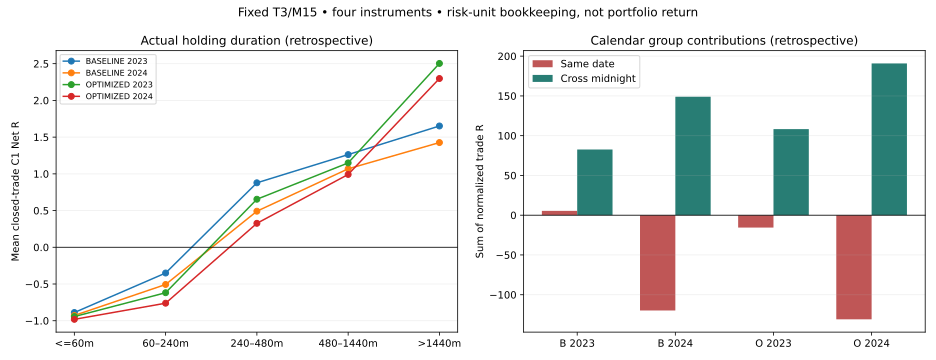

# T3/M15 Holding & Entry Diagnostics v1

## Summary для внешнего аудита

**Основная наблюдаемая слабость — недостаточное продолжение после значительной части входов. Управление выходами дополнительно отдаёт часть достигнутого движения, но массовое превращение +2R в убыток не подтверждается. Положительный C1-результат особенно в 2024 полностью зависит от сделок, фактически переживших календарную полночь. Полная исполнимая экономика переноса остаётся неизвестной.**

Это причинно-корректная реконструкция оригинального исполнения, а не идентификация причинного эффекта нового правила. Нельзя установить процент падения результата, который исправит изменение входа или выхода, без отдельного заранее заданного эксперимента. Приведённые доли относятся к объёму отрицательных R уже закрытых сделок, а не к потенциально возвратимой прибыли.

Фактический GitHub discovery/main на проверке: `d963b783b9de31fc0f2c965f6dfb11ab9cd90f5b`, merge PR #490. Данные: `f8486b446cf3d5f9f3cba6dfec32bdef8fd184c8`. Две фиксированные версии (trail ATR 3.0 / 3.5), четыре инструмента, только 2023–2024. 1 442 исходные закрытые сделки и две открытые терминальные позиции IMOEXF восстановлены; альтернативные сигналы или выходы не моделировались.

## Что считается и когда информация доступна

- R каждой сделки нормализован на её собственный первоначальный риск, Stop = entry ± 2 ATR M15. PF относится к C1 Net R; Gross PF дан отдельно в CSV. C1 = 2 × research unit / initial risk; units USDRUBF/CNYRUBF 0.001, GLDRUBF 0.1, IMOEXF 0.5 сохранены из PR #490.
- Свеча M15 становится доступна после закрытия; вход принят по закрытию сигнальной свечи. H1 использует исходные дневные ordinal-блоки из четырёх последовательных M15, лишь после их завершения. Последний доступный H1 имеет timestamp ≤ entry; Donchian использует предыдущие 20 свечей через shift(1). EMA, ATR, ADX и Donchian явно пересекают календарные дни, как в исходном исполнении; блоки H1 сбрасываются по московской дате закрытия.
- EMA75, slope5, ADX14>20 и H1 ATR14>ATRMean20 — исходные состояния, не новые фильтры. Все entry-признаки доступны при закрытии сигнальной свечи. Из этих OHLC нельзя доказать исполнимый fill по тому же закрытию после вычисления сигнала.
- SAME_DAY / CROSS_MIDNIGHT определяются московскими календарными датами entry/exit. Год и месяц — дата выхода; entry_year сохранён. Группы времени: ≤60, (60,240], (240,480], (480,1440], >1440 минут. Также показаны фактические бары. Это фиксированные описательные интервалы, не подобранные торговые параметры.
- Stop действует со следующей свечи: carried Stop проверяется первым; при гэпе используется неблагоприятный Open. Только пережитая свеча обновляет favorable extreme и Stop. На закрытии той же свечи разрешён исходный повторный вход. Stop только ужесточается; не округляется к тиковой сетке, как в исходном исследовании.
- Длительность, перенос, MAE/MFE, исход WIN/LOSS и первые свечи — **ретроспективные характеристики**. Они не используются для отбора входов. OHLC после Stop в фиксированных горизонтах помечены как движение цены после завершённой сделки. Условие «ещё открыта» тоже создаёт survivor selection и не является правилом.
- 2023 не полон для GLD (старт 11.07) и IMOEX (14.11; всего девять сделок на версию). Разница состава между годами не означает единый рыночный режим. 2025–2026 OHLC не читались исследовательским парсером; полные файлы хешировались как непрозрачные байты для проверки pin.
- Суммы R четырёх инструментов ниже — только бухгалтерия одинаковых условных единиц риска. Это **не портфельная доходность**, CAGR, RUB P&L или моделирование капитала. DD — просадка последовательности закрытых сделок в R с нулевым начальным уровнем, без внутрипозиционной переоценки/маржи; ties сортируются exit_time, instrument, trade_id.

## A. Продолжительность и перенос: подтверждённые результаты

Общая предпосылка «внутри дня всегда убыток» слишком сильна: Baseline в 2023 даёт +5.43R внутри дня; USDRUBF в 2023 даёт +14.90R / +5.45R внутри дня у двух версий. **В 2024 каждый инструмент обеих версий отрицателен внутри дня и положителен через полночь**. Ни одна из этих групп не была доступна для выбора при входе.

| version | year | carry | trades | PF_net_C1 | gross_R | C1_R | net_R | mean_MAE_R | mean_MFE_R | max_closed_trade_drawdown_R | top5_share_positive_R |
|---|---|---|---|---|---|---|---|---|---|---|---|
| BASELINE | 2023 | CROSS_MIDNIGHT | 73 | 6.572 | 84.190 | 1.592 | 82.599 | 0.531 | 2.637 | 3.191 | 0.294 |
| BASELINE | 2023 | SAME_DAY | 183 | 1.062 | 10.015 | 4.584 | 5.430 | 0.610 | 1.535 | 21.922 | 0.309 |
| BASELINE | 2024 | CROSS_MIDNIGHT | 142 | 6.376 | 155.238 | 6.263 | 148.975 | 0.511 | 2.340 | 2.583 | 0.182 |
| BASELINE | 2024 | SAME_DAY | 343 | 0.412 | -105.031 | 14.804 | -119.835 | 0.686 | 1.039 | 123.835 | 0.259 |
| OPTIMIZED | 2023 | CROSS_MIDNIGHT | 83 | 6.599 | 110.060 | 1.824 | 108.236 | 0.535 | 2.952 | 2.760 | 0.254 |
| OPTIMIZED | 2023 | SAME_DAY | 160 | 0.828 | -11.442 | 4.133 | -15.576 | 0.682 | 1.558 | 34.898 | 0.383 |
| OPTIMIZED | 2024 | CROSS_MIDNIGHT | 160 | 6.530 | 198.389 | 7.551 | 190.838 | 0.530 | 2.719 | 2.492 | 0.207 |
| OPTIMIZED | 2024 | SAME_DAY | 298 | 0.340 | -118.287 | 12.674 | -130.961 | 0.750 | 1.039 | 132.056 | 0.306 |

Разрез инструмент × год × перенос:

| version | instrument | year | carry | trades | PF_net_C1 | gross_R | net_R |
|---|---|---|---|---|---|---|---|
| BASELINE | CNYRUBF | 2023 | CROSS_MIDNIGHT | 25 | 4.783 | 26.363 | 25.272 |
| BASELINE | CNYRUBF | 2023 | SAME_DAY | 60 | 0.990 | 2.806 | -0.310 |
| BASELINE | CNYRUBF | 2024 | CROSS_MIDNIGHT | 31 | 10.336 | 47.227 | 45.446 |
| BASELINE | CNYRUBF | 2024 | SAME_DAY | 83 | 0.275 | -31.363 | -36.648 |
| BASELINE | GLDRUBF | 2023 | CROSS_MIDNIGHT | 12 | 3.916 | 7.811 | 7.686 |
| BASELINE | GLDRUBF | 2023 | SAME_DAY | 39 | 0.604 | -7.913 | -8.266 |
| BASELINE | GLDRUBF | 2024 | CROSS_MIDNIGHT | 37 | 3.838 | 32.106 | 31.805 |
| BASELINE | GLDRUBF | 2024 | SAME_DAY | 90 | 0.539 | -20.835 | -21.597 |
| BASELINE | IMOEXF | 2023 | CROSS_MIDNIGHT | 2 | — | 0.647 | 0.519 |
| BASELINE | IMOEXF | 2023 | SAME_DAY | 7 | 0.768 | -0.368 | -0.891 |
| BASELINE | IMOEXF | 2024 | CROSS_MIDNIGHT | 41 | 13.219 | 60.155 | 56.235 |
| BASELINE | IMOEXF | 2024 | SAME_DAY | 88 | 0.164 | -40.981 | -49.068 |
| BASELINE | USDRUBF | 2023 | CROSS_MIDNIGHT | 34 | 9.919 | 49.369 | 49.121 |
| BASELINE | USDRUBF | 2023 | SAME_DAY | 77 | 1.450 | 15.490 | 14.898 |
| BASELINE | USDRUBF | 2024 | CROSS_MIDNIGHT | 33 | 3.201 | 15.750 | 15.488 |
| BASELINE | USDRUBF | 2024 | SAME_DAY | 82 | 0.738 | -11.852 | -12.523 |
| OPTIMIZED | CNYRUBF | 2023 | CROSS_MIDNIGHT | 29 | 4.214 | 29.041 | 27.766 |
| OPTIMIZED | CNYRUBF | 2023 | SAME_DAY | 53 | 0.855 | -1.495 | -4.280 |
| OPTIMIZED | CNYRUBF | 2024 | CROSS_MIDNIGHT | 34 | 10.415 | 61.660 | 59.667 |
| OPTIMIZED | CNYRUBF | 2024 | SAME_DAY | 72 | 0.265 | -31.106 | -35.795 |
| OPTIMIZED | GLDRUBF | 2023 | CROSS_MIDNIGHT | 16 | 4.912 | 15.804 | 15.646 |
| OPTIMIZED | GLDRUBF | 2023 | SAME_DAY | 33 | 0.315 | -15.045 | -15.345 |
| OPTIMIZED | GLDRUBF | 2024 | CROSS_MIDNIGHT | 40 | 5.268 | 48.868 | 48.543 |
| OPTIMIZED | GLDRUBF | 2024 | SAME_DAY | 77 | 0.364 | -28.311 | -28.987 |
| OPTIMIZED | IMOEXF | 2023 | CROSS_MIDNIGHT | 2 | — | 0.531 | 0.403 |
| OPTIMIZED | IMOEXF | 2023 | SAME_DAY | 7 | 0.661 | -0.875 | -1.399 |
| OPTIMIZED | IMOEXF | 2024 | CROSS_MIDNIGHT | 49 | 10.562 | 70.751 | 65.823 |
| OPTIMIZED | IMOEXF | 2024 | SAME_DAY | 76 | 0.086 | -46.923 | -53.637 |
| OPTIMIZED | USDRUBF | 2023 | CROSS_MIDNIGHT | 36 | 10.626 | 64.684 | 64.421 |
| OPTIMIZED | USDRUBF | 2023 | SAME_DAY | 67 | 1.158 | 5.973 | 5.447 |
| OPTIMIZED | USDRUBF | 2024 | CROSS_MIDNIGHT | 37 | 2.695 | 17.110 | 16.805 |
| OPTIMIZED | USDRUBF | 2024 | SAME_DAY | 73 | 0.724 | -11.947 | -12.542 |

Фактическая длительность (условная pooled-бухгалтерия):

| version | year | holding_bucket | trades | PF_net_C1 | gross_R | net_R | mean_net_R | mean_MFE_R |
|---|---|---|---|---|---|---|---|---|
| BASELINE | 2023 | 01_0_to_60m | 39 | 0.001 | -33.704 | -34.652 | -0.889 | 0.538 |
| BASELINE | 2023 | 02_60_to_240m | 85 | 0.347 | -27.720 | -29.795 | -0.351 | 1.147 |
| BASELINE | 2023 | 03_240_to_480m | 51 | 6.571 | 46.053 | 44.783 | 0.878 | 2.395 |
| BASELINE | 2023 | 04_480_to_1440m | 67 | 7.416 | 86.117 | 84.567 | 1.262 | 2.843 |
| BASELINE | 2023 | 05_over_1440m | 14 | 18.846 | 23.459 | 23.126 | 1.652 | 3.020 |
| BASELINE | 2024 | 01_0_to_60m | 99 | 0.013 | -87.590 | -91.904 | -0.928 | 0.425 |
| BASELINE | 2024 | 02_60_to_240m | 161 | 0.187 | -74.501 | -81.582 | -0.507 | 0.921 |
| BASELINE | 2024 | 03_240_to_480m | 81 | 3.943 | 43.044 | 39.783 | 0.491 | 1.833 |
| BASELINE | 2024 | 04_480_to_1440m | 119 | 8.313 | 132.648 | 127.190 | 1.069 | 2.299 |
| BASELINE | 2024 | 05_over_1440m | 25 | 5.922 | 36.606 | 35.653 | 1.426 | 3.048 |
| OPTIMIZED | 2023 | 01_0_to_60m | 34 | 0.000 | -31.208 | -32.081 | -0.944 | 0.532 |
| OPTIMIZED | 2023 | 02_60_to_240m | 68 | 0.139 | -40.571 | -42.089 | -0.619 | 1.025 |
| OPTIMIZED | 2023 | 03_240_to_480m | 45 | 3.917 | 30.775 | 29.435 | 0.654 | 2.435 |
| OPTIMIZED | 2023 | 04_480_to_1440m | 76 | 6.275 | 89.142 | 87.325 | 1.149 | 2.821 |
| OPTIMIZED | 2023 | 05_over_1440m | 20 | 23.144 | 50.481 | 50.070 | 2.503 | 4.126 |
| OPTIMIZED | 2024 | 01_0_to_60m | 84 | 0.011 | -78.453 | -82.423 | -0.981 | 0.381 |
| OPTIMIZED | 2024 | 02_60_to_240m | 125 | 0.049 | -89.841 | -95.190 | -0.762 | 0.778 |
| OPTIMIZED | 2024 | 03_240_to_480m | 79 | 2.363 | 28.708 | 25.770 | 0.326 | 1.850 |
| OPTIMIZED | 2024 | 04_480_to_1440m | 137 | 6.529 | 142.547 | 135.878 | 0.992 | 2.430 |
| OPTIMIZED | 2024 | 05_over_1440m | 33 | 13.543 | 77.141 | 75.842 | 2.298 | 4.132 |

Обе версии убыточны среди сделок ≤4 часов, а более длинные группы положительны в двухлетней pooled-бухгалтерии. Это естественно совместимо с устройством исполнения: неудачные входы достигают Stop быстро; устойчивые движения дольше сохраняют позицию. Это не доказывает преимущество обязательного минимального удержания или запрета закрытия в день входа. Вход поздно вечером может пересечь полночь быстрее раннего входа; entry_hour.csv позволяет проверить состав по времени входа, без создания SESSION-правила.

Календарная полночь не равна фактическому ночному переносу. Закрытие последней свечи в 00:00 уже относится к следующей дате; вход в 00:00 перед утренним открытием может иметь ночной перерыв, оставаясь на той же календарной дате. Поэтому дополнительно показан наблюдаемый нерабочий ночной gap: разница соседних доступных M15 >15 минут, дата следующего открытия отличается от даты последней торговавшей минуты предыдущей свечи. Это диагностика gaps в источнике, не биржевой funding-календарь и не доказательство реального исполнения через клиринг.

| version | year | carry_kind | trades | net_R |
|---|---|---|---|---|
| BASELINE | 2023 | CROSSED_NONTRADING_NIGHT_GAP | 72 | 82.946 |
| BASELINE | 2023 | MIDNIGHT_OR_CONTINUOUS_CROSS_ONLY | 1 | -0.347 |
| BASELINE | 2023 | SAME_DAY | 183 | 5.430 |
| BASELINE | 2024 | CROSSED_NONTRADING_NIGHT_GAP | 133 | 150.612 |
| BASELINE | 2024 | MIDNIGHT_OR_CONTINUOUS_CROSS_ONLY | 9 | -1.637 |
| BASELINE | 2024 | SAME_DATE_WITH_NONTRADING_NIGHT_GAP | 1 | -1.107 |
| BASELINE | 2024 | SAME_DAY | 342 | -118.728 |
| OPTIMIZED | 2023 | CROSSED_NONTRADING_NIGHT_GAP | 82 | 109.063 |
| OPTIMIZED | 2023 | MIDNIGHT_OR_CONTINUOUS_CROSS_ONLY | 1 | -0.827 |
| OPTIMIZED | 2023 | SAME_DAY | 160 | -15.576 |
| OPTIMIZED | 2024 | CROSSED_NONTRADING_NIGHT_GAP | 154 | 193.592 |
| OPTIMIZED | 2024 | MIDNIGHT_OR_CONTINUOUS_CROSS_ONLY | 6 | -2.755 |
| OPTIMIZED | 2024 | SAME_DAY | 298 | -130.961 |

В 2024 pooled SAME_DAY даёт -119.84R / -130.96R, CROSS_MIDNIGHT +148.97R / +190.84R; итог +29.14R / +59.88R. Оба направления внутри дня в 2024 отрицательны в pooled-бухгалтерии. Разрезы direction × instrument × year × carry/holding доступны в CSV. Удаление overnight-группы задним числом не является допустимым бэктестом.

## B. Первые 1/2/4 завершённые свечи: подтверждённые результаты

Номер свечи — следующий доступный M15 после entry, а не обязательно 15/30/60 минут календарного времени: пропуски/выходные увеличивают elapsed_minutes. Для каждого исходного входа показаны signed close R, благоприятный/неблагоприятный экстремум данной свечи и накопленный экстремум до горизонта, close за исходным breakout level, wick-возврат и хотя бы одно закрытие обратно за уровнем. Исходный breakout level не пересчитывается по будущим свечам.

`all_*` ниже включает цену и после выхода; `alive_*` включает только свечи, завершившиеся строго раньше Stop-выхода. Свеча Stop исключена из `alive_*`, даже если запись exit_time соответствует её закрытию. Эти две оценки нельзя смешивать или выдавать движение уже закрытой позиции за удержанную прибыль.

| version | year | bar | outcome | trades | alive_before_close | all_close_R | all_cum_favorable_R | all_cum_adverse_R | all_return_pct | alive_return_pct |
|---|---|---|---|---|---|---|---|---|---|---|
| BASELINE | 2023 | 1 | LOSS | 148 | 138 | -0.060 | 0.323 | 0.388 | 33.784 | 31.159 |
| BASELINE | 2023 | 1 | WIN | 108 | 108 | 0.124 | 0.396 | 0.275 | 25.000 | 25.000 |
| BASELINE | 2023 | 2 | LOSS | 148 | 126 | -0.140 | 0.454 | 0.532 | 43.243 | 35.714 |
| BASELINE | 2023 | 2 | WIN | 108 | 108 | 0.269 | 0.611 | 0.308 | 33.333 | 33.333 |
| BASELINE | 2023 | 4 | LOSS | 148 | 107 | -0.285 | 0.544 | 0.783 | 62.838 | 53.271 |
| BASELINE | 2023 | 4 | WIN | 108 | 107 | 0.595 | 0.995 | 0.346 | 36.111 | 36.449 |
| BASELINE | 2024 | 1 | LOSS | 311 | 293 | -0.112 | 0.292 | 0.403 | 32.154 | 29.693 |
| BASELINE | 2024 | 1 | WIN | 173 | 173 | 0.168 | 0.437 | 0.212 | 20.231 | 20.231 |
| BASELINE | 2024 | 2 | LOSS | 311 | 265 | -0.185 | 0.376 | 0.570 | 51.447 | 46.415 |
| BASELINE | 2024 | 2 | WIN | 173 | 172 | 0.297 | 0.644 | 0.283 | 26.590 | 26.744 |
| BASELINE | 2024 | 4 | LOSS | 311 | 212 | -0.253 | 0.470 | 0.789 | 65.595 | 55.189 |
| BASELINE | 2024 | 4 | WIN | 173 | 171 | 0.541 | 0.948 | 0.337 | 32.370 | 32.164 |
| OPTIMIZED | 2023 | 1 | LOSS | 144 | 136 | -0.060 | 0.309 | 0.378 | 34.722 | 32.353 |
| OPTIMIZED | 2023 | 1 | WIN | 99 | 99 | 0.144 | 0.412 | 0.279 | 25.253 | 25.253 |
| OPTIMIZED | 2023 | 2 | LOSS | 144 | 126 | -0.119 | 0.449 | 0.516 | 44.444 | 38.889 |
| OPTIMIZED | 2023 | 2 | WIN | 99 | 99 | 0.270 | 0.622 | 0.309 | 32.323 | 32.323 |
| OPTIMIZED | 2023 | 4 | LOSS | 144 | 106 | -0.228 | 0.561 | 0.764 | 61.806 | 53.774 |
| OPTIMIZED | 2023 | 4 | WIN | 99 | 99 | 0.560 | 0.984 | 0.348 | 36.364 | 36.364 |
| OPTIMIZED | 2024 | 1 | LOSS | 290 | 274 | -0.110 | 0.289 | 0.394 | 33.793 | 31.022 |
| OPTIMIZED | 2024 | 1 | WIN | 167 | 167 | 0.156 | 0.439 | 0.224 | 18.563 | 18.563 |
| OPTIMIZED | 2024 | 2 | LOSS | 290 | 251 | -0.172 | 0.375 | 0.561 | 51.379 | 46.614 |
| OPTIMIZED | 2024 | 2 | WIN | 167 | 166 | 0.253 | 0.635 | 0.303 | 28.144 | 28.313 |
| OPTIMIZED | 2024 | 4 | LOSS | 290 | 207 | -0.239 | 0.473 | 0.772 | 65.172 | 54.589 |
| OPTIMIZED | 2024 | 4 | WIN | 167 | 165 | 0.471 | 0.910 | 0.367 | 35.928 | 35.758 |

В 2024 убыточные входы уже на первой свече имеют среднее закрытие -0.112R / -0.110R против +0.168R / +0.156R у победителей. К четвёртой свече 65.6% / 65.2% будущих проигравших имели хотя бы одно закрытие обратно за breakout level, против 32.4% / 35.9% победителей. Среди ещё открытых до четвёртого закрытия: 55.2% / 54.6% против 32.2% / 35.8%. Различие сохраняется, но survivor-подвыборка сама зависит от Stop. Эти числа подтверждают связь слабого продолжения/возврата с итоговым убытком; не доказывают пригодность ONE_BAR и не являются готовым причинным фильтром.

Предвходовые признаки в entry_features_by_outcome.csv: средние и медианы breakout penetration, тела/диапазона сигнальной свечи, исходных ATR M15/H1, ATR ratio, ADX, расстояния H1 Close от EMA, signed slope и возраста H1. Полные EMA/ADX/ATR/H1-trend доступны по каждой сделке. EMA в исходном T3 находится на H1; новой M15 EMA не добавлено.

Нет универсального монотонного разделения по силе пробоя или ADX. Например, Baseline CNY 2024: median penetration у проигравших 0.231R против 0.150R у победителей; USDRUBF почти одинаков 0.216R против 0.215R. ADX Baseline GLD 2023 у проигравших выше (33.09 против 31.39), а в 2024 ниже (29.46 против 32.33). В OPTIMIZED эти различия также не дают единого направления для всех инструментов. Подбор порогов/индикаторов не проводился. Объяснение через ложные пробои/диапазон — рабочая гипотеза; формальное наблюдение здесь лишь возврат цены через исходный уровень и слабое последующее движение.

## C. Первоначальный Stop, trailing и потеря движения

stop_trajectory.csv содержит entry, каждую пережитую свечу и исходный exit, stop_before/after в цене и R, proposed Stop, отношение текущего ATR к entry ATR, trailing distance R, накопленные исходные MAE/MFE, ужесточение без нового extreme и close через новый Stop. Две терминальные позиции включены в траектории с OPEN_TERMINAL, исключены из закрытой экономики. Новых закрытий им не назначено.

Исходный recorded MFE исключает всю Stop-свечу. Это консервативная **модельная** оценка, не доказательство отсутствия любой favourable tick. `observed_MFE_lower_R` добавляет известный Open перед внутрисвечным Stop и сам fill. `possible_MFE_upper_R` допускает благоприятный экстремум Stop-свечи до касания Stop. Если Stop срабатывает уже на Open (включая Open ровно на Stop), все последующие wick исключены и upper=lower. Порядок High/Low внутри M15 не выдумывается. На пережитых свечах OHLC целиком относится к открытой позиции.

Для утверждения «не было благоприятного движения вообще»: confirmed означает upper≤1e-12; unresolved означает lower≤1e-12<upper. Оставшаяся разница между recorded zero и этими категориями — благоприятный Open, который исходный MFE не учёл. Числа +1/+2 в bounds относятся к net-loss; gross-loss отдельно показан по исходному MFE.

| version | year | loss_recorded_MFE_zero | loss_no_favorable_confirmed | loss_no_favorable_unresolved | loss_confirmed_MFE_ge_1 | loss_possible_MFE_ge_1 | loss_confirmed_MFE_ge_2 | loss_possible_MFE_ge_2 | gross_loss_recorded_MFE_ge_1 | gross_loss_recorded_MFE_ge_2 |
|---|---|---|---|---|---|---|---|---|---|---|
| BASELINE | 2023 | 19 | 12 | 5 | 33 | 35 | 1 | 1 | 31 | 1 |
| BASELINE | 2024 | 32 | 16 | 11 | 59 | 62 | 3 | 3 | 51 | 2 |
| OPTIMIZED | 2023 | 17 | 11 | 5 | 38 | 39 | 2 | 2 | 37 | 2 |
| OPTIMIZED | 2024 | 29 | 14 | 10 | 58 | 61 | 2 | 3 | 54 | 1 |

Разложение объёма отрицательных C1 R по записанному MFE (описательная бухгалтерия):

| version | year | losses | loss_volume_R | MFE_lt_0_5_count | MFE_lt_0_5_loss_share_pct | MFE_0_5_to_1_loss_share_pct | MFE_ge_1_count | MFE_ge_1_loss_share_pct | MFE_ge_2_count |
|---|---|---|---|---|---|---|---|---|---|
| BASELINE | 2023 | 148 | 102.848 | 77 | 68.783 | 21.011 | 33 | 10.206 | 1 |
| BASELINE | 2024 | 311 | 231.596 | 164 | 67.531 | 23.739 | 59 | 8.730 | 3 |
| OPTIMIZED | 2023 | 144 | 109.880 | 73 | 63.460 | 21.962 | 38 | 14.579 | 2 |
| OPTIMIZED | 2024 | 290 | 232.993 | 153 | 64.953 | 24.757 | 58 | 10.290 | 2 |

В 2024 MFE<0.5R: 164/311 убыточных сделок Baseline (156.40R убытков, 67.5% отрицательного объёма) и 153/290 OPTIMIZED (151.34R, 65.0%). MFE≥1R с net-loss: 59 / 58 сделок, соответственно 20.22R / 23.98R (8.7% / 10.3% объёма убытков); из них 53 / 50 закрылись внутри дня. MFE≥2R с net-loss — только 3 / 2; с gross-loss — 2 / 1. Поэтому массовый механизм «+2R затем полный убыток» не подтверждён. Это не говорит, что всю потерю после MFE можно было бы реализовать на пике.

Формула текущего candidate Stop в R: `running_extreme_R − (trail_atr / 2) × ATR_current / ATR_entry`; активный Stop — максимум достигнутого signed Stop. При неизменном ATR trail-distance равна 1.5R / 1.75R. Достижение +1R не обязано ни включать безубыток, ни блокировать прибыль: такого механизма в исходной стратегии нет. Сжатие ATR может ужесточать Stop без нового favorable extreme; расширение ATR снижает candidate, но ранее достигнутый Stop не ослабляет. Реальный эффект считается по исходным траекториям, без моделирования альтернативы.

| version | year | initial_stop_exits | ratcheted_stop_losses | positive_stop_then_net_loss | of_these_gap_exit | of_these_C1_flip | updates | without_new_extreme | close_through_new_stop_bars | mean_giveback_R |
|---|---|---|---|---|---|---|---|---|---|---|
| BASELINE | 2023 | 52 | 96 | 5 | 4 | 1 | 2526 | 1705 | 15 | 1.481 |
| BASELINE | 2024 | 126 | 185 | 13 | 6 | 8 | 4518 | 3128 | 18 | 1.316 |
| OPTIMIZED | 2023 | 65 | 79 | 2 | 2 | 0 | 2523 | 1783 | 10 | 1.628 |
| OPTIMIZED | 2024 | 151 | 139 | 6 | 5 | 3 | 4518 | 3273 | 16 | 1.451 |

Отдача движения и время после пика по фактическому исходу:

| version | year | outcome | trades | net_R | mean_MFE_R | mean_giveback_R | median_giveback_R | mean_bars_after_peak | mean_exit_stop_R |
|---|---|---|---|---|---|---|---|---|---|
| BASELINE | 2023 | LOSS | 148 | -102.848 | 0.614 | 1.285 | 1.207 | 6.872 | -0.628 |
| BASELINE | 2023 | WIN | 108 | 190.877 | 3.542 | 1.750 | 1.566 | 6.731 | 1.942 |
| BASELINE | 2024 | FLAT | 1 | 0.000 | 1.318 | 1.255 | 1.255 | 17.000 | 0.301 |
| BASELINE | 2024 | LOSS | 311 | -231.596 | 0.567 | 1.268 | 1.231 | 6.145 | -0.671 |
| BASELINE | 2024 | WIN | 173 | 260.736 | 2.954 | 1.404 | 1.348 | 7.272 | 1.574 |
| OPTIMIZED | 2023 | LOSS | 144 | -109.880 | 0.663 | 1.403 | 1.336 | 7.125 | -0.704 |
| OPTIMIZED | 2023 | WIN | 99 | 202.540 | 4.028 | 1.955 | 1.774 | 8.495 | 2.211 |
| OPTIMIZED | 2024 | FLAT | 1 | 0.000 | 1.318 | 1.255 | 1.255 | 17.000 | 0.132 |
| OPTIMIZED | 2024 | LOSS | 290 | -232.993 | 0.583 | 1.344 | 1.291 | 6.914 | -0.748 |
| OPTIMIZED | 2024 | WIN | 167 | 292.870 | 3.439 | 1.639 | 1.490 | 9.479 | 1.849 |

В 2024 Stop ужесточался без нового extreme 3 128 / 3 273 раза; такие изменения происходят за счёт ATR, а не нового ценового пика. 18 / 16 пережитых свечей закрылись уже через новый рассчитанный Stop: историческая модель активирует его лишь на следующей свече. Это конкретное ограничение close-only stop updates, не доказанный дефект LIVE. Положительный Stop затем net-loss встречается 13 / 6 раз, при этом гэпы и C1-flips могут пересекаться. Стоп выше entry сам по себе не гарантирует положительный net-fill при гэпе/затратах.

`giveback_recorded_R = recorded MFE − gross_R` — отданное движение в ценовой траектории, не исполнимая прибыль на известном пике. bars_after_peak_MFE показывает, где во времени оно теряется; пик — первое достижение максимума. В среднем recorded giveback в 2024 составляет 1.316R / 1.451R; в 2023 он больше, 1.481R / 1.628R. Поэтому сама средняя отдача не объясняет ухудшение 2024: уменьшился и запас favorable движения, особенно в USDRUBF.

## Концентрация, календарные месяцы и сравнение годов

Top5 — пять крупнейших **положительных** net-сделок в данной instrument/year группе. Их удаление — стресс-описание концентрации, не торговый отбор и не новое Robustness-испытание. На выборках с ≤5 победителями удаляются все победители; отрицательные сделки не удаляются.

Бухгалтерское разложение среднего Gross R для Si/CNY: `mean Gross = mean recorded MFE − mean recorded giveback`:

| version | year | trades | mean_recorded_MFE_R | mean_recorded_giveback_R | mean_gross_R | mean_C1_R | mean_net_R |
|---|---|---|---|---|---|---|---|
| BASELINE | 2023 | 196 | 1.994 | 1.514 | 0.480 | 0.026 | 0.454 |
| BASELINE | 2024 | 229 | 1.376 | 1.290 | 0.086 | 0.035 | 0.051 |
| OPTIMIZED | 2023 | 185 | 2.207 | 1.676 | 0.531 | 0.026 | 0.505 |
| OPTIMIZED | 2024 | 216 | 1.593 | 1.428 | 0.165 | 0.035 | 0.130 |

У Si/CNY в 2024 уменьшились и MFE, и средняя отдача движения. Снижение отдачи частично компенсировало снижение MFE; это не подтверждает объяснение валютного провала только чрезмерно поздним выходом. Это тождество на наблюдаемых сделках, а не причинная доля качества входа.

| version | instrument | year | trades | PF_net_C1 | gross_R | C1_R | net_R | mean_MFE_R | top5_share_positive_R | net_R_without_top5_winners |
|---|---|---|---|---|---|---|---|---|---|---|
| BASELINE | CNYRUBF | 2023 | 85 | 1.677 | 29.169 | 4.207 | 24.962 | 1.731 | 0.392 | 0.755 |
| BASELINE | CNYRUBF | 2024 | 114 | 1.159 | 15.863 | 7.065 | 8.798 | 1.491 | 0.431 | -18.923 |
| BASELINE | GLDRUBF | 2023 | 51 | 0.975 | -0.103 | 0.477 | -0.580 | 1.384 | 0.746 | -17.706 |
| BASELINE | GLDRUBF | 2024 | 127 | 1.176 | 11.271 | 1.063 | 10.208 | 1.461 | 0.366 | -14.753 |
| BASELINE | IMOEXF | 2023 | 9 | 0.903 | 0.280 | 0.652 | -0.372 | 1.329 | 1.000 | -3.845 |
| BASELINE | IMOEXF | 2024 | 129 | 1.113 | 19.174 | 12.006 | 7.168 | 1.456 | 0.306 | -14.386 |
| BASELINE | USDRUBF | 2023 | 111 | 2.658 | 64.859 | 0.840 | 64.019 | 2.195 | 0.308 | 32.434 |
| BASELINE | USDRUBF | 2024 | 115 | 1.054 | 3.898 | 0.933 | 2.966 | 1.263 | 0.331 | -16.131 |
| OPTIMIZED | CNYRUBF | 2023 | 82 | 1.614 | 27.546 | 4.059 | 23.487 | 1.880 | 0.366 | 0.871 |
| OPTIMIZED | CNYRUBF | 2024 | 106 | 1.434 | 30.554 | 6.682 | 23.872 | 1.820 | 0.475 | -13.631 |
| OPTIMIZED | GLDRUBF | 2023 | 49 | 1.011 | 0.759 | 0.458 | 0.301 | 1.512 | 0.836 | -22.024 |
| OPTIMIZED | GLDRUBF | 2024 | 117 | 1.343 | 20.557 | 1.002 | 19.555 | 1.740 | 0.407 | -11.555 |
| OPTIMIZED | IMOEXF | 2023 | 9 | 0.759 | -0.344 | 0.652 | -0.996 | 1.329 | 1.000 | -4.125 |
| OPTIMIZED | IMOEXF | 2024 | 125 | 1.186 | 23.828 | 11.641 | 12.187 | 1.576 | 0.315 | -12.297 |
| OPTIMIZED | USDRUBF | 2023 | 103 | 2.701 | 70.657 | 0.788 | 69.869 | 2.467 | 0.306 | 35.948 |
| OPTIMIZED | USDRUBF | 2024 | 110 | 1.077 | 5.163 | 0.900 | 4.262 | 1.374 | 0.367 | -17.615 |

Во всех восьми instrument/version результатах 2024 удаление пяти лучших победителей оставляет отрицательный net. Top5 дают 30.6–47.5% положительных R; положительный итог зависит от хвоста победителей, хотя большинство отдельных overnight-подгрупп сохраняют плюс и без своих top5. Внутридневные группы USDRUBF 2023 положительны только с крупными победителями.

Главное падение 2023→2024 в FX: Si/CNY Gross 94.03→19.76R Baseline и 98.20→35.72R OPTIMIZED, до C1. USDRUBF Net 64.02→2.97R / 69.87→4.26R. Его mean MFE 2.195→1.263R / 2.467→1.374R. CNY второй фиксированной версии не ухудшается по Net (23.49→23.87R). GLD и IMOEX улучшаются относительно короткого 2023. Единого подтверждённого режима ухудшения всех четырёх инструментов нет.

Два худших наблюдаемых месяца каждого instrument/version приведены ниже; monthly.csv содержит все месяцы с закрытыми сделками, monthly_carry.csv — month × direction × carry. Месяцы без закрытий имеют 0R, до старта инструмента — отсутствующую историю, не отрицательные/нулевые торговые месяцы. Неполные стартовые месяцы не превращались в полные годы.

| version | instrument | month | trades | PF_net_C1 | gross_R | C1_R | net_R |
|---|---|---|---|---|---|---|---|
| BASELINE | CNYRUBF | 2023-03 | 7 | 0.106 | -5.123 | 0.396 | -5.519 |
| BASELINE | CNYRUBF | 2024-03 | 10 | 0.146 | -4.708 | 0.736 | -5.444 |
| BASELINE | GLDRUBF | 2024-06 | 12 | 0.097 | -6.459 | 0.093 | -6.552 |
| BASELINE | GLDRUBF | 2024-12 | 13 | 0.222 | -5.215 | 0.053 | -5.267 |
| BASELINE | IMOEXF | 2024-01 | 10 | 0.395 | -3.178 | 1.502 | -4.680 |
| BASELINE | IMOEXF | 2024-04 | 17 | 0.244 | -5.132 | 2.433 | -7.565 |
| BASELINE | USDRUBF | 2024-04 | 11 | 0.301 | -4.453 | 0.127 | -4.579 |
| BASELINE | USDRUBF | 2024-10 | 13 | 0.309 | -5.631 | 0.102 | -5.733 |
| OPTIMIZED | CNYRUBF | 2024-03 | 10 | 0.089 | -5.343 | 0.736 | -6.079 |
| OPTIMIZED | CNYRUBF | 2024-05 | 12 | 0.232 | -5.123 | 1.015 | -6.138 |
| OPTIMIZED | GLDRUBF | 2023-08 | 14 | 0.273 | -5.206 | 0.117 | -5.324 |
| OPTIMIZED | GLDRUBF | 2024-06 | 12 | 0.325 | -4.924 | 0.093 | -5.018 |
| OPTIMIZED | IMOEXF | 2024-04 | 17 | 0.206 | -5.703 | 2.433 | -8.137 |
| OPTIMIZED | IMOEXF | 2024-08 | 12 | 0.483 | -2.752 | 0.777 | -3.529 |
| OPTIMIZED | USDRUBF | 2024-04 | 11 | 0.240 | -5.187 | 0.127 | -5.313 |
| OPTIMIZED | USDRUBF | 2024-07 | 8 | 0.202 | -4.511 | 0.066 | -4.577 |

Обе фиксированные версии имеют 701 общих instrument/entry_time/direction; OPTIMIZED содержит 701 закрытых сделок, Baseline 741. Сопоставление оригинальных выходов дано в fixed_version_entry_pairs.csv. Более длинный trailing меняет продолжительность и доступность повторных входов; агрегатное сравнение версий не изолирует один эффект выхода и не выбирает победителя.

## D. C1 и полная экономика переноса

Нормализованная C1-модель — один исходный исследовательский unit на сторону, уже вычтенный из Gross. Это не подтверждение реального тарифа брокера/биржи и не полный spread/slippage. Дополнительные комиссии, spread, slippage, funding/вариационные корректировки и дивидендные поправки **UNRESOLVED, а не 0**. Номинал, количество контрактов, маржа, обеспечение и real fills не моделировались. Ночная календарная группа не соответствует автоматически конкретному расчётному событию funding.

Для каждого instrument/year показан оставшийся запас C1. Отрицательный break-even означает, что дополнительных расходов система уже не выдерживает; это не отрицательный реальный тариф. Формулы:

- Постоянный дополнительный расход `c R / trade`: `c* = sum(net_R) / N`.
- Постоянные совокупные round-trip `b bps` от **entry price-equivalent notional** каждой сделки: дополнительный R = `b × entry_price / (10 000 × initial_risk)`; `b* = sum(net_R) / sum(entry_price / risk / 10 000)`. Это не тариф на сторону и не RUB-прибыль портфеля.
- Постоянный drag в bps на 24 часа по фиксированному entry notional: `d* = 240 000 × sum(net_R) / sum(entry_price / risk × elapsed_hours)`. Это единица чувствительности, **не оценка реального funding**, который может иметь иной базис, событие расчёта, знак и зависимость от стороны. Ночные/выходные часы учтены, но это не знание расписания списаний.

Три предела — отдельные one-at-a-time математические бюджеты; их нельзя одновременно потратить целиком. Реальный полный результат равен исходному net минус сумма документально восстановленных дополнительных расходов в R, включая кредитовые/дебетовые корректировки со знаком. Величины не имитируют реальные тарифы.

| version | instrument | year | net_R | extra_cost_break_even_R_per_trade | extra_cost_break_even_bps_entry_notional | extra_drag_break_even_bps_per_24h |
|---|---|---|---|---|---|---|
| BASELINE | CNYRUBF | 2023 | 24.962 | 0.294 | 9.731 | 25.563 |
| BASELINE | CNYRUBF | 2024 | 8.798 | 0.077 | 1.964 | 5.942 |
| BASELINE | GLDRUBF | 2023 | -0.580 | -0.011 | -0.419 | -1.131 |
| BASELINE | GLDRUBF | 2024 | 10.208 | 0.080 | 2.790 | 6.647 |
| BASELINE | IMOEXF | 2023 | -0.372 | -0.041 | -1.853 | -6.560 |
| BASELINE | IMOEXF | 2024 | 7.168 | 0.056 | 1.902 | 4.672 |
| BASELINE | USDRUBF | 2023 | 64.019 | 0.577 | 17.739 | 44.381 |
| BASELINE | USDRUBF | 2024 | 2.966 | 0.026 | 0.689 | 2.194 |
| OPTIMIZED | CNYRUBF | 2023 | 23.487 | 0.286 | 9.479 | 21.531 |
| OPTIMIZED | CNYRUBF | 2024 | 23.872 | 0.225 | 5.630 | 14.359 |
| OPTIMIZED | GLDRUBF | 2023 | 0.301 | 0.006 | 0.227 | 0.513 |
| OPTIMIZED | GLDRUBF | 2024 | 19.555 | 0.167 | 5.715 | 11.478 |
| OPTIMIZED | IMOEXF | 2023 | -0.996 | -0.111 | -4.960 | -15.370 |
| OPTIMIZED | IMOEXF | 2024 | 12.187 | 0.097 | 3.337 | 6.137 |
| OPTIMIZED | USDRUBF | 2023 | 69.869 | 0.678 | 20.666 | 41.973 |
| OPTIMIZED | USDRUBF | 2024 | 4.262 | 0.039 | 1.027 | 2.523 |

В 2024 USDRUBF выдерживает лишь 0.0258R / 0.0387R дополнительного постоянного расхода на сделку; эквивалентный совокупный round-trip бюджет 0.689 / 1.027 bps. Baseline CNY/IMOEX — около 1.964 / 1.902 bps. Это узкий исследовательский запас. Overnight-результат превышает общий итог, потому что покрывает внутридневные убытки; к нему добавляется экспозиция к неизвестной полной экономике переноса. Без исторического учёта этих корректировок прибыльность вечных фьючерсов не доказана.

## Следующие эксперименты: приоритеты, не выполнены

1. **ONE_BAR**: заранее фиксированный отдельный эксперимент раннего продолжения/возврата через исходный breakout level после первого завершённого M15. Основание — слабость уже первой свечи и большой отрицательный объём low-MFE. Проверять полный исходный поток без выбора будущих победителей, цену исполнения только после появления признака, потери крупных победителей и C1. Конкретное правило следует определить до запуска; здесь оно не конструируется и не исполняется.
2. **TRAIL1**: отдельно проверить заранее определённую причинную механику исходного ATR trailing — активацию на следующей свече, зависимость от ATR-сжатия и отдачу favorable движения. Основание — тысячи ужесточений без нового пика и отсутствие защиты после +1R. Сначала формализовать одно изменение и полную цену исполнения; нельзя превращать исходный MFE-пик в доступный exit. Измерять повреждение длинных победителей вместе с уменьшением убытков.
3. **SESSION**: после восстановления исторической полной экономики переноса проверить один заранее заданный session/holding протокол на всём потоке. Основание — зависимость результата 2024 от overnight-позиций и узкий cost slack USDRUBF. Не отбирать сделки по будущему exit_day; определить события сессии/клиринга по известному календарю, а реальные funding/adjustments — по архивным данным.

**LOCK1 пока ниже приоритета**: достигавших +2R и завершившихся net-loss в 2024 лишь 3 / 2; убытки после +1R дают 8.7% / 10.3% отрицательного объёма. Это не отсутствие giveback у победителей и не доказательство бесполезности lock; отдельный lock может также уничтожать главный прибыльный хвост. Четвёртый эксперимент не предлагается.

## Независимая проверка и границы вывода

verify.py использует отдельные стандартные рекурсивные формулы и уже независимый oracle PR #490; не импортирует diagnose.py/pandas/numpy. Повторно считает все оригинальные сделки, H1/entry-признаки, каждую строку Stop, первые свечи и центральные метрики всех групп. Точность и объём сверки — AUDIT_RESULTS.json. Hand-calculated tests покрывают stop-first, гэп, Open ровно на Stop, ATR-сжатие, зеркальный SHORT, полночь и неизменность предвходовых признаков при замене будущего OHLC.

Два свежих процесса сравниваются по SHA-256 всех сгенерированных CSV/JSON, отчёта и SVG (REPEATABILITY.json); исходный каталог и data pin проверяются на неизменность (SCOPE_CHECK.json). Независимость здесь **реализационная, тот же автор**. Внешний аудитор ещё не проверил результат. Никакие изменения LIVE/TradingSystemLab, исходных результатов, закреплённых данных или Optimization Level Rejection не выполнялись; новых Optimization/Robustness/WF/TRUE OOS нет. После создания отдельного Draft PR — остановка для внешнего аудита, без merge/auto-merge.

