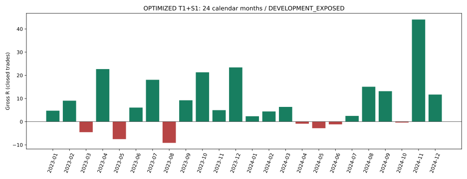

# T3/M15 OPTIMIZED T1+S1 — диагноз календарных месяцев и входов

**2024 снизил PF прежде всего из-за ухудшения доли успешных принятых входов и частоты крупных выигрышей, при значительно большем объёме убыточных сделок. Средний убыток не вырос. Свечные данные не подтверждают общее отсутствие трендов. Убедительного одного изменения, одновременно улучшающего слабые месяцы и сохраняющего ключевые тренды, не найдено.**

**GROSS_ONLY / COSTS_DEFERRED / NOT_LIVE_READY. 2023–2024: DEVELOPMENT_EXPOSED.** Исследуется только прежний OPTIMIZED T1+S1; торговых изменений, новых вариантов или численной Optimization нет. Исторический вход по signal Close остаётся непроверенным предположением.

## Воспроизведение и определения

Фактический discovery `main`: `8c40950726446ebccb1ad80b8f129558470d9c11`, Merge #500. Pinned read-only данные `market-pattern-data/forever/`: `f8486b446cf3d5f9f3cba6dfec32bdef8fd184c8`. Предыдущие #490, #491, #495–#500 и ROADMAP изучены; [PR_CONTEXT](../PR_CONTEXT.json) и [SHA прочитанных материалов](../READ_REFERENCES_SHA256.json) сохранены. Основной источник — неизменный `t3_m15_t1_s1_v1`.

EMA75, slope5, H1 ADX14>20, Donchian20 shift(1), Stop 2 M15 ATR, trail 3.5 ATR, T1 [10:00,18:00) MSK по завершённому signal Close; S1 — активация на завершённой пережитой свече после +1 первоначального R. Исходный код также требует H1 ATR14/ATRMean20>1. Это сохранённое условие, не новый фильтр; A6 отдельно требует роста этого отношения относительно предыдущего опубликованного H1.

H1 состоит из исходных дневных ordinal-блоков четырёх последовательных наблюдаемых M15, публикуется только на четвёртом Close. Рекурсивные индикаторы и Donchian пересекают дни. Сначала действует прежний Stop, неблагоприятный gap исполняется по Open; новые extrema/активация/Stop доступны только после пережитого Close, Stop применяется на следующем наблюдаемом баре. Занятость, same-Close повторный вход, переносы и OPEN сохранены.

Полный causal replay воспроизвёл **545 CLOSED и 1 terminal OPEN**. Сверены **547 878 полей** исходных trade/Stop/entry/gap/period OPEN журналов, расхождений нет. Это воспроизведение прежней стратегии, а не удаление сделок из CSV. [Результат](REPRODUCTION.json), [контрольные точки](CHECKPOINTS.json), [полные журналы](trades.csv).

Месяц/год экономики — историческая Close-метка выхода MSK. Качество входа и рыночные признаки — дата signal Close. DD — просадка суммы CLOSED R с нулевого начального уровня, порядок exit_time/instrument/trade_id; это не портфельная доходность и не внутрипозиционная MTM-просадка. OPEN не ликвидируется и не входит в PF. MFE/MAE, длительность и будущий исход — только диагностика. MFE — нижняя наблюдаемая оценка по пережитым свечам; extrema Stop-свечи исключены, неизвестный intrabar порядок не выдумывается.

| Год | CLOSED | Gross PF | Gross R | Exp R | +месяцев /12 | DD R |
| --- | --- | --- | --- | --- | --- | --- |
| 2023 | 190 | 2.1373 | 98.3963 | 0.5179 | 9 | 12.5782 |
| 2024 | 355 | 1.5199 | 94.4229 | 0.2660 | 8 | 21.3400 |

Контрольные апрель −0.8685R, май −2.8096R, июнь −1.1554R, октябрь −0.3681R и ноябрь +44.0619R совпали. **2024 без ноября: +50.3610R, PF 1.2958**; это ретроспективная чувствительность CLOSED-журнала, не новый causal replay.

## 1. Почему снизился Profit Factor

PF = (число выигрышей / число убытков) × (средний выигрыш / абсолютный средний убыток). В 2023 есть одна нулевая CLOSED-сделка; она не входит в выигрыши/убытки.

| Год | WIN | LOSS | WIN доля | Средний WIN R | Средний LOSS R | Положительные R | Отрицательные R |
| --- | --- | --- | --- | --- | --- | --- | --- |
| 2023 | 90 | 99 | 47.4% | 2.0546 | -0.8740 | 184.9175 | 86.5212 |
| 2024 | 144 | 211 | 40.6% | 1.9170 | -0.8608 | 276.0436 | 181.6207 |

Положительная сумма выросла примерно на 49%, отрицательная — на 110%; почти одинаковый итоговый Gross R теперь получен значительно большим оборотом риска. Expectancy упала примерно вдвое. Главный арифметический механизм — меньшая вероятность выигрышного входа; уменьшение среднего выигрыша вторично, средний убыток даже немного меньше.

| Год | MFE≥0.5R | MFE≥1R | MFE≥2R | Initial Stop без S1 | Удержание среднее, мин | Медиана, мин | WIN≥2R | WIN≥5R |
| --- | --- | --- | --- | --- | --- | --- | --- | --- |
| 2023 | 72.1% | 60.0% | 37.9% | 40.0% | 677.6053 | 285.0000 | 29 | 14 |
| 2024 | 67.6% | 54.1% | 30.1% | 45.9% | 644.1127 | 240.0000 | 48 | 10 |

Доля ≥5R CLOSED снизилась с 14/190 (7.4%) до 10/355 (2.8%). Нижняя MFE и средняя длительность подтверждают более слабый реализованный хвост принятой последовательности. Это не означает, что любой позднее успешный сигнал можно было отличить при входе.

Состав инструментов изменился: в 2023 GLD доступен с 11 июля, IMOEX — с 14 ноября. Число CLOSED IMOEX выросло с 8 до 103, и менее эффективный инструмент занял большую долю. Но состав не объясняет всё: на USD/CNY с полными годами PF упал с 2.5420 до 1.4926. Основной провал — USD: +64.9775R → +13.2431R. CNY вырос +27.2127R → +30.9933R, GLD и IMOEX улучшились относительно короткой истории 2023.

| Год | Инструмент | CLOSED | PF | R | WIN доля |
| --- | --- | --- | --- | --- | --- |
| 2023 | FX | 143 | 2.5420 | 92.1901 | 50.3% |
| 2023 | USDRUBF | 82 | 2.9368 | 64.9775 | 50.0% |
| 2023 | CNYRUBF | 61 | 2.0373 | 27.2127 | 50.8% |
| 2023 | GLDRUBF | 39 | 1.2547 | 5.7912 | 35.9% |
| 2023 | IMOEXF | 8 | 1.1037 | 0.4150 | 50.0% |
| 2024 | FX | 171 | 1.4926 | 44.2363 | 40.4% |
| 2024 | USDRUBF | 85 | 1.2911 | 13.2431 | 41.2% |
| 2024 | CNYRUBF | 86 | 1.6994 | 30.9933 | 39.5% |
| 2024 | GLDRUBF | 81 | 1.8975 | 34.6652 | 39.5% |
| 2024 | IMOEXF | 103 | 1.2918 | 15.5214 | 41.7% |

Дополнительно сопоставлены **одинаковые фактически доступные MM-DD даты с готовыми H1** для каждого инструмента, а не условные полные годы GLD/IMOEX. [Точный перечень](matched_dates.csv): USD 156 пар дат, CNY 156, GLD 72, IMOEX 16. Выборка по дате входа берётся из полного неизменного пути; выходы не перезапускаются. Календарные будни и число свечей могут различаться. Это диагностическая когорта, не результат укороченного replay; IMOEX особенно мал.

| Год входа | Охват | CLOSED | PF | R | WIN доля |
| --- | --- | --- | --- | --- | --- |
| 2023 | ALL | 122 | 2.3089 | 69.5847 | 50.0% |
| 2023 | FX | 93 | 2.8304 | 67.5971 | 53.8% |
| 2023 | USDRUBF | 55 | 3.4755 | 48.5064 | 56.4% |
| 2023 | CNYRUBF | 38 | 2.1012 | 19.0907 | 50.0% |
| 2023 | GLDRUBF | 24 | 0.9962 | -0.0538 | 33.3% |
| 2023 | IMOEXF | 5 | 2.0207 | 2.0414 | 60.0% |
| 2024 | ALL | 117 | 1.8751 | 51.8945 | 41.0% |
| 2024 | FX | 92 | 1.5011 | 24.3043 | 42.4% |
| 2024 | USDRUBF | 48 | 0.9856 | -0.3966 | 39.6% |
| 2024 | CNYRUBF | 44 | 2.1828 | 24.7009 | 45.5% |
| 2024 | GLDRUBF | 19 | 4.2048 | 24.1111 | 36.8% |
| 2024 | IMOEXF | 6 | 2.0631 | 3.4791 | 33.3% |

На matched FX PF также падает 2.8304→1.5011. У matched USD R становится немного отрицательным, CNY и GLD положительны. Единой деградации всех четырёх рынков нет.

## 2. Все 24 календарных месяца

«Неудачные» ниже — CLOSED с Gross R<0 и нижней MFE<0.5R. Это исход после входа, не доступный тогда фильтр. «Stop» — первоначальный Stop без активации S1. «Top3» — доля трёх крупнейших победителей в положительных R месяца. Более подробный разрез всех инструментов и LONG/SHORT — [MONTHLY_DETAIL](MONTHLY_DETAIL.md); NO_COVERAGE до реальных запусков показан отдельно.

| Месяц | CLOSED | PF | R | Exp | DD R | LONG R | SHORT R | Неудачные | Stop | S1 | Top3 |
| --- | --- | --- | --- | --- | --- | --- | --- | --- | --- | --- | --- |
| 2023-01 | 5 | 3.3726 | 4.7452 | 0.9490 | 1.0000 | 5.0270 | -0.2818 | 1 | 40.0% | 60.0% | 100.0% |
| 2023-02 | 11 | 4.0195 | 9.0584 | 0.8235 | 3.0000 | 7.7204 | 1.3380 | 3 | 27.3% | 72.7% | 82.1% |
| 2023-03 | 9 | 0.2265 | -4.5230 | -0.5026 | 4.8003 | -3.6759 | -0.8471 | 5 | 55.6% | 44.4% | 100.0% |
| 2023-04 | 10 | 9.2863 | 22.6935 | 2.2694 | 2.7387 | 11.0472 | 11.6463 | 1 | 20.0% | 80.0% | 79.4% |
| 2023-05 | 18 | 0.3006 | -7.5208 | -0.4178 | 8.1649 | -7.1649 | -0.3560 | 6 | 55.6% | 44.4% | 87.0% |
| 2023-06 | 7 | 4.0417 | 6.0833 | 0.8690 | 1.0000 | 7.0833 | -1.0000 | 2 | 28.6% | 71.4% | 95.6% |
| 2023-07 | 13 | 4.2958 | 18.0709 | 1.3901 | 2.0839 | 19.0709 | -1.0000 | 4 | 38.5% | 61.5% | 76.0% |
| 2023-08 | 29 | 0.4669 | -9.1423 | -0.3153 | 9.6264 | -7.1423 | -2.0000 | 10 | 51.7% | 48.3% | 79.5% |
| 2023-09 | 14 | 2.2113 | 9.2387 | 0.6599 | 4.0986 | -2.7984 | 12.0371 | 6 | 50.0% | 50.0% | 89.2% |
| 2023-10 | 24 | 4.1457 | 21.3036 | 0.8876 | 2.0000 | 2.5336 | 18.7699 | 2 | 25.0% | 75.0% | 45.7% |
| 2023-11 | 21 | 1.4758 | 4.9750 | 0.2369 | 3.3395 | 2.0445 | 2.9306 | 8 | 38.1% | 61.9% | 62.1% |
| 2023-12 | 29 | 2.8445 | 23.4137 | 0.8074 | 6.0000 | 17.6972 | 5.7165 | 5 | 37.9% | 62.1% | 44.2% |
| 2024-01 | 25 | 1.2073 | 2.3514 | 0.0941 | 8.3593 | 8.1773 | -5.8259 | 8 | 40.0% | 60.0% | 64.2% |
| 2024-02 | 28 | 1.3320 | 4.4111 | 0.1575 | 5.4970 | -1.8570 | 6.2681 | 7 | 39.3% | 60.7% | 57.5% |
| 2024-03 | 27 | 1.4531 | 6.3772 | 0.2362 | 5.7042 | 12.4527 | -6.0754 | 11 | 51.9% | 48.1% | 57.8% |
| 2024-04 | 37 | 0.9581 | -0.8685 | -0.0235 | 6.4546 | -4.8242 | 3.9557 | 14 | 48.6% | 51.4% | 65.2% |
| 2024-05 | 33 | 0.8452 | -2.8096 | -0.0851 | 8.0322 | 1.7890 | -4.5985 | 10 | 48.5% | 51.5% | 48.9% |
| 2024-06 | 29 | 0.9391 | -1.1554 | -0.0398 | 14.6037 | -1.7272 | 0.5718 | 10 | 51.7% | 48.3% | 91.7% |
| 2024-07 | 25 | 1.1929 | 2.4928 | 0.0997 | 4.7347 | 0.3737 | 2.1191 | 11 | 48.0% | 52.0% | 66.6% |
| 2024-08 | 31 | 2.0099 | 15.0723 | 0.4862 | 4.3347 | 13.9273 | 1.1450 | 8 | 45.2% | 54.8% | 64.0% |
| 2024-09 | 26 | 2.2560 | 13.1553 | 0.5060 | 4.5875 | 3.5363 | 9.6191 | 5 | 38.5% | 61.5% | 50.1% |
| 2024-10 | 33 | 0.9801 | -0.3681 | -0.0112 | 7.9350 | 4.5681 | -4.9362 | 16 | 54.5% | 45.5% | 64.7% |
| 2024-11 | 31 | 4.8850 | 44.0619 | 1.4214 | 3.0000 | 34.6187 | 9.4432 | 7 | 32.3% | 67.7% | 43.9% |
| 2024-12 | 30 | 1.6904 | 11.7024 | 0.3901 | 7.6779 | 1.5667 | 10.1357 | 8 | 50.0% | 50.0% | 54.4% |

Вклад каждого инструмента:

| Месяц | USD R | CNY R | GLD R | IMOEX R |
| --- | --- | --- | --- | --- |
| 2023-01 | 4.7452 | 0.0000 | 0.0000 | 0.0000 |
| 2023-02 | 5.3409 | 3.7175 | 0.0000 | 0.0000 |
| 2023-03 | -0.9955 | -3.5275 | 0.0000 | 0.0000 |
| 2023-04 | 12.8491 | 9.8444 | 0.0000 | 0.0000 |
| 2023-05 | -3.1072 | -4.4136 | 0.0000 | 0.0000 |
| 2023-06 | 5.7357 | 0.3476 | 0.0000 | 0.0000 |
| 2023-07 | 10.8885 | 9.2663 | -2.0839 | 0.0000 |
| 2023-08 | -2.4419 | -4.7481 | -1.9522 | 0.0000 |
| 2023-09 | 3.2823 | 4.6516 | 1.3048 | 0.0000 |
| 2023-10 | 18.3516 | 6.6468 | -3.6949 | 0.0000 |
| 2023-11 | 0.7135 | 2.2960 | 2.9655 | -1.0000 |
| 2023-12 | 9.6151 | 3.1318 | 9.2519 | 1.4150 |
| 2024-01 | 2.8029 | 2.1031 | 0.1132 | -2.6679 |
| 2024-02 | 2.7858 | 0.8621 | -4.8381 | 5.6013 |
| 2024-03 | -0.5120 | -5.2588 | 6.9076 | 5.2404 |
| 2024-04 | -4.2914 | 5.9883 | 1.6198 | -4.1853 |
| 2024-05 | -0.9083 | -4.8523 | 0.3470 | 2.6040 |
| 2024-06 | -1.1573 | 9.0708 | -6.6435 | -2.4254 |
| 2024-07 | -0.8955 | -5.0000 | 3.7917 | 4.5967 |
| 2024-08 | 5.4388 | 1.4997 | 10.9210 | -2.7872 |
| 2024-09 | 4.8894 | 4.3982 | 1.9798 | 1.8880 |
| 2024-10 | -0.9406 | 1.4084 | 0.0338 | -0.8697 |
| 2024-11 | 7.2430 | 10.8069 | 22.2268 | 3.7851 |
| 2024-12 | -1.2117 | 9.9668 | -1.7939 | 4.7413 |

### Апрель–июнь: три разные проблемы, а не три месяца без тренда

Итого −4.8334R при 99 CLOSED: 35 выигрышей и 64 убытка; средний выигрыш +1.5143R, убыток −0.9037R. Без S1 закрылись 49/99, неудачных с MFE<0.5R — 34. LONG дал −4.7624R, SHORT около −0.0710R: слабый квартал нельзя целиком приписать SHORT.

- **Апрель:** 15/37 выигрышей, средний +1.3228R; USD −4.2914R и IMOEX −4.1853R перекрыли CNY +5.9883R и GLD +1.6198R. При доле пригодного H1-режима 45.1% и среднем ADX 34.24 не было дефицита формально направленного режима; 53.8% полных пригодных Donchian-пробоев не получили +0.5 исходного R в следующие четыре M15. Для LONG это 65.0%, SHORT 45.1%.
- **Май:** 13/33 выигрышей со средним +1.1802R, ни одного ≥5R. CNY −4.8523R — главный отрицательный вклад; IMOEX +2.6040R его не компенсировал. Пригодные LONG-сигналы редки (8 полных окон), 75% без часового продолжения; у SHORT 65 окон и 43.1% без продолжения. Небольшие выигрыши при обычных Stop-убытках — другая форма слабости, чем апрель.
- **Июнь:** лишь 7/29 выигрышей; их средний +2.5454R почти целиком поддерживает CNY SHORT +13.1105R, entry 18.06 16:00, exit 19.06 11:00 MSK. Другие 28 CLOSED дали −14.2659R. CNY +9.0708R перекрывался GLD −6.6435R и остальными. Месячная CLOSED-DD 14.6037R при итоговом −1.1554R показывает, почему маленький месячный минус не означает контролируемую внутримесячную просадку. Пригодных часовых пробоев без продолжения лишь 40.7%; у FX 21.7%. Тренд существовал, но слишком мало прибыльных принятых сделок и очень высокая зависимость от одного хвоста.

### Октябрь

−0.3681R, 33 CLOSED, WIN 11/33, средний выигрыш +1.6457R; 18 Initial Stop без S1, 16 неудачных MFE<0.5R. LONG +4.5681R против SHORT −4.9362R. Средний рыночный ADX 26.81 — ниже апрельского/ноябрьского; 60.3% полных пригодных часовых пробоев без продолжения. Здесь свидетельство шумных входов сильнее, чем в июне. Однако одна CNY LONG сделка +5.7690R сохранила полезный тренд.

### Ноябрь

+44.0619R — **46.7% годового Gross R**, но около 20.1% годовых положительных R. Поэтому речь о концентрации итогового результата, а не о половине всех выигрышных R. 16/31 WIN, средний выигрыш +3.4627R, средний убыток −0.7561R; S1 активирован у 21/31, Initial Stop без S1 только 10/31.

Все четыре инструмента положительны: GLD +22.2268R, CNY +10.8069R, USD +7.2430R, IMOEX +3.7851R. LONG +34.6187R даёт 78.6% результата месяца. Пригодный H1-режим занимает 50.4% core bars, средний ADX 34.03, normalized slope 0.4771 H1 ATR. Лишь 26.4% пригодных полных пробоев не получили часового продолжения, против 60.3% в октябре.

Две крупнейшие сделки GLD LONG +11.4352R и CNY LONG +8.0961R дают +19.5313R: 44.3% итогового R месяца и 35.3% его положительных R. Они удерживались 6750 и 4680 календарных минут с переносами. S1 и свободное удержание позволили сохранить тренды; принудительное закрытие сессии либо раннее отсечение не проверено как улучшение.

| Инструмент | Сторона | Entry MSK | R | Минут | ADX входа | dADX | dATRRatio |
| --- | --- | --- | --- | --- | --- | --- | --- |
| GLDRUBF | LONG | 2024-11-20T17:30:00+03:00 | 11.4352 | 6750 | 48.7876 | -1.1876 | 0.0102 |
| CNYRUBF | LONG | 2024-11-22T12:00:00+03:00 | 8.0961 | 4680 | 30.8728 | -1.3907 | 0.0448 |
| GLDRUBF | SHORT | 2024-11-06T15:30:00+03:00 | 4.7976 | 1200 | 28.7644 | 2.3395 | 0.0270 |
| CNYRUBF | LONG | 2024-11-26T16:30:00+03:00 | 4.2997 | 1065 | 61.3301 | 0.0743 | -0.0398 |
| GLDRUBF | LONG | 2024-11-26T17:15:00+03:00 | 4.1046 | 1425 | 26.5516 | -1.5909 | -0.0354 |
| USDRUBF | LONG | 2024-11-27T11:45:00+03:00 | 3.2628 | 300 | 66.2193 | 0.8475 | 0.0386 |

### Концентрация месяцев и победителей

Доля лучшего/трёх лучших месяцев ниже делится на итоговый Gross R; отдельно дана доля лучшего в сумме только положительных месяцев. Эти знаменатели различаются. У отдельных инструментов доля может быть >100%, если остальные месяцы убыточны.

| Год | Лучший / Gross R | Три лучших / Gross R | Лучший / +месяцы R | Три лучших / +месяцы R | Top5 WIN / +R | Top10 WIN / +R |
| --- | --- | --- | --- | --- | --- | --- |
| 2023 | 23.8% | 68.5% | 19.6% | 56.4% | 18.5% | 33.6% |
| 2024 | 46.7% | 76.6% | 44.2% | 72.6% | 17.9% | 28.8% |

Top10-доля положительных торговых R не выросла, а снизилась 33.6%→28.8%: нельзя утверждать, что ухудшились все виды концентрации. Но лучший месяц теперь даёт 46.7% годового итога, три лучших — 76.6%. Без десяти крупнейших выигрышей 2024 остаётся +15.0006R / PF 1.0826. Это диагностическая чувствительность прежнего списка, не новый replay.

## 3. Были ли тренды: H1 против H2

Рыночная таблица построена по всем доступным завершённым M15/H1, независимо от наличия позиции. Знаменатель долей — core M15 bars с готовыми причинными H1-признаками. Directional до ATR-gate требует ADX>20, согласованные EMA/slope; пригодный режим дополнительно ATRRatio>1. Efficiency5 — абсолютное изменение H1 Close за пять H1, делённое на сумму абсолютных соседних изменений; это причинная оценка направленности, не торговый фильтр.

| Год | Охват | Покрытие | Directional | Пригодный | ADX | ATRRatio | Efficiency5 | Пробои без +0.5R |
| --- | --- | --- | --- | --- | --- | --- | --- | --- |
| 2023 | ALL | FULL | 67.5% | 35.3% | 29.3971 | 1.0091 | 0.4781 | 46.9% |
| 2023 | ALL | MATCHED | 66.5% | 34.6% | 29.3834 | 1.0001 | 0.4795 | 46.7% |
| 2023 | FX | FULL | 65.9% | 35.7% | 29.2561 | 1.0105 | 0.4820 | 44.1% |
| 2023 | FX | MATCHED | 64.5% | 35.3% | 29.0802 | 1.0017 | 0.4805 | 43.9% |
| 2024 | ALL | FULL | 75.6% | 38.5% | 30.4304 | 1.0067 | 0.5013 | 47.1% |
| 2024 | ALL | MATCHED | 75.3% | 37.9% | 30.9999 | 1.0058 | 0.5049 | 44.0% |
| 2024 | FX | FULL | 75.1% | 38.7% | 30.6008 | 1.0075 | 0.5200 | 41.9% |
| 2024 | FX | MATCHED | 74.5% | 37.7% | 31.0496 | 1.0060 | 0.5098 | 42.7% |

**H1 — «устойчивых направленных движений было меньше»: не подтверждена как общий диагноз.** На FULL и MATCHED FX направленные/пригодные режимы, средний ADX и efficiency5 не слабее; аналогичный pooled вывод сохраняется на matched календаре. При этом короткая 5-H1 направленность не доказывает неизменную частоту многодневных движений относительно начального риска. Ухудшение частоты ≥5R принятой последовательности реально, но его нельзя автоматически приписать исчезновению всех рыночных трендов.

**H2 — «движения присутствовали, но текущая логика часто принимала неудачные пробои»: частично поддержана на принятой последовательности.** Доля сделок с нижней MFE<0.5R выросла 27.9%→32.4%, Initial Stop без S1 40.0%→45.9%, WIN-доля упала. Но все пригодные часовые сигналы в целом не стали явно хуже: доля без продолжения 46.9%→47.1%, а FX даже лучше 44.1%→41.9%. Значит, ключевое различие — качество реально принятой очереди/более длинного продолжения и изменившийся состав, а не установленная массовая деградация каждого Donchian-сигнала. Причинный вклад занятости без альтернативного replay не идентифицирован.

Четыре будущие M15 должны быть строго последовательны, в той же дате Close; неполные окна CENSORED. Эта диагностика включает движение после возможного Stop и не равна MFE сделки. Перекрывающиеся сигналы не являются независимыми наблюдениями. В качестве «нет продолжения» взят только фиксированный +1 ATR сигнала (=0.5 исходного R), не выбранный лучший порог.

| Месяц | Пригодный | ADX | dADX | ATRRatio | dATRRatio | Slope / ATR | Без +0.5R | Без режима |
| --- | --- | --- | --- | --- | --- | --- | --- | --- |
| 2024-04 | 45.1% | 34.2377 | 0.0492 | 1.0107 | 0.0124 | 0.4440 | 53.8% | 54.9% |
| 2024-05 | 40.5% | 31.4801 | 0.0808 | 1.0226 | 0.0111 | 0.3899 | 46.6% | 59.5% |
| 2024-06 | 40.6% | 28.7186 | -0.0805 | 1.0362 | 0.0129 | 0.2684 | 40.7% | 59.4% |
| 2024-10 | 39.1% | 26.8087 | 0.0448 | 1.0007 | 0.0125 | 0.3853 | 60.3% | 60.9% |
| 2024-11 | 50.4% | 34.0278 | 0.0327 | 1.0333 | 0.0061 | 0.4771 | 26.4% | 49.6% |

Периоды без пригодного режима занимают 64.7% core bars 2023 и 61.5% 2024. Число наблюдаемых эпизодов на 1000 core bars почти одинаково: 35.0 и 35.6. Эпизод начинается при входе в отсутствие режима; день/core/gap прерывает эпизод. Это не реконструкция отсутствующих биржевых свечей.

Повторные пробои после часовой неудачи: 192/969 полных follow-up окон в 2023, 408/1862 в 2024; противоположные — 40/969 и 102/1862. Частоты выросли умеренно, а абсолютные количества также отражают расширенное покрытие. [Полные признаки](h1_features.csv), [каждый пробой и цензурирование](breakout_diagnostics.csv), [рыночные/инструментальные месяцы](market_regime.csv), [стороны](breakout_direction.csv). Эти результаты не доказывают преимущество запрета повторного входа.

## 4. Почему SHORT уступал LONG

| Год | Сторона | CLOSED | PF | R | WIN доля | Средний WIN | Средний LOSS | Stop без S1 | MFE≥2R |
| --- | --- | --- | --- | --- | --- | --- | --- | --- | --- |
| 2023 | LONG | 116 | 1.9451 | 51.4428 | 45.7% | 1.9977 | -0.8780 | 42.2% | 34.5% |
| 2023 | SHORT | 74 | 2.4633 | 46.9535 | 50.0% | 2.1362 | -0.8672 | 36.5% | 43.2% |
| 2024 | LONG | 178 | 1.8752 | 72.6013 | 46.1% | 1.8970 | -0.8641 | 42.1% | 32.0% |
| 2024 | SHORT | 177 | 1.2212 | 21.8216 | 35.0% | 1.9434 | -0.8580 | 49.7% | 28.2% |

В 2024 средние выигрыши/убытки почти одинаковы у обеих сторон; разрыв возникает в WIN-доле 46.1% против 35.0%. SHORT чаще закрывается первоначальным Stop без S1 (49.7% против 42.1%) и реже достигает ≥2R. SHORT удерживается в среднем 458.7 мин, LONG 828.5; это будущая характеристика, а не критерий входа.

Свечной часовой анализ не подтверждает «SHORT всегда хуже продолжает»: без +0.5R у пригодных SHORT 44.1%, у LONG 49.8%. Но Close-возврат за исходный уровень чаще SHORT — 55.9% против 51.1%. Быстрый отскок в направлении SHORT не гарантирует устойчивого движения до выхода. В 2023 SHORT имел **более высокий** PF, чем LONG; исключать SHORT по известному 2024 было бы подгонкой. И слабость апрель–июнь в основном LONG, поэтому запрет SHORT её не решает.

## 5. Признаки, известные на входе, и A6

Сравниваются только завершённые H1/M15: ADX/dADX, ATRRatio/dATRRatio, slope/H1 ATR со знаком позиции, M15 ATR/Close, превышение исходного Donchian в ATR, положение Close внутри range в направлении позиции, час MSK. Все характеристики outcome/MFE/MAE/holding остаются отдельно. Средние по pooled данным могут быть смешаны инструментами; соответствующие instrument/direction группы и квартили сохранены.

| Год входа | Исход | N | ADX | dADX | ATRRatio | dATRRatio | Slope/ATR | ATR/Close % | Breakout/ATR | Close range | Час MSK |
| --- | --- | --- | --- | --- | --- | --- | --- | --- | --- | --- | --- |
| 2023 | WIN | 90 | 35.9269 | 0.3860 | 1.1035 | 0.0408 | 0.4344 | 0.1672 | 0.5943 | 0.8190 | 12.5917 |
| 2023 | LOSS | 99 | 36.1062 | 0.3172 | 1.1074 | 0.0279 | 0.4291 | 0.1954 | 0.7486 | 0.8128 | 13.3258 |
| 2023 | GE5 | 14 | 35.1545 | 0.3460 | 1.1335 | 0.0319 | 0.3130 | 0.1643 | 0.5706 | 0.8265 | 11.5179 |
| 2024 | WIN | 144 | 33.6290 | 0.4168 | 1.0870 | 0.0357 | 0.4237 | 0.1845 | 0.6327 | 0.8242 | 13.9618 |
| 2024 | LOSS | 211 | 35.3278 | 0.6732 | 1.1108 | 0.0441 | 0.4172 | 0.1909 | 0.6865 | 0.7868 | 13.2464 |
| 2024 | GE5 | 10 | 37.5498 | 0.5103 | 1.0635 | 0.0123 | 0.5046 | 0.1814 | 0.5599 | 0.7855 | 14.6250 |

В 2024 убытки в среднем имели **выше ADX и dADX**, чем выигрыши. Превышение Donchian у убыточных входов немного больше, но распределения перекрываются. У всех крупных победителей есть исходное согласование режима, поскольку это условие стратегии, — оно также есть у всех убытков. Вывести из него дополнительный разделяющий фильтр нельзя.

| Исход | Признак | N | Min | Q25 | Медиана | Q75 | Max |
| --- | --- | --- | --- | --- | --- | --- | --- |
| LOSS | H1ADX | 211 | 20.0434 | 26.6512 | 33.5111 | 42.1941 | 71.0985 |
| LOSS | dATRRatio | 211 | -0.1036 | -0.0229 | 0.0210 | 0.0769 | 1.1615 |
| LOSS | signed_slope_ATR | 211 | 0.0052 | 0.1973 | 0.3637 | 0.6037 | 1.2346 |
| LOSS | breakout_ATR | 211 | 0.0088 | 0.2378 | 0.4406 | 0.8570 | 6.0460 |
| GE5 | H1ADX | 10 | 20.6430 | 30.1502 | 36.5180 | 47.4408 | 54.4404 |
| GE5 | dATRRatio | 10 | -0.0446 | -0.0196 | 0.0167 | 0.0400 | 0.0698 |
| GE5 | signed_slope_ATR | 10 | 0.1004 | 0.2970 | 0.5680 | 0.5912 | 1.0014 |
| GE5 | breakout_ATR | 10 | 0.0880 | 0.3214 | 0.4818 | 0.7344 | 1.2212 |

Часовые эффекты также меняются местами: [10,12) даёт +84.7541R в 2023 и −8.3907R в 2024, [15,18) −4.3725R и +69.6759R. Это отрицательное свидетельство против выбора нового часового порога по одному году. М15 ATR rising в 2024 почти не разделяет PF (1.5202 против 1.5182). ADX rising хуже non-rising (1.4059 против 1.8247). Не подбирались новые пороги или комбинации.

### Что действительно известно про A6

В предыдущем полном standalone replay #495 A6 на OPTIMIZED улучшал 2024 PF 1.3631→1.5573 и R +80.1020→+86.1245R, давал 9 вместо 8 положительных месяцев. Но терял около 20.2% R 2023, 15 из 56 исходных победителей ≥2R 2024, увеличивал концентрацию. #497 A6+S1 также не дал одновременного улучшения календаря/DD. Это другие пути исполнения; добавления A6 к T1+S1 здесь нет.

| Старый replay #495 | Месяц выхода | N | PF | R |
| --- | --- | --- | --- | --- |
| CONTROL | 2024-04 | 48 | 0.9221 | -1.9484 |
| CONTROL | 2024-05 | 41 | 0.9247 | -1.4023 |
| CONTROL | 2024-06 | 41 | 1.2442 | 5.4406 |
| CONTROL | 2024-10 | 40 | 0.8862 | -2.4057 |
| CONTROL | 2024-11 | 39 | 6.2974 | 54.1860 |
| A6 | 2024-04 | 34 | 1.0603 | 1.0583 |
| A6 | 2024-05 | 29 | 0.8538 | -1.9507 |
| A6 | 2024-06 | 27 | 1.7614 | 9.1763 |
| A6 | 2024-10 | 28 | 0.9234 | -1.2428 |
| A6 | 2024-11 | 28 | 9.1100 | 53.0486 |

A6 раньше улучшал апрель и июнь, но ухудшал май; октябрь оставался убыточным. Это совместимо с отсевом части неустойчивых расширений/затухающих движений, но не доказывает такой причинный механизм.

На **замороженном** списке входов T1+S1 группы A6 pass/fail имеют следующую картину. Ничего не удалено из основной оценки. Это **диагностические группы, не результаты нового causal replay**:

| Период входа | A6 pass | N | Групповой PF | Групповой R | Неудачные | ≥2R | ≥5R |
| --- | --- | --- | --- | --- | --- | --- | --- |
| 2023 | True | 121 | 2.2383 | 65.6806 | 30 | 20 | 8 |
| 2023 | False | 69 | 1.9771 | 32.7156 | 23 | 9 | 6 |
| 2024 | True | 228 | 1.7525 | 82.9687 | 65 | 38 | 6 |
| 2024 | False | 127 | 1.1605 | 11.4542 | 50 | 10 | 4 |
| 2024Q2 | True | 63 | 0.7713 | -8.5248 | 19 | 5 | 1 |
| 2024Q2 | False | 36 | 1.1795 | 3.6913 | 15 | 3 | 1 |
| 2024-10 | True | 21 | 1.0935 | 1.2269 | 12 | 3 | 1 |
| 2024-10 | False | 12 | 0.7019 | -1.5951 | 4 | 0 | 0 |
| 2024-11 | True | 17 | 16.4934 | 41.0723 | 2 | 9 | 2 |
| 2024-11 | False | 14 | 1.3440 | 2.9896 | 5 | 2 | 0 |

Годовая pass-группа лучше, однако в апреле–июне она даёт −8.5248R, fail +3.6913R; единственный крупнейший июньский CNY SHORT +13.1105R имеет **падающий ATRRatio** (dATRRatio −0.0446). В 2024 fail-группа содержит четыре из десяти ≥5R с суммой +35.9919R. Такой фильтр отсеял бы эти исходные входы; возможность позже войти в те же тренды требует полного replay. Эта арифметика не равна эффекту фильтра: отсутствие входа освобождает позицию, допускает другие сигналы и меняет всю последующую очередь.

## 6. Главная проблема: вход, режим, Stop или сопровождение

**Наблюдаемый центр проблемы — слабое продолжение значительной части принятых пробоев, особенно в отдельных инструментальных/направленных эпизодах. Это взаимодействие входа и локального режима, а не доказанная ошибка только одного компонента.**

В 2024 115 неудачных MFE<0.5R закрытий дают −115.0333R — 63.3% отрицательных R. После уже наблюдённого MFE≥1R потеряно лишь 18.5874R (10.2% отрицательных R), а MFE≥2R → LOSS случился один раз. Поэтому массовое превращение больших выигрышей в убыток не является главным источником падения PF. Первоначальный Stop без S1 встречается в 163/355 CLOSED и даёт почти обычный −1R; средний убыток не вырос.

Большой giveback существует: ноябрьский GLD дошёл до нижней MFE 19.6343R и завершился +11.4352R. Но эта будущая разница не доказывает, что иной trail мог удержать весь экстремум. Ранее проверенные ранние выходы #495 ухудшали 2024; изменения Initial Stop #498 снижали полный PF и губили тренды. Основания вновь сужать Stop, добавлять BE или forced flat из этих данных нет.

**Занятость существенна:**

| Год signal | Все исходные сигналы | В T1 | Занятые T1 | Принятые с OPEN | Same Close повтор |
| --- | --- | --- | --- | --- | --- |
| 2023 | 698 | 496 | 306 | 190 | 0 |
| 2024 | 1319 | 900 | 544 | 356 | 1 |

Сигнал считается на каждом завершённом Close; последовательные пробои не дедуплицируются в одну «идею». В 2024 544 из 900 T1-сигналов заблокированы позицией. Ни PF групп A6, ни доля будущих неудач не заменяют новый полный replay. По #500 изменение занятости уже теряло один ≥2R победитель относительно T1; этот риск явно сохраняется.

## 7. Как уменьшить зависимость от сильных месяцев

Регулярность требует улучшения распределения **всех** слабых месяцев при сохранении положительного хвоста, а не искусственного удаления ноября или выигрышей. В рамках неизменной стратегии зависимость констатируется, но не исправляется. Основные слабые месяцы близки к нулю по итоговому R, однако июньская DD и редкие большие выигрыши делают равномерную прибыльность ненадёжной.

Для любого отдельно разрешённого будущего изменения нужны полный причинный путь, все 24 месяца, худшие месяцы/DD, сохранение ≥2/≥5R и последствия новой занятости; оба года уже DEVELOPMENT_EXPOSED. Сокращение SHORT, утренних часов, расширений ATR или длительных позиций не обосновано как универсальное решение. Риск/капитал/корреляции и расходы не моделировались, поэтому уменьшение CLOSED-R DD не обещает такой же эффект на счёте.

## 8. Одно следующее изменение

**Убедительного причинного кандидата, отвечающего приоритету календарной регулярности и сохранения крупных трендов, нет. Новое изменение не рекомендуется.** Ближайший ранее подтверждённый standalone кандидат — фиксированный A6, но он не получает поддержки на слабом апреле–июне T1+S1 и отсеял бы исходный вход крупнейшего июньского победителя. Возможность другого входа в тот же тренд без полного replay неизвестна. Объявлять его решением этой задачи было бы сильнее имеющихся данных.

Это отрицательный исследовательский вывод, а не повод придумать новый порог/комбинацию. Если A6 отдельно всё же будет разрешён, единственная проверяемая гипотеза — его уже зафиксированное условие `H1 ATRRatio > Previous H1 ATRRatio` поверх неизменного T1+S1, с полным replay и сохранением отрицательных результатов; преимущество не заявляется. Здесь такой вариант **не запускался**, разрешение на него не запрашивается.

## Контроль качества и ограничения

Независимая вычислительная сверка — **1,102,167 полей, 0 расхождений**, max delta `5.68e-14` при абсолютном допуске 1e−8. Primary — dataframe features/object replay; проверка — ранее независимые scalar features/replay #500 плюс отдельно написанные stdlib агрегаты и диагностические окна. Проверены все H1/пробои, исходные и обогащённые trade-поля, Stop/entry/gap/OPEN, покрытия, matched dates и все числовые строки CSV, включая отрицательные результаты. Автор один; независимое человеческое ревью PENDING. [AUDIT_RESULT](../audit/AUDIT_RESULT.json).

Отдельные causal fixtures проверяют prefix invariance диагностических признаков, запрет чтения будущего numeric suffix и цензурирование gap-окна; исходные 40 причинных fixtures #500 выполняются без изменения их файлов. Два свежих полных повтора primary+scalar audit+presentation сверяются direct bytes и SHA256; [REPEATABILITY](../REPEATABILITY.json). Все исходные SHA, число/границы свечей и реально наблюдаемые gaps проверены: [coverage](coverage.csv), [SOURCE_MANIFEST](SOURCE_MANIFEST.json). Наличие биржевых свечей в отсутствующие интервалы не выдумывается; полнота относительно официального исторического session calendar не установлена.

Полные файлы хешируются как непрозрачные байты, но timestamp-first парсеры прекращают чтение до OHLC 2025+. Издержки, funding, tick-grid, реальные fills, sizing и капитал отложены. Историческая метка Stop Close не является точным intrabar временем исполнения. Никаких изменений прежних исследований, ROADMAP, TradingSystemLab или источников нет. Ни новых стадий, Robustness, Walk Forward, TRUE OOS, LIVE, ни нового торгового варианта.

**Один Draft PR; Auto-Merge выключен; Merge не выполняется. STOP после создания и проверки PR.**
