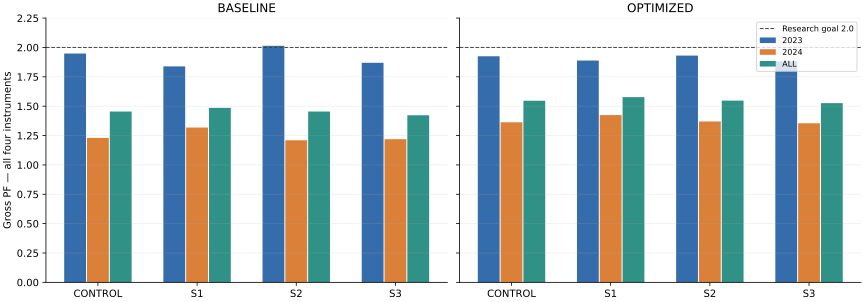
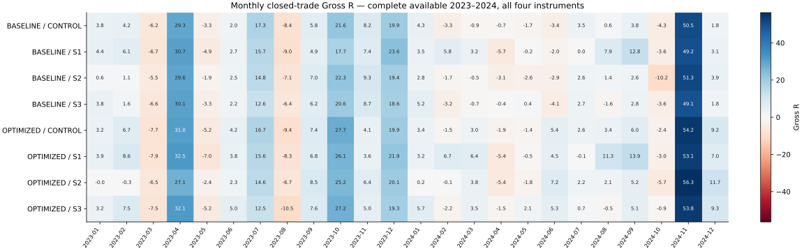
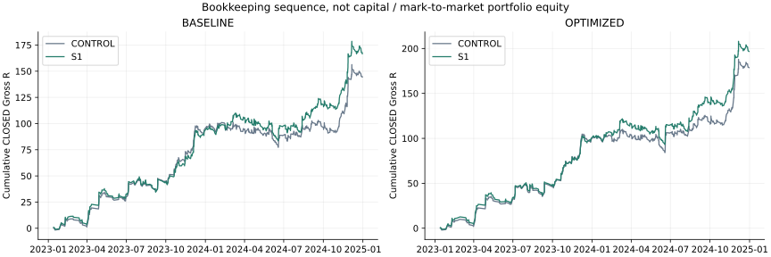

# T3/M15 Stop & Exit v1 — экспериментальный отчёт

**COSTS_DEFERRED / GROSS_ONLY / NOT_LIVE_READY. Внешний review и решение пользователя: PENDING. Draft PR, STOP без merge/auto-merge.**

Исследовательская цель **не достигнута**: ни S1, ни S2, ни S3 не дают полного Gross PF ≥2 на четырёх инструментах. S1 даёт наиболее полезный standalone вклад в Gross R 2024 при небольшом изменении Gross R 2023, но увеличивает просадку и остаётся ниже PF 2. S2 уменьшает убытки ценой более сильного сокращения победителей. S3 ограничивает часть трендов, а новые входы преимущественно ухудшают итог. Все исходы сохранены; параметры после просмотра результатов не подбирали.

## База, preregistration и область данных

Фактический GitHub `main` перед началом совпал с ожидаемым `bc4f95f48b332f43d79ed10f26fc03c5ad01cd97` (merged #495); изменений после него нет. Данные `market-pattern-data` @ `f8486b446cf3d5f9f3cba6dfec32bdef8fd184c8` чистые и read-only. Спецификация и SHA зафиксированы **до любых результатов этого пакета** в коммите `d6728adac580070a69c7ea9b33b1f7f9fe59cd73`; причинный engine, unit-тесты и независимый auditor зафиксированы перед S-результатами в `4beb8813`.

Использован весь фактически доступный M15 prefix 2023–2024. Перед первой строкой 2025+ проверяется только timestamp, OHLC этой строки не загружается. Полные исходные SHA-256 вычисляются как непрозрачные байты для целостности; это не чтение будущих OHLC для анализа. **2023 и 2024 — development-exposed; 2024 не является независимым WF.**

| Инструмент | Первый Close MSK | Последний Close MSK | M15 |
|---|---|---|---|
| USDRUBF | 2023-01-03T09:15:00+03:00 | 2024-12-31T00:00:00+03:00 | 29890 |
| CNYRUBF | 2023-01-03T09:15:00+03:00 | 2024-12-31T00:00:00+03:00 | 29633 |
| GLDRUBF | 2023-07-11T10:15:00+03:00 | 2024-12-31T00:00:00+03:00 | 22189 |
| IMOEXF | 2023-11-14T10:15:00+03:00 | 2024-12-31T00:00:00+03:00 | 16593 |

## Фиксированные механики и исполнение

| Механика | Правило |
|---|---|
| CONTROL | Изначальный Stop 2 ATR, оригинальный ATR trailing: BASELINE 3.0, OPTIMIZED 3.5. |
| S1 TRAIL_AFTER_1R | До подтверждённого +1 первоначального R Stop фиксирован. После пережитой завершённой свечи разрешён оригинальный trailing по накопленному с входа благоприятному экстремуму. |
| S2 BREAK_EVEN_1R | Оригинальный trailing действует всегда; после пережитой свечи с +1R Stop ужесточён не хуже входа. |
| S3 LOCK_1R_AFTER_2R | Оригинальный trailing действует всегда; после пережитой свечи с +2R Stop ужесточён не хуже входа +1 первоначальный R. |

SHORT полностью зеркален. Первоначальный риск неизменен: `abs(entry-initial_stop)`; равенство порогу проходит. EMA75, H1, ADX14>20, Donchian20, ATR14, H1 ATRMean20, slope lookback5 и остальные исходные параметры не менялись. Нет S-комбинаций или A6/A7-фильтра.

Сначала исполняется старый действующий Stop: неблагоприятный gap Open, затем intrabar Low для LONG / High для SHORT. **На Stop-свече не обновляются экстремумы, активация и новый Stop.** Пережитая полная свеча подтверждает порог и ratchet, новый Stop действует на следующей фактической свече. Возврат через новый Stop внутри trigger-свечи не вызывает ретроактивного выхода. Stop никогда не ослабляется. Signal High/Low не входят в после-входной экстремум.

Сохраняются исходные Close-входы и same-Close re-entry после Stop; физическая исполнимость входа ровно по signal Close не доказана. Непрерывные Stop-цены не приводятся к tick grid. Protective exit сохраняет историческую метку Close свечи; точный intrabar timestamp неизвестен. Межсессионные/выходные/годовые переходы переносят состояние, риск и Stop без reset или forced flat. Нет искусственных свечей и терминальной ликвидации.

## Воспроизведение контроля

**PASS: 741 BASELINE + 701 OPTIMIZED = 1 442 CLOSED и по одной terminal OPEN IMOEXF.** С #490 сверены все 19 исходных полей механики; с #495 — все 39 общих полей gross-only контроля, включая сигнал, контекст, Stop, выходы, порядок и occupancy-связанные метки. Все исходные поля terminal OPEN сохранены. Расхождений 0 при абсолютном числовом допуске 1e-8; максимальное отличие цены 5.46e-12. Старые C1/net поля исключены из этого gross-only сопоставления; расходы здесь не вычисляются и не вычитаются. [Машинный контроль](results/CONTROL_REPRODUCTION.json), [пустой diff](results/CONTROL_DIFF.csv).

## Полный период и оба календарных года

Год/месяц CLOSED определяется исторической меткой выхода MSK. Terminal OPEN относится к году/месяцу входа и не означает snapshot на конец каждого года. Каждая из восьми version/mechanic имеет одну terminal OPEN IMOEXF; её unrealized Gross R приводится отдельно и не прибавляется к CLOSED Gross R. [OPEN_POSITIONS](results/OPEN_POSITIONS.json).

Gross PF = сумма положительных Gross R / абсолютная сумма отрицательных Gross R; нулевые сделки не входят в эти суммы. `—` означает неопределённый PF без отрицательной суммы (не PF=0), либо отсутствие значения. Expectancy = сумма Gross R / CLOSED. Сумма R по четырём инструментам — учётная сумма нормированных сделок, **не доходность портфеля**.

| Версия | Механика | Период | Gross PF | Gross R | Exp R | CLOSED | terminal OPEN |
|---|---|---|---|---|---|---|---|
| BASELINE | CONTROL | 2023 | 1.948 | 94.205 | 0.368 | 256 | 0 |
| BASELINE | CONTROL | 2024 | 1.230 | 50.206 | 0.104 | 485 | 1 |
| BASELINE | CONTROL | ALL | 1.454 | 144.411 | 0.195 | 741 | 1 |
| BASELINE | S1 | 2023 | 1.839 | 92.589 | 0.366 | 253 | 0 |
| BASELINE | S1 | 2024 | 1.318 | 74.132 | 0.159 | 465 | 1 |
| BASELINE | S1 | ALL | 1.485 | 166.721 | 0.232 | 718 | 1 |
| BASELINE | S2 | 2023 | 2.014 | 92.185 | 0.353 | 261 | 0 |
| BASELINE | S2 | 2024 | 1.210 | 43.601 | 0.089 | 492 | 1 |
| BASELINE | S2 | ALL | 1.455 | 135.787 | 0.180 | 753 | 1 |
| BASELINE | S3 | 2023 | 1.869 | 88.258 | 0.338 | 261 | 0 |
| BASELINE | S3 | 2024 | 1.219 | 48.479 | 0.099 | 490 | 1 |
| BASELINE | S3 | ALL | 1.423 | 136.738 | 0.182 | 751 | 1 |
| OPTIMIZED | CONTROL | 2023 | 1.925 | 98.618 | 0.406 | 243 | 0 |
| OPTIMIZED | CONTROL | 2024 | 1.363 | 80.102 | 0.175 | 458 | 1 |
| OPTIMIZED | CONTROL | ALL | 1.546 | 178.720 | 0.255 | 701 | 1 |
| OPTIMIZED | S1 | 2023 | 1.889 | 99.678 | 0.414 | 241 | 0 |
| OPTIMIZED | S1 | 2024 | 1.424 | 97.030 | 0.217 | 448 | 1 |
| OPTIMIZED | S1 | ALL | 1.577 | 196.708 | 0.285 | 689 | 1 |
| OPTIMIZED | S2 | 2023 | 1.931 | 88.220 | 0.349 | 253 | 0 |
| OPTIMIZED | S2 | 2024 | 1.370 | 75.570 | 0.161 | 468 | 1 |
| OPTIMIZED | S2 | ALL | 1.547 | 163.790 | 0.227 | 721 | 1 |
| OPTIMIZED | S3 | 2023 | 1.882 | 96.262 | 0.387 | 249 | 0 |
| OPTIMIZED | S3 | 2024 | 1.354 | 80.533 | 0.173 | 466 | 1 |
| OPTIMIZED | S3 | ALL | 1.526 | 176.796 | 0.247 | 715 | 1 |

## Регулярность, худшие месяцы, losing streak и closed-trade DD

Все фактически доступные месяцы включены, в том числе нулевые; GLD/IMOEX не получают искусственные месяцы до запуска. `L trade` — максимальная серия CLOSED с Gross R<0; нулевая/положительная сделка сбрасывает серию. `L month` — отрицательные месяцы подряд. DD рассчитан по cumulative CLOSED R с началом в нуле, в порядке `exit_time / instrument / trade_id`, без mark-to-market открытого риска.

| Версия | Механика | Период | + | − | 0 | Худший месяц | R худшего | L trade | L month | DD R |
|---|---|---|---|---|---|---|---|---|---|---|
| BASELINE | CONTROL | 2023 | 9 | 3 | 0 | 2023-08 | -8.443 | 10 | 1 | 13.204 |
| BASELINE | CONTROL | 2024 | 6 | 6 | 0 | 2024-10 | -4.279 | 14 | 5 | 23.677 |
| BASELINE | CONTROL | ALL | 15 | 9 | 0 | 2023-08 | -8.443 | 14 | 5 | 23.677 |
| BASELINE | S1 | 2023 | 9 | 3 | 0 | 2023-08 | -9.028 | 10 | 1 | 14.659 |
| BASELINE | S1 | 2024 | 8 | 4 | 0 | 2024-04 | -5.671 | 14 | 3 | 26.510 |
| BASELINE | S1 | ALL | 17 | 7 | 0 | 2023-08 | -9.028 | 14 | 3 | 26.510 |
| BASELINE | S2 | 2023 | 9 | 3 | 0 | 2023-08 | -7.069 | 6 | 1 | 11.405 |
| BASELINE | S2 | 2024 | 6 | 6 | 0 | 2024-10 | -10.159 | 9 | 5 | 24.984 |
| BASELINE | S2 | ALL | 15 | 9 | 0 | 2024-10 | -10.159 | 9 | 5 | 24.984 |
| BASELINE | S3 | 2023 | 9 | 3 | 0 | 2023-03 | -6.558 | 9 | 1 | 11.763 |
| BASELINE | S3 | 2024 | 6 | 6 | 0 | 2024-06 | -4.106 | 13 | 3 | 22.006 |
| BASELINE | S3 | ALL | 15 | 9 | 0 | 2023-03 | -6.558 | 13 | 3 | 22.006 |
| OPTIMIZED | CONTROL | 2023 | 9 | 3 | 0 | 2023-08 | -9.407 | 8 | 1 | 14.644 |
| OPTIMIZED | CONTROL | 2024 | 8 | 4 | 0 | 2024-10 | -2.406 | 13 | 2 | 26.126 |
| OPTIMIZED | CONTROL | ALL | 17 | 7 | 0 | 2023-08 | -9.407 | 13 | 2 | 26.126 |
| OPTIMIZED | S1 | 2023 | 9 | 3 | 0 | 2023-08 | -8.325 | 12 | 1 | 14.173 |
| OPTIMIZED | S1 | 2024 | 8 | 4 | 0 | 2024-04 | -5.394 | 14 | 2 | 28.471 |
| OPTIMIZED | S1 | ALL | 17 | 7 | 0 | 2023-08 | -8.325 | 14 | 2 | 28.471 |
| OPTIMIZED | S2 | 2023 | 7 | 5 | 0 | 2023-08 | -6.703 | 5 | 3 | 11.527 |
| OPTIMIZED | S2 | 2024 | 8 | 4 | 0 | 2024-10 | -5.653 | 10 | 2 | 27.051 |
| OPTIMIZED | S2 | ALL | 15 | 9 | 0 | 2023-08 | -6.703 | 10 | 3 | 27.051 |
| OPTIMIZED | S3 | 2023 | 9 | 3 | 0 | 2023-08 | -10.453 | 9 | 1 | 17.010 |
| OPTIMIZED | S3 | 2024 | 8 | 4 | 0 | 2024-02 | -2.154 | 12 | 1 | 22.622 |
| OPTIMIZED | S3 | ALL | 17 | 7 | 0 | 2023-08 | -10.453 | 12 | 1 | 22.622 |

## Концентрация и удаление крупнейших победителей

Top5/Top10 доли относятся к сумме **положительных** R. Удаление победителей — диагностическая чувствительность того же replay, не новый запуск или стратегия.

| Версия | Механика | Период | Top5/+R | Top10/+R | R без top5 | PF без top5 | R без top10 | PF без top10 |
|---|---|---|---|---|---|---|---|---|
| BASELINE | CONTROL | 2023 | 0.167 | 0.298 | 61.815 | 1.622 | 36.456 | 1.367 |
| BASELINE | CONTROL | 2024 | 0.126 | 0.213 | 16.377 | 1.075 | -7.167 | 0.967 |
| BASELINE | CONTROL | ALL | 0.081 | 0.143 | 107.103 | 1.337 | 78.192 | 1.246 |
| BASELINE | S1 | 2023 | 0.160 | 0.284 | 60.199 | 1.545 | 34.840 | 1.316 |
| BASELINE | S1 | 2024 | 0.125 | 0.210 | 35.835 | 1.154 | 9.744 | 1.042 |
| BASELINE | S1 | ALL | 0.078 | 0.140 | 126.670 | 1.369 | 95.450 | 1.278 |
| BASELINE | S2 | 2023 | 0.177 | 0.305 | 59.796 | 1.658 | 36.305 | 1.399 |
| BASELINE | S2 | 2024 | 0.135 | 0.228 | 9.772 | 1.047 | -13.772 | 0.934 |
| BASELINE | S2 | ALL | 0.086 | 0.152 | 98.478 | 1.330 | 69.568 | 1.233 |
| BASELINE | S3 | 2023 | 0.171 | 0.301 | 55.868 | 1.550 | 31.065 | 1.306 |
| BASELINE | S3 | 2024 | 0.125 | 0.212 | 14.650 | 1.066 | -8.894 | 0.960 |
| BASELINE | S3 | ALL | 0.081 | 0.144 | 99.429 | 1.308 | 70.519 | 1.218 |
| OPTIMIZED | CONTROL | 2023 | 0.167 | 0.303 | 64.353 | 1.604 | 36.471 | 1.342 |
| OPTIMIZED | CONTROL | 2024 | 0.156 | 0.252 | 33.132 | 1.150 | 4.233 | 1.019 |
| OPTIMIZED | CONTROL | ALL | 0.096 | 0.161 | 129.984 | 1.397 | 97.088 | 1.297 |
| OPTIMIZED | S1 | 2023 | 0.162 | 0.293 | 65.413 | 1.583 | 37.531 | 1.335 |
| OPTIMIZED | S1 | 2024 | 0.152 | 0.244 | 47.559 | 1.208 | 17.608 | 1.077 |
| OPTIMIZED | S1 | ALL | 0.092 | 0.157 | 147.237 | 1.432 | 112.336 | 1.330 |
| OPTIMIZED | S2 | 2023 | 0.187 | 0.334 | 54.001 | 1.570 | 27.130 | 1.286 |
| OPTIMIZED | S2 | 2024 | 0.168 | 0.271 | 28.600 | 1.140 | -0.299 | 0.999 |
| OPTIMIZED | S2 | ALL | 0.105 | 0.176 | 115.055 | 1.385 | 82.159 | 1.275 |
| OPTIMIZED | S3 | 2023 | 0.167 | 0.303 | 61.997 | 1.568 | 34.116 | 1.313 |
| OPTIMIZED | S3 | 2024 | 0.153 | 0.247 | 33.563 | 1.148 | 4.664 | 1.021 |
| OPTIMIZED | S3 | ALL | 0.095 | 0.159 | 128.060 | 1.381 | 95.164 | 1.283 |

## Четыре инструмента: 2023, 2024 и полный период

Ни один инструмент не исключён. Все годовые частоты, expectancy, терминальные OPEN и gross-показатели доступны ниже; полный набор концентрации, календаря и риска — в [INSTRUMENT_DIRECTION_DETAIL](INSTRUMENT_DIRECTION_DETAIL.md) и CSV.

| Версия | Механика | Период | Инструмент | Gross PF | Gross R | Exp R | CLOSED | terminal OPEN |
|---|---|---|---|---|---|---|---|---|
| BASELINE | CONTROL | 2023 | USDRUBF | 2.698 | 64.859 | 0.584 | 111 | 0 |
| BASELINE | CONTROL | 2024 | USDRUBF | 1.072 | 3.898 | 0.034 | 115 | 0 |
| BASELINE | CONTROL | 2023 | CNYRUBF | 1.846 | 29.169 | 0.343 | 85 | 0 |
| BASELINE | CONTROL | 2024 | CNYRUBF | 1.312 | 15.863 | 0.139 | 114 | 0 |
| BASELINE | CONTROL | 2023 | GLDRUBF | 0.996 | -0.103 | -0.002 | 51 | 0 |
| BASELINE | CONTROL | 2024 | GLDRUBF | 1.196 | 11.271 | 0.089 | 127 | 0 |
| BASELINE | CONTROL | 2023 | IMOEXF | 1.081 | 0.280 | 0.031 | 9 | 0 |
| BASELINE | CONTROL | 2024 | IMOEXF | 1.341 | 19.174 | 0.149 | 129 | 1 |
| BASELINE | S1 | 2023 | USDRUBF | 2.555 | 63.544 | 0.578 | 110 | 0 |
| BASELINE | S1 | 2024 | USDRUBF | 1.194 | 11.367 | 0.103 | 110 | 0 |
| BASELINE | S1 | 2023 | CNYRUBF | 1.742 | 28.579 | 0.336 | 85 | 0 |
| BASELINE | S1 | 2024 | CNYRUBF | 1.473 | 25.185 | 0.235 | 107 | 0 |
| BASELINE | S1 | 2023 | GLDRUBF | 0.976 | -0.638 | -0.013 | 49 | 0 |
| BASELINE | S1 | 2024 | GLDRUBF | 1.305 | 18.526 | 0.151 | 123 | 0 |
| BASELINE | S1 | 2023 | IMOEXF | 1.275 | 1.104 | 0.123 | 9 | 0 |
| BASELINE | S1 | 2024 | IMOEXF | 1.316 | 19.055 | 0.152 | 125 | 1 |
| BASELINE | S2 | 2023 | USDRUBF | 2.895 | 61.931 | 0.539 | 115 | 0 |
| BASELINE | S2 | 2024 | USDRUBF | 0.925 | -4.127 | -0.035 | 119 | 0 |
| BASELINE | S2 | 2023 | CNYRUBF | 1.907 | 29.313 | 0.341 | 86 | 0 |
| BASELINE | S2 | 2024 | CNYRUBF | 1.312 | 14.696 | 0.128 | 115 | 0 |
| BASELINE | S2 | 2023 | GLDRUBF | 1.029 | 0.648 | 0.013 | 51 | 0 |
| BASELINE | S2 | 2024 | GLDRUBF | 1.298 | 15.774 | 0.124 | 127 | 0 |
| BASELINE | S2 | 2023 | IMOEXF | 1.085 | 0.293 | 0.033 | 9 | 0 |
| BASELINE | S2 | 2024 | IMOEXF | 1.326 | 17.259 | 0.132 | 131 | 1 |
| BASELINE | S3 | 2023 | USDRUBF | 2.539 | 60.313 | 0.534 | 113 | 0 |
| BASELINE | S3 | 2024 | USDRUBF | 1.080 | 4.343 | 0.037 | 116 | 0 |
| BASELINE | S3 | 2023 | CNYRUBF | 1.841 | 29.256 | 0.336 | 87 | 0 |
| BASELINE | S3 | 2024 | CNYRUBF | 1.307 | 15.750 | 0.137 | 115 | 0 |
| BASELINE | S3 | 2023 | GLDRUBF | 1.016 | 0.364 | 0.007 | 51 | 0 |
| BASELINE | S3 | 2024 | GLDRUBF | 1.178 | 10.540 | 0.082 | 129 | 0 |
| BASELINE | S3 | 2023 | IMOEXF | 0.613 | -1.674 | -0.167 | 10 | 0 |
| BASELINE | S3 | 2024 | IMOEXF | 1.314 | 17.846 | 0.137 | 130 | 1 |
| OPTIMIZED | CONTROL | 2023 | USDRUBF | 2.737 | 70.657 | 0.686 | 103 | 0 |
| OPTIMIZED | CONTROL | 2024 | USDRUBF | 1.094 | 5.163 | 0.047 | 110 | 0 |
| OPTIMIZED | CONTROL | 2023 | CNYRUBF | 1.765 | 27.546 | 0.336 | 82 | 0 |
| OPTIMIZED | CONTROL | 2024 | CNYRUBF | 1.601 | 30.554 | 0.288 | 106 | 0 |
| OPTIMIZED | CONTROL | 2023 | GLDRUBF | 1.029 | 0.759 | 0.015 | 49 | 0 |
| OPTIMIZED | CONTROL | 2024 | GLDRUBF | 1.365 | 20.557 | 0.176 | 117 | 0 |
| OPTIMIZED | CONTROL | 2023 | IMOEXF | 0.910 | -0.344 | -0.038 | 9 | 0 |
| OPTIMIZED | CONTROL | 2024 | IMOEXF | 1.406 | 23.828 | 0.191 | 125 | 1 |
| OPTIMIZED | S1 | 2023 | USDRUBF | 2.624 | 69.817 | 0.678 | 103 | 0 |
| OPTIMIZED | S1 | 2024 | USDRUBF | 1.198 | 11.660 | 0.108 | 108 | 0 |
| OPTIMIZED | S1 | 2023 | CNYRUBF | 1.724 | 27.285 | 0.333 | 82 | 0 |
| OPTIMIZED | S1 | 2024 | CNYRUBF | 1.612 | 32.215 | 0.313 | 103 | 0 |
| OPTIMIZED | S1 | 2023 | GLDRUBF | 1.063 | 1.742 | 0.037 | 47 | 0 |
| OPTIMIZED | S1 | 2024 | GLDRUBF | 1.480 | 27.602 | 0.240 | 115 | 0 |
| OPTIMIZED | S1 | 2023 | IMOEXF | 1.208 | 0.834 | 0.093 | 9 | 0 |
| OPTIMIZED | S1 | 2024 | IMOEXF | 1.429 | 25.553 | 0.209 | 122 | 1 |
| OPTIMIZED | S2 | 2023 | USDRUBF | 3.100 | 66.156 | 0.601 | 110 | 0 |
| OPTIMIZED | S2 | 2024 | USDRUBF | 1.007 | 0.369 | 0.003 | 114 | 0 |
| OPTIMIZED | S2 | 2023 | CNYRUBF | 1.600 | 20.818 | 0.245 | 85 | 0 |
| OPTIMIZED | S2 | 2024 | CNYRUBF | 1.589 | 27.177 | 0.249 | 109 | 0 |
| OPTIMIZED | S2 | 2023 | GLDRUBF | 1.079 | 1.963 | 0.040 | 49 | 0 |
| OPTIMIZED | S2 | 2024 | GLDRUBF | 1.539 | 26.738 | 0.227 | 118 | 0 |
| OPTIMIZED | S2 | 2023 | IMOEXF | 0.813 | -0.718 | -0.080 | 9 | 0 |
| OPTIMIZED | S2 | 2024 | IMOEXF | 1.393 | 21.287 | 0.168 | 127 | 1 |
| OPTIMIZED | S3 | 2023 | USDRUBF | 2.640 | 68.341 | 0.645 | 106 | 0 |
| OPTIMIZED | S3 | 2024 | USDRUBF | 1.131 | 7.204 | 0.065 | 111 | 0 |
| OPTIMIZED | S3 | 2023 | CNYRUBF | 1.795 | 29.033 | 0.346 | 84 | 0 |
| OPTIMIZED | S3 | 2024 | CNYRUBF | 1.637 | 32.875 | 0.307 | 107 | 0 |
| OPTIMIZED | S3 | 2023 | GLDRUBF | 1.032 | 0.825 | 0.017 | 49 | 0 |
| OPTIMIZED | S3 | 2024 | GLDRUBF | 1.327 | 19.723 | 0.163 | 121 | 0 |
| OPTIMIZED | S3 | 2023 | IMOEXF | 0.600 | -1.936 | -0.194 | 10 | 0 |
| OPTIMIZED | S3 | 2024 | IMOEXF | 1.343 | 20.732 | 0.163 | 127 | 1 |
| BASELINE | CONTROL | ALL | USDRUBF | 1.744 | 68.757 | 0.304 | 226 | 0 |
| BASELINE | CONTROL | ALL | CNYRUBF | 1.528 | 45.032 | 0.226 | 199 | 0 |
| BASELINE | CONTROL | ALL | GLDRUBF | 1.139 | 11.168 | 0.063 | 178 | 0 |
| BASELINE | CONTROL | ALL | IMOEXF | 1.326 | 19.454 | 0.141 | 138 | 1 |
| BASELINE | S1 | ALL | USDRUBF | 1.753 | 74.910 | 0.341 | 220 | 0 |
| BASELINE | S1 | ALL | CNYRUBF | 1.586 | 53.764 | 0.280 | 192 | 0 |
| BASELINE | S1 | ALL | GLDRUBF | 1.204 | 17.889 | 0.104 | 172 | 0 |
| BASELINE | S1 | ALL | IMOEXF | 1.313 | 20.158 | 0.150 | 134 | 1 |
| BASELINE | S2 | ALL | USDRUBF | 1.661 | 57.804 | 0.247 | 234 | 0 |
| BASELINE | S2 | ALL | CNYRUBF | 1.554 | 44.009 | 0.219 | 201 | 0 |
| BASELINE | S2 | ALL | GLDRUBF | 1.218 | 16.422 | 0.092 | 178 | 0 |
| BASELINE | S2 | ALL | IMOEXF | 1.311 | 17.552 | 0.125 | 140 | 1 |
| BASELINE | S3 | ALL | USDRUBF | 1.692 | 64.656 | 0.282 | 229 | 0 |
| BASELINE | S3 | ALL | CNYRUBF | 1.523 | 45.006 | 0.223 | 202 | 0 |
| BASELINE | S3 | ALL | GLDRUBF | 1.132 | 10.904 | 0.061 | 180 | 0 |
| BASELINE | S3 | ALL | IMOEXF | 1.264 | 16.172 | 0.116 | 140 | 1 |
| OPTIMIZED | CONTROL | ALL | USDRUBF | 1.794 | 75.820 | 0.356 | 213 | 0 |
| OPTIMIZED | CONTROL | ALL | CNYRUBF | 1.669 | 58.100 | 0.309 | 188 | 0 |
| OPTIMIZED | CONTROL | ALL | GLDRUBF | 1.259 | 21.316 | 0.128 | 166 | 0 |
| OPTIMIZED | CONTROL | ALL | IMOEXF | 1.376 | 23.484 | 0.175 | 134 | 1 |
| OPTIMIZED | S1 | ALL | USDRUBF | 1.800 | 81.478 | 0.386 | 211 | 0 |
| OPTIMIZED | S1 | ALL | CNYRUBF | 1.659 | 59.500 | 0.322 | 185 | 0 |
| OPTIMIZED | S1 | ALL | GLDRUBF | 1.345 | 29.344 | 0.181 | 162 | 0 |
| OPTIMIZED | S1 | ALL | IMOEXF | 1.415 | 26.387 | 0.201 | 131 | 1 |
| OPTIMIZED | S2 | ALL | USDRUBF | 1.775 | 66.525 | 0.297 | 224 | 0 |
| OPTIMIZED | S2 | ALL | CNYRUBF | 1.594 | 47.995 | 0.247 | 194 | 0 |
| OPTIMIZED | S2 | ALL | GLDRUBF | 1.386 | 28.701 | 0.172 | 167 | 0 |
| OPTIMIZED | S2 | ALL | IMOEXF | 1.354 | 20.570 | 0.151 | 136 | 1 |
| OPTIMIZED | S3 | ALL | USDRUBF | 1.783 | 75.545 | 0.348 | 217 | 0 |
| OPTIMIZED | S3 | ALL | CNYRUBF | 1.703 | 61.907 | 0.324 | 191 | 0 |
| OPTIMIZED | S3 | ALL | GLDRUBF | 1.238 | 20.548 | 0.121 | 170 | 0 |
| OPTIMIZED | S3 | ALL | IMOEXF | 1.288 | 18.795 | 0.137 | 137 | 1 |

## LONG/SHORT: все четыре инструмента вместе

| Версия | Механика | Период | Направление | Gross PF | Gross R | Exp R | CLOSED | terminal OPEN |
|---|---|---|---|---|---|---|---|---|
| BASELINE | CONTROL | 2023 | LONG | 1.773 | 49.350 | 0.307 | 161 | 0 |
| BASELINE | CONTROL | 2023 | SHORT | 2.263 | 44.855 | 0.472 | 95 | 0 |
| BASELINE | CONTROL | 2024 | LONG | 1.397 | 43.715 | 0.171 | 255 | 1 |
| BASELINE | CONTROL | 2024 | SHORT | 1.060 | 6.491 | 0.028 | 230 | 0 |
| BASELINE | CONTROL | ALL | LONG | 1.535 | 93.065 | 0.224 | 416 | 1 |
| BASELINE | CONTROL | ALL | SHORT | 1.357 | 51.346 | 0.158 | 325 | 0 |
| BASELINE | S1 | 2023 | LONG | 1.749 | 52.011 | 0.329 | 158 | 0 |
| BASELINE | S1 | 2023 | SHORT | 1.991 | 40.579 | 0.427 | 95 | 0 |
| BASELINE | S1 | 2024 | LONG | 1.471 | 56.441 | 0.228 | 248 | 1 |
| BASELINE | S1 | 2024 | SHORT | 1.156 | 17.691 | 0.082 | 217 | 0 |
| BASELINE | S1 | ALL | LONG | 1.573 | 108.452 | 0.267 | 406 | 1 |
| BASELINE | S1 | ALL | SHORT | 1.378 | 58.270 | 0.187 | 312 | 0 |
| BASELINE | S2 | 2023 | LONG | 1.732 | 43.431 | 0.262 | 166 | 0 |
| BASELINE | S2 | 2023 | SHORT | 2.543 | 48.754 | 0.513 | 95 | 0 |
| BASELINE | S2 | 2024 | LONG | 1.374 | 39.228 | 0.152 | 258 | 1 |
| BASELINE | S2 | 2024 | SHORT | 1.043 | 4.373 | 0.019 | 234 | 0 |
| BASELINE | S2 | ALL | LONG | 1.503 | 82.660 | 0.195 | 424 | 1 |
| BASELINE | S2 | ALL | SHORT | 1.395 | 53.127 | 0.161 | 329 | 0 |
| BASELINE | S3 | 2023 | LONG | 1.700 | 45.425 | 0.277 | 164 | 0 |
| BASELINE | S3 | 2023 | SHORT | 2.168 | 42.834 | 0.442 | 97 | 0 |
| BASELINE | S3 | 2024 | LONG | 1.370 | 41.653 | 0.161 | 258 | 1 |
| BASELINE | S3 | 2024 | SHORT | 1.063 | 6.826 | 0.029 | 232 | 0 |
| BASELINE | S3 | ALL | LONG | 1.491 | 87.078 | 0.206 | 422 | 1 |
| BASELINE | S3 | ALL | SHORT | 1.340 | 49.660 | 0.151 | 329 | 0 |
| OPTIMIZED | CONTROL | 2023 | LONG | 1.787 | 53.664 | 0.353 | 152 | 0 |
| OPTIMIZED | CONTROL | 2023 | SHORT | 2.169 | 44.954 | 0.494 | 91 | 0 |
| OPTIMIZED | CONTROL | 2024 | LONG | 1.432 | 49.436 | 0.203 | 244 | 1 |
| OPTIMIZED | CONTROL | 2024 | SHORT | 1.288 | 30.666 | 0.143 | 214 | 0 |
| OPTIMIZED | CONTROL | ALL | LONG | 1.565 | 103.100 | 0.260 | 396 | 1 |
| OPTIMIZED | CONTROL | ALL | SHORT | 1.522 | 75.620 | 0.248 | 305 | 0 |
| OPTIMIZED | S1 | 2023 | LONG | 1.781 | 55.693 | 0.371 | 150 | 0 |
| OPTIMIZED | S1 | 2023 | SHORT | 2.078 | 43.984 | 0.483 | 91 | 0 |
| OPTIMIZED | S1 | 2024 | LONG | 1.568 | 67.067 | 0.281 | 239 | 1 |
| OPTIMIZED | S1 | 2024 | SHORT | 1.271 | 29.963 | 0.143 | 209 | 0 |
| OPTIMIZED | S1 | ALL | LONG | 1.648 | 122.761 | 0.316 | 389 | 1 |
| OPTIMIZED | S1 | ALL | SHORT | 1.488 | 73.947 | 0.246 | 300 | 0 |
| OPTIMIZED | S2 | 2023 | LONG | 1.646 | 40.104 | 0.249 | 161 | 0 |
| OPTIMIZED | S2 | 2023 | SHORT | 2.470 | 48.116 | 0.523 | 92 | 0 |
| OPTIMIZED | S2 | 2024 | LONG | 1.452 | 47.792 | 0.193 | 248 | 1 |
| OPTIMIZED | S2 | 2024 | SHORT | 1.282 | 27.779 | 0.126 | 220 | 0 |
| OPTIMIZED | S2 | ALL | LONG | 1.524 | 87.896 | 0.215 | 409 | 1 |
| OPTIMIZED | S2 | ALL | SHORT | 1.578 | 75.895 | 0.243 | 312 | 0 |
| OPTIMIZED | S3 | 2023 | LONG | 1.756 | 52.237 | 0.335 | 156 | 0 |
| OPTIMIZED | S3 | 2023 | SHORT | 2.101 | 44.025 | 0.473 | 93 | 0 |
| OPTIMIZED | S3 | 2024 | LONG | 1.399 | 47.483 | 0.191 | 249 | 1 |
| OPTIMIZED | S3 | 2024 | SHORT | 1.306 | 33.051 | 0.152 | 217 | 0 |
| OPTIMIZED | S3 | ALL | LONG | 1.530 | 99.720 | 0.246 | 405 | 1 |
| OPTIMIZED | S3 | ALL | SHORT | 1.520 | 77.076 | 0.249 | 310 | 0 |

По каждому инструменту LONG/SHORT для 2023/2024/ALL — [INSTRUMENT_DIRECTION_DETAIL](INSTRUMENT_DIRECTION_DETAIL.md); каждый календарный месяц отдельно для инструмента и направления — [MONTHLY_DETAIL](MONTHLY_DETAIL.md) и [monthly_direction_report.csv](results/monthly_direction_report.csv).

## Исходные CLOSED ≥2R: сохранённые, потерянные и уменьшенные

Сопоставление по точным `version/instrument/direction/entry_time`. Сохранённые: новый R не меньше исходного с допуском 1e-8; это сохранность результата, не гарантия идентичной длительности. «Потеря» означает отсутствие исходного входа из-за новой хронологии occupancy; «сокращены» — присутствующий вход с меньшим R. OPEN выделяется отдельно. Это диагностика, не входной фильтр.

| Версия | Механика | Исх. год | Исх. ≥2R | Сохранены | Потеря входа | Сокращены | OPEN | Стали ≤0 | Стали <2R |
|---|---|---|---|---|---|---|---|---|---|
| BASELINE | S1 | ALL | 81 | 78 | 3 | 0 | 0 | 0 | 0 |
| BASELINE | S1 | 2023 | 34 | 34 | 0 | 0 | 0 | 0 | 0 |
| BASELINE | S1 | 2024 | 47 | 44 | 3 | 0 | 0 | 0 | 0 |
| BASELINE | S2 | ALL | 81 | 76 | 0 | 5 | 0 | 5 | 5 |
| BASELINE | S2 | 2023 | 34 | 31 | 0 | 3 | 0 | 3 | 3 |
| BASELINE | S2 | 2024 | 47 | 45 | 0 | 2 | 0 | 2 | 2 |
| BASELINE | S3 | ALL | 81 | 75 | 0 | 6 | 0 | 0 | 6 |
| BASELINE | S3 | 2023 | 34 | 30 | 0 | 4 | 0 | 0 | 4 |
| BASELINE | S3 | 2024 | 47 | 45 | 0 | 2 | 0 | 0 | 2 |
| OPTIMIZED | S1 | ALL | 90 | 88 | 2 | 0 | 0 | 0 | 0 |
| OPTIMIZED | S1 | 2023 | 34 | 34 | 0 | 0 | 0 | 0 | 0 |
| OPTIMIZED | S1 | 2024 | 56 | 54 | 2 | 0 | 0 | 0 | 0 |
| OPTIMIZED | S2 | ALL | 90 | 79 | 0 | 11 | 0 | 11 | 11 |
| OPTIMIZED | S2 | 2023 | 34 | 27 | 0 | 7 | 0 | 7 | 7 |
| OPTIMIZED | S2 | 2024 | 56 | 52 | 0 | 4 | 0 | 4 | 4 |
| OPTIMIZED | S3 | ALL | 90 | 84 | 0 | 6 | 0 | 0 | 6 |
| OPTIMIZED | S3 | 2023 | 34 | 30 | 0 | 4 | 0 | 0 | 4 |
| OPTIMIZED | S3 | 2024 | 56 | 54 | 0 | 2 | 0 | 0 | 2 |

## Изменение исходных убытков и новые входы

| Версия | Механика | Исх. год | Исх. убытков | Нет входа | Улучшены | Ухудшены | Без изменения | OPEN | Δ matched loss R | Новых CLOSED | Новых OPEN | Новые +R | Новые −R объём |
|---|---|---|---|---|---|---|---|---|---|---|---|---|---|
| BASELINE | S1 | ALL | 448 | 15 | 44 | 136 | 253 | 0 | 29.640 | 0 | 0 | 0.000 | 0.000 |
| BASELINE | S1 | 2023 | 145 | 3 | 12 | 47 | 83 | 0 | -4.849 | 0 | 0 | 0.000 | 0.000 |
| BASELINE | S1 | 2024 | 303 | 12 | 32 | 89 | 170 | 0 | 34.489 | 0 | 0 | 0.000 | 0.000 |
| BASELINE | S2 | ALL | 448 | 0 | 75 | 0 | 373 | 0 | 22.320 | 12 | 0 | 9.023 | 3.029 |
| BASELINE | S2 | 2023 | 145 | 0 | 29 | 0 | 116 | 0 | 9.279 | 5 | 0 | 7.350 | 0.852 |
| BASELINE | S2 | 2024 | 303 | 0 | 46 | 0 | 257 | 0 | 13.041 | 7 | 0 | 1.673 | 2.177 |
| BASELINE | S3 | ALL | 448 | 0 | 0 | 0 | 448 | 0 | 0.000 | 10 | 0 | 1.459 | 5.357 |
| BASELINE | S3 | 2023 | 145 | 0 | 0 | 0 | 145 | 0 | 0.000 | 5 | 0 | 1.361 | 2.173 |
| BASELINE | S3 | 2024 | 303 | 0 | 0 | 0 | 303 | 0 | 0.000 | 5 | 0 | 0.099 | 3.183 |
| OPTIMIZED | S1 | ALL | 429 | 8 | 33 | 85 | 303 | 0 | 24.308 | 0 | 0 | 0.000 | 0.000 |
| OPTIMIZED | S1 | 2023 | 143 | 2 | 9 | 30 | 102 | 0 | -0.518 | 0 | 0 | 0.000 | 0.000 |
| OPTIMIZED | S1 | 2024 | 286 | 6 | 24 | 55 | 201 | 0 | 24.826 | 0 | 0 | 0.000 | 0.000 |
| OPTIMIZED | S2 | ALL | 429 | 0 | 88 | 0 | 341 | 0 | 34.862 | 20 | 0 | 19.063 | 6.414 |
| OPTIMIZED | S2 | 2023 | 143 | 0 | 36 | 0 | 107 | 0 | 14.945 | 10 | 0 | 14.678 | 3.134 |
| OPTIMIZED | S2 | 2024 | 286 | 0 | 52 | 0 | 234 | 0 | 19.917 | 10 | 0 | 4.386 | 3.280 |
| OPTIMIZED | S3 | ALL | 429 | 0 | 1 | 0 | 428 | 0 | 1.049 | 14 | 0 | 2.997 | 9.138 |
| OPTIMIZED | S3 | 2023 | 143 | 0 | 1 | 0 | 142 | 0 | 1.049 | 6 | 0 | 2.997 | 2.553 |
| OPTIMIZED | S3 | 2024 | 286 | 0 | 0 | 0 | 286 | 0 | 0.000 | 8 | 0 | 0.000 | 6.585 |

## Полное разложение изменения Gross R

Матчинг исходных победителей и убытков, отсутствующие CLOSED исходы и новые CLOSED входы объясняют полный Δ R. Годовые перенесения отдельно сохранены в CSV; в этом запуске они нулевые. [gross_R_attribution.csv](results/gross_R_attribution.csv) содержит проверяемое равенство всех компонентов и итогового Δ.

| Версия | Механика | Δ исх. победителей | Δ исх. убытков | Δ нулевых | Отсутствующие исходы | Новые CLOSED R | Полный ΔR |
|---|---|---|---|---|---|---|---|
| BASELINE | S1 | 0.525 | 29.640 | 0.115 | -7.970 | 0.000 | 22.310 |
| BASELINE | S2 | -36.938 | 22.320 | 0.000 | 0.000 | 5.993 | -8.624 |
| BASELINE | S3 | -3.776 | 0.000 | 0.000 | 0.000 | -3.897 | -7.673 |
| OPTIMIZED | S1 | -2.699 | 24.308 | 0.000 | -3.621 | 0.000 | 17.988 |
| OPTIMIZED | S2 | -62.441 | 34.862 | 0.000 | 0.000 | 12.649 | -14.929 |
| OPTIMIZED | S3 | 3.168 | 1.049 | 0.000 | 0.000 | -6.141 | -1.924 |

## Ноябрь 2024 и 2024 без ноября: только диагностическая чувствительность

Удаление ноября не меняет replay, не создаёт новую выборку для отбора и не является Robustness/WF. Полные чувствительности каждого инструмента — в CSV.

| Версия | Механика | PF 2024 | R 2024 | CLOSED ноября | PF ноября | R ноября | PF без ноября | R без ноября | +мес без ноября | DD без ноября |
|---|---|---|---|---|---|---|---|---|---|---|
| BASELINE | CONTROL | 1.230 | 50.206 | 44 | 5.090 | 50.529 | 0.998 | -0.322 | 5 | 23.677 |
| BASELINE | S1 | 1.318 | 74.132 | 42 | 4.445 | 49.249 | 1.114 | 24.883 | 7 | 26.510 |
| BASELINE | S2 | 1.210 | 43.601 | 44 | 5.438 | 51.270 | 0.961 | -7.669 | 5 | 24.984 |
| BASELINE | S3 | 1.219 | 48.479 | 45 | 4.822 | 49.094 | 0.997 | -0.614 | 5 | 22.006 |
| OPTIMIZED | CONTROL | 1.363 | 80.102 | 39 | 6.297 | 54.186 | 1.123 | 25.916 | 7 | 26.126 |
| OPTIMIZED | S1 | 1.424 | 97.030 | 38 | 5.396 | 53.073 | 1.203 | 43.958 | 7 | 28.471 |
| OPTIMIZED | S2 | 1.370 | 75.570 | 39 | 7.918 | 56.279 | 1.098 | 19.291 | 7 | 27.051 |
| OPTIMIZED | S3 | 1.354 | 80.533 | 40 | 5.889 | 53.793 | 1.124 | 26.740 | 7 | 22.622 |

## Причины результата каждой механики

**S1.** Более позднее разрешение trailing позволяет части исходных проигрышей восстановиться; итоговый matched-loss эффект +29.640R / +24.308R (BASELINE / OPTIMIZED) на полном периоде. Однако 136 / 85 matched-убытков становятся хуже, в то время как улучшаются только 44 / 33: улучшение суммы обеспечивают более крупные изменения отдельных исходов. В 2024 matched-loss вклад +34.489R / +24.826R, но longer occupancy устраняет 3 / 2 исходных победителя ≥2R и другие исходы. Новых входов нет, CLOSED 741→718 / 701→689. 78/81 и 88/90 крупных исходных победителей сохранены, уменьшенных matched ≥2R нет. R 2023 −1.616R (−1.7%) / +1.060R (+1.1%). Все четыре инструмента в 2024 остаются положительными, но BASELINE IMOEXF чуть ухудшается; OPTIMIZED SHORT 2024 R 30.666→29.963 тоже не улучшается.

S1 повышает 2024 R 50.206→74.132 / 80.102→97.030 и PF 1.230→1.318 / 1.363→1.424. BASELINE плюс месяцев 2024 6→8; OPTIMIZED 8→8. 2024 без ноября −0.322→+24.883 / +25.916→+43.958R. Top10 концентрация полного периода слегка ниже контроля. **Цена улучшения:** full/2024 DD 23.677→26.510 / 26.126→28.471R, частота ниже; цель PF 2 остаётся недостигнутой. Отложенный trailing не устраняет все ранние слабые входы: до +1R остаётся полный исходный риск.

**S2.** BE улучшает 75 / 88 исходных убытков без ухудшения matched-убытков; matched-loss вклад +22.320 / +34.862R. Но matched-победители теряют −36.938 / −62.441R: 5 / 11 исходных ≥2R превращаются в неположительные исходы. Новые 12 / 20 CLOSED дают только +5.993 / +12.649R нетто gross. Полный ΔR −8.624 / −14.929; PF почти не меняется, expectancy и R ниже. Концентрация растёт; OPTIMIZED теряет две положительные календарные месячные суммы в 2023. В 2024 BASELINE USD становится отрицательным (−4.127R). BE защищает уже развившееся движение ценой преждевременного выхода из части трендов. Gap может исполнить ниже BE, поэтому активация не обещает безубыточность.

**S3.** Исходные убытки почти не затрагиваются: вклад 0 / +1.049R, поскольку +2R достигнут лишь частью сделок. По 6 исходных ≥2R имеют уменьшенный результат; у ORIGINAL ≥2R нет потерянных входов и неположительных matched-выходов. LOCK может сохранить прибыль после разворота, но также раньше закрывает продолжающийся тренд. Новые 10 / 14 CLOSED дают −3.897 / −6.141R. Полный ΔR −7.673 / −1.924; PF ниже обоих контролей. 2024 OPTIMIZED R слегка выше (+0.431R), PF ниже, DD лучше; этого недостаточно для устойчивого улучшения двух версий. Lock +1R не гарантирует +1R fill при неблагоприятном gap.

Это объяснение **детерминированных изменений данной модели**, не доказательство причин рыночного режима или универсального преимущества. Численные правила не менялись после просмотра исходов.

## Активации и последний источник Stop при выходе

«Последний источник» — последнее строгое ужесточение Stop; равные предложения сохраняют прежний источник. `updates` считает любое изменение Stop (ATR или BE/LOCK). Полный bar-by-bar журнал сохраняет все проверки и предложения.

| Версия | Механика | CLOSED | Порог активирован | Initial Stop | ATR Stop | BE Stop | LOCK Stop | Gap | Активирован и R≤0 |
|---|---|---|---|---|---|---|---|---|---|
| BASELINE | CONTROL | 741 | 0 | 178 | 563 | 0 | 0 | 64 | 0 |
| BASELINE | S1 | 718 | 404 | 314 | 404 | 0 | 0 | 49 | 81 |
| BASELINE | S2 | 753 | 371 | 179 | 474 | 100 | 0 | 67 | 108 |
| BASELINE | S3 | 751 | 201 | 181 | 515 | 0 | 55 | 60 | 3 |
| OPTIMIZED | CONTROL | 701 | 0 | 216 | 485 | 0 | 0 | 54 | 0 |
| OPTIMIZED | S1 | 689 | 388 | 301 | 388 | 0 | 0 | 51 | 96 |
| OPTIMIZED | S2 | 721 | 367 | 221 | 373 | 127 | 0 | 51 | 131 |
| OPTIMIZED | S3 | 715 | 211 | 223 | 421 | 0 | 71 | 51 | 2 |

## A6/A7: неизменные исторические ориентиры #495

Они не запускались в этом пакете и не комбинировались с S1/S2/S3. Строки перенесены из frozen CSV #495 без изменения значений; независимый auditor сравнивает каждую строку. Старые дополнительные поля отчётов сохраняют исходное значение/определение.

| Версия | Механика | Период | Gross PF | Gross R | Exp R | CLOSED | terminal OPEN |
|---|---|---|---|---|---|---|---|
| BASELINE | A6 | 2023 | 2.051 | 72.025 | 0.402 | 179 | 0 |
| BASELINE | A6 | 2024 | 1.427 | 63.942 | 0.186 | 343 | 1 |
| BASELINE | A7 | 2023 | 2.043 | 95.421 | 0.401 | 238 | 0 |
| BASELINE | A7 | 2024 | 1.241 | 46.838 | 0.109 | 431 | 1 |
| OPTIMIZED | A6 | 2023 | 2.080 | 78.729 | 0.460 | 171 | 0 |
| OPTIMIZED | A6 | 2024 | 1.557 | 86.125 | 0.261 | 330 | 1 |
| OPTIMIZED | A7 | 2023 | 2.026 | 101.019 | 0.449 | 225 | 0 |
| OPTIMIZED | A7 | 2024 | 1.421 | 81.453 | 0.201 | 406 | 1 |
| BASELINE | A6 | ALL | 1.623 | 135.967 | 0.260 | 522 | 1 |
| BASELINE | A7 | ALL | 1.497 | 142.260 | 0.213 | 669 | 1 |
| OPTIMIZED | A6 | ALL | 1.725 | 164.854 | 0.329 | 501 | 1 |
| OPTIMIZED | A7 | ALL | 1.625 | 182.472 | 0.289 | 631 | 1 |

S1 сохраняет больше полного Gross R и 2023 R, чем исторический A6, но его PF ниже и DD выше. Сравнение не разрешает комбинаций. A6/A7 также не дают полного PF 2; выбор следующей работы остаётся за пользователем после review.

## Качество, аудит и повторяемость

20 причинных unit-тестов PASS до просмотра вариантов. Тесты включают LONG/SHORT, Stop-before-ratchet и Stop-before-activation, точные BE/LOCK пороги, благоприятный экстремум сигнальной/Stop-свечи, same-bar ambiguity, gap до/после активации, immutable risk, отсутствие ослабления Stop, обе версии trailing, terminal OPEN, same-Close re-entry/occupancy, сессии/выходные/границу года, H1 gaps и prefix-invariance, запрет парсинга 2025+ OHLC.

Отдельный standard-library auditor заново читает только разрешённый raw prefix, независимо вычисляет рекурсивные ATR/EMA/ADX, H1 и Donchian, затем полный replay. Он реконструирует extrema из пережитого пути, независимо выбирает ratchet и проверяет каждую закрытую сделку, каждую Stop-проверку/активацию, все occupancy решения и terminal OPEN. Также заново сверяет все поля центральных отчётов, lineage, winner/loss, ноября, активаций, R attribution, A6/A7-истории, источников и SHA. Числовой допуск 1e-8, ненумерические поля точно.

**Аудит реализации выполнен тем же автором; внешний независимый человеческий review остаётся PENDING.** Это не заменяется словом PASS. Два свежих процесса повторяют все generated артефакты с прямым сравнением bytes и SHA-256. Подробности: [INDEPENDENT_AUDIT](INDEPENDENT_AUDIT.md), [AUDIT_RESULTS](AUDIT_RESULTS.json), [REPEATABILITY](REPEATABILITY.json), [TEST_RESULTS](TEST_RESULTS.txt), [SCOPE_CHECK](SCOPE_CHECK.json).

## Артефакты и ограничения

[EXPERIMENT_SPECS](EXPERIMENT_SPECS.json), [PREREGISTRATION](PREREGISTRATION.json), [SOURCE_MANIFEST](results/SOURCE_MANIFEST.json), [GENERATED_SHA256](results/GENERATED_SHA256.json), [ARTIFACT_SHA256](ARTIFACT_SHA256.json) фиксируют параметры, код, данные и результаты.

Полный общий [журнал CLOSED](results/trades.csv), отдельные CONTROL/S1/S2/S3, [bar-by-bar Stop](results/stop_decisions.csv), [входы/occupancy](results/entry_opportunities.csv), [lineage](results/trade_lineage.csv), [winner/loss](results/winner_loss_changes.csv) и [top5/top10 исходных победителей](results/large_winners.csv) доступны для review. Все gross метрики в `overall/yearly/monthly/instrument/direction/monthly_direction_report.csv`, включая OPEN, expectancy, форму выигрышей/убытков, календарь, losing streak, DD и концентрацию.

Рыночные CSV не копируются в discovery. Изменения только в новом `IntradayLab/t3_m15_stop_exit_v1/`; исходные исследования, ROADMAP, TradingSystemLab, data, robot, конфигурации брокера и реальные счета не изменяются. Нет Optimization, Robustness, Walk Forward, TRUE OOS, LIVE, следующих комбинаций или порогов. Нет C1, комиссий, spread/slippage/funding или иных вычетов. Это gross-only исследование, не deployable net economics. Следующее действие — внешний review и решение пользователя; **STOP на Draft PR**.
