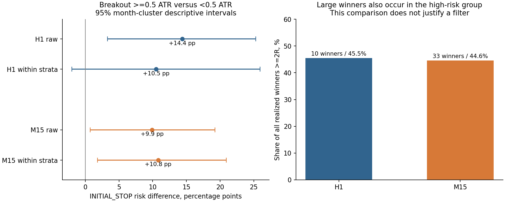

# T3 ENTRY DIAGNOSTICS V1 — H1/M15

На development 2023–2024 наиболее согласованное наблюдаемое свойство неудачных входов — большее превышение предыдущего Donchian20 относительно ATR. На M15 дополнительно выделяется широкий диапазон сигнальной свечи. Это ассоциации с INITIAL_STOP, а не доказательство причинности или прибыльности отбора. Большая часть INITIAL_STOP не достигает +0.5R; отрицательный M15 trailing — отдельный механизм возврата уже накопленной плавающей прибыли.

**Новых фильтров, стратегий, backtest альтернатив, пороговой оптимизации и изменений исполнения нет. Сохранность крупных победителей при изменениях НЕ установлена.** Протокол заморожен в `e00cf40dc7b45d590e914a5d0f66316eca507769` до discovery. 2025–2026 обработаны только изолированным процессом обязательного CONTROL; новых OOS-выводов нет.

## Источники и CONTROL

| Источник | Закреплённый SHA |
| --- | --- |
| main | c3695b1304aef1acdd889264b3451184f7332bf7 |
| pr560 | 90a0a552c05f9ae280f4f2350fd013ea507ea00f |
| pr557 | 5836971e7ff8e472d8128c675c4f837b40a036ef |
| pr518 | d85cf85083d6fea047a1a960c9ead441f7b4a6ed |
| H1 data | 50f1fd2178c18b7ab3bd969be82ad01f47a34745 |
| M15 data | f8486b446cf3d5f9f3cba6dfec32bdef8fd184c8 |

SHA256 архивов, frozen source и восьми data blobs сверены. Данные остаются read-only вне git; source OHLC не копируются в исследование. `SOURCE_MANIFEST.json` содержит полный перечень.

| CONTROL | CLOSED | INITIAL_STOP | Результат |
| --- | --- | --- | --- |
| H1 | 355 | 141 | PASS |
| M15 | 1114 | 356 | PASS |
| H1 WF отдельно | 63 | 17 | PASS, не discovery и не добавлен к H1 |

Сверены 202418 полей первоначальных журналов и 4385052 поля состояния PR557, затем все CONTROL trade fields PR560; свежий scalar CONTROL replay совпал. Конфигурации: H1 `TRAIL1__N4_01__FULL__R15`, Initial 2.5 ATR / TRAIL1 3 ATR; M15 `T3_M15_T1_TRAIL35_N4_R15`, NEXT_OPEN, Initial 2 / trail 3.5 ATR. FULL N4, одна позиция на инструмент. Frozen stop-first, активация H1 TRAIL1 и R15 сохранены.

## Покрытие, причинность и неопределённость

| Система | Инструмент | Первый replay Close МСК | Последний Close | Исходных сигналов |
| --- | --- | --- | --- | --- |
| H1 | USDRUBF | 2023-01-03T10:00:00+03:00 | 2024-12-31T00:00:00+03:00 | 219 |
| H1 | CNYRUBF | 2023-01-03T10:00:00+03:00 | 2024-12-31T00:00:00+03:00 | 145 |
| H1 | GLDRUBF | 2023-07-11T11:00:00+03:00 | 2024-12-31T00:00:00+03:00 | 129 |
| H1 | IMOEXF | 2023-11-14T11:00:00+03:00 | 2024-12-31T00:00:00+03:00 | 112 |
| M15 | USDRUBF | 2023-01-03T09:15:00+03:00 | 2024-12-31T00:00:00+03:00 | 615 |
| M15 | CNYRUBF | 2023-01-03T09:15:00+03:00 | 2024-12-31T00:00:00+03:00 | 500 |
| M15 | GLDRUBF | 2023-07-11T10:15:00+03:00 | 2024-12-31T00:00:00+03:00 | 516 |
| M15 | IMOEXF | 2023-11-14T10:15:00+03:00 | 2024-12-31T00:00:00+03:00 | 386 |

GLDRUBF отсутствует до 11.07.2023, IMOEXF — до 14.11.2023; N4 в 2023 неполон. H1 baseline холодно стартует в 2023, начальные строки 2022 не входят в его индикаторы или сделки. Конец обоих development потоков фактически 31.12.2024 00:00 МСК, исходный close-label. H1 historical TRUE OOS и WF в discovery отсутствуют. Одна OPEN позиция в каждой системе не разрешена будущими данными.

Все признаки рассчитаны для каждого исходного сигнала, включая занятость и M15 вне T1; outcome-таблицы относятся только к исполненным CONTROL входам. Прежний Donchian исключает текущую свечу. EMA/ADX/ATR и предшествующее движение CROSS_DAY используют только завершённые свечи. У H1 frozen EMA100 принадлежит H4; диагностическая H1 EMA100 хранится отдельно. Опубликованные H4/H1 состояния имеют `context_available_at <= signal_time`. Блоки старшего контекста строятся по frozen close-date, включая midnight; показатели не публикуются до последнего Close блока. Дневной `session_minutes` считается от 10:00 МСК, T1 [10:00,18:00). Это часы frozen сессии, а не аттестация исторического биржевого расписания.

NEXT_OPEN gap известен в следующем событии исполнения (при непрерывной сетке имеет тот же wall timestamp, что signal Close, но более позднюю фазу). Он вынесен в `EXECUTION_DIAGNOSTICS.csv`, не включён в signal features и не используется для выбора гипотез.

Терцили заданы квантилями доступных признаков development-входов без outcome. Везде 95% описательные интервалы paired bootstrap по 24 календарным месяцам входа сразу по всем инструментам, 2000 повторов, seed 560518; дополнительно 8 квартальных блоков. Они не исправляют множественный просмотр признаков, возможную зависимость через границы блоков или нестационарность. SMALL = <20 CLOSED или <6 месяцев хотя бы в одной сравниваемой группе. Один-два года и малые страты не дают основания объявлять универсальную закономерность.

## H1: исходы и признаки входа

Исполнено 172 входов: 171 CLOSED, 1 OPEN. INITIAL_STOP 60 (35.1% CLOSED); победителей от +2R — 22.

| Исход | N closed/open | Mean Gross R | Median R | Median MAE | Median MFE | +0.5R наблюдалось | Медиана минут до +0.5R* |
| --- | --- | --- | --- | --- | --- | --- | --- |
| INITIAL_STOP | 60/0 | -1.005 | -1.000 | 1.000 | 0.286 | 14 | 360 |
| TRAILING_NEGATIVE | 8/0 | -0.158 | -0.145 | 0.528 | 1.082 | 8 | 180 |
| TRAILING_POSITIVE | 103/0 | 1.406 | 1.017 | 0.240 | 2.277 | 103 | 300 |
| TRAILING_ZERO | 0/0 | — | — | — | — | 0 | — |
| OPEN | 0/1 | — | — | 0.144 | 4.357 | 1 | 60 |

| Исход | Первое >0R наблюдалось | Не наблюдалось / ambiguous / censored | Median минут до первого >0R* |
| --- | --- | --- | --- |
| INITIAL_STOP | 54 | 4 / 2 / 0 | 60 |
| TRAILING_NEGATIVE | 8 | 0 / 0 / 0 | 60 |
| TRAILING_POSITIVE | 103 | 0 / 0 / 0 | 60 |
| OPEN | 1 | 0 / 0 / 0 | 60 |

*Только среди достигших; Open — точный момент, intrabar — верхняя временная граница. Ненаблюдавшиеся, ambiguous exit-bar и OPEN censoring перечислены отдельно в OUTCOME_SUMMARY. MAE/MFE — CONTROL R0, stop-first гарантированная граница; полные exit-bar High/Low лишь upper bounds, их порядок неизвестен. OPEN extrema ограничены development endpoint.

| Признак | WINNERS p25 / median / p75 | LOSERS p25 / median / p75 |
| --- | --- | --- |
| breakout_atr | 0.189 / 0.377 / 0.696 | 0.263 / 0.501 / 0.797 |
| range_atr | 1.121 / 1.532 / 2.023 | 1.066 / 1.496 / 1.969 |
| body_abs_atr | 0.584 / 1.011 / 1.496 | 0.614 / 0.997 / 1.374 |
| prior_move20_atr_cross_day | 0.883 / 2.022 / 3.339 | 1.345 / 3.181 / 4.705 |
| context_adx | 26.053 / 31.839 / 39.165 | 25.091 / 32.127 / 40.041 |
| context_slope_atr | 0.157 / 0.354 / 0.576 | 0.130 / 0.323 / 0.491 |

Полные распределения всех запрошенных признаков, в том числе EMA, ADX, ATR, ATRRatio, location, prior movement и session time: `FEATURE_DISTRIBUTIONS.csv`; все исходные feature rows — `ENTRY_FEATURES_H1.csv`. Абсолютные ATR выражены в единицах цены, их pooled сравнение между разными инструментами само по себе неинформативно.

| Признак HIGH–LOW | Δ INITIAL_STOP, п.п. | 95% month CI | 95% quarter CI |
| --- | --- | --- | --- |
| breakout_atr | 19.3 | [9.1; 30.4] | [7.6; 32.3] |
| range_atr | 4.1 | [-9.8; 18.0] | [-7.8; 17.9] |
| prior_move20_atr_cross_day | 19.3 | [4.1; 35.4] | [8.7; 30.2] |

H1: превышение Donchian направлено одинаково на всех четырёх инструментах, обеих сторонах и в обоих годах; большинство instrument-терцилей SMALL. Предшествующее движение 20 свечей также ассоциировано с INITIAL_STOP, но направление разворачивается на IMOEXF и оценка слабее после исключения CNY. Широкая сигнальная свеча не даёт согласованного H1 эффекта. Слабый H4 slope — лишь намёк: на USDRUBF направление противоположно, ADX почти не различает исходы внутри уже отобранного gate.

## M15: исходы и признаки входа

Исполнено 550 входов: 549 CLOSED, 1 OPEN. INITIAL_STOP 184 (33.5% CLOSED); победителей от +2R — 74.

| Исход | N closed/open | Mean Gross R | Median R | Median MAE | Median MFE | +0.5R наблюдалось | Медиана минут до +0.5R* |
| --- | --- | --- | --- | --- | --- | --- | --- |
| INITIAL_STOP | 184/0 | -1.000 | -1.000 | 1.000 | 0.224 | 32 | 30 |
| TRAILING_NEGATIVE | 144/0 | -0.491 | -0.492 | 0.657 | 0.954 | 133 | 30 |
| TRAILING_POSITIVE | 220/0 | 1.998 | 1.312 | 0.347 | 2.865 | 220 | 30 |
| TRAILING_ZERO | 1/0 | 0.000 | 0.000 | 0.532 | 7.916 | 1 | 30 |
| OPEN | 0/1 | — | — | 0.284 | 4.100 | 1 | 45 |

| Исход | Первое >0R наблюдалось | Не наблюдалось / ambiguous / censored | Median минут до первого >0R* |
| --- | --- | --- | --- |
| INITIAL_STOP | 151 | 15 / 18 / 0 | 15 |
| TRAILING_NEGATIVE | 144 | 0 / 0 / 0 | 15 |
| TRAILING_POSITIVE | 220 | 0 / 0 / 0 | 15 |
| OPEN | 1 | 0 / 0 / 0 | 15 |

*Только среди достигших; Open — точный момент, intrabar — верхняя временная граница. Ненаблюдавшиеся, ambiguous exit-bar и OPEN censoring перечислены отдельно в OUTCOME_SUMMARY. MAE/MFE — CONTROL R0, stop-first гарантированная граница; полные exit-bar High/Low лишь upper bounds, их порядок неизвестен. OPEN extrema ограничены development endpoint.

| Признак | WINNERS p25 / median / p75 | LOSERS p25 / median / p75 |
| --- | --- | --- |
| breakout_atr | 0.242 / 0.442 / 0.757 | 0.262 / 0.447 / 0.859 |
| range_atr | 1.106 / 1.535 / 1.970 | 1.147 / 1.536 / 2.127 |
| body_abs_atr | 0.663 / 1.028 / 1.560 | 0.666 / 1.049 / 1.573 |
| prior_move20_atr_cross_day | 0.733 / 2.348 / 4.068 | 0.891 / 2.457 / 4.427 |
| context_adx | 25.632 / 32.999 / 42.440 | 26.268 / 32.896 / 41.782 |
| context_slope_atr | 0.237 / 0.395 / 0.605 | 0.194 / 0.358 / 0.604 |

Полные распределения всех запрошенных признаков, в том числе EMA, ADX, ATR, ATRRatio, location, prior movement и session time: `FEATURE_DISTRIBUTIONS.csv`; все исходные feature rows — `ENTRY_FEATURES_M15.csv`. Абсолютные ATR выражены в единицах цены, их pooled сравнение между разными инструментами само по себе неинформативно.

| Признак HIGH–LOW | Δ INITIAL_STOP, п.п. | 95% month CI | 95% quarter CI |
| --- | --- | --- | --- |
| breakout_atr | 13.7 | [2.7; 24.4] | [2.9; 23.6] |
| range_atr | 18.0 | [8.6; 29.9] | [6.6; 34.2] |
| prior_move20_atr_cross_day | 2.0 | [-9.2; 13.4] | [-13.3; 16.1] |

M15: HIGH range >1.842 ATR против LOW ≤1.227 ATR: 78/183 (42.6%) против 45/183 (24.6%) INITIAL_STOP; разница +18.0 п.п. [8.6;29.9]. Направление положительное на всех инструментах, обеих сторонах, в обоих годах и при исключении каждого инструмента; отдельные instrument CI широки. В HIGH range всё же 25/74 всех крупных победителей (33.8%), средний Gross R HIGH +0.307 и LOW +0.303. Тело свечи само по себе гораздо слабее диапазона. Context ADX, EMA-distance, slope и ATRRatio не дают согласованного объяснения. Возраст контекста и часы сессии имеют вторичные ассоциации, которые могут отражать структуру времени; они не выделены как самостоятельная механическая гипотеза.

## Предварительное наблюдение Donchian ≥0.5 ATR

| Система | Группа | CLOSED | INITIAL_STOP | Доля | Mean / median Gross R | Победителей ≥2R | Доля всех ≥2R |
| --- | --- | --- | --- | --- | --- | --- | --- |
| H1 | LT_0.5 | 97 | 28 | 28.9% | 0.619 / 0.485 | 12 | 54.5% |
| H1 | GE_0.5 | 74 | 32 | 43.2% | 0.314 / 0.216 | 10 | 45.5% |
| M15 | LT_0.5 | 294 | 85 | 28.9% | 0.365 / -0.329 | 41 | 55.4% |
| M15 | GE_0.5 | 255 | 99 | 38.8% | 0.304 / -0.432 | 33 | 44.6% |

Порог 0.5 ATR задан до расчёта как исследовательский ориентир. Его не оптимизировали и не утверждали фильтром.

| Система | Оценка | Δ INITIAL_STOP, п.п. | 95% month CI | Покрытие |
| --- | --- | --- | --- | --- |
| H1 | Raw | 14.4 | [3.3; 25.3] | 100% |
| H1 | instrument × direction × year × context ATRRatio tercile | 10.5 | [-2.0; 25.9] | 86.5% |
| M15 | Raw | 9.9 | [0.7; 19.2] | 100% |
| M15 | instrument × direction × year × context ATRRatio tercile | 10.8 | [1.8; 20.9] | 99.6% |

Вес общей страты n_high*n_low/(n_high+n_low), страты без обеих групп исключены. M15: +10.8 п.п. [1.8;20.9], квартальный CI [1.8;20.2]; связь не объясняется полностью этими наблюдаемыми факторами. Это не устраняет ненаблюдаемые факторы. На CNY и USD эффект около +17.4/+17.3 п.п.; на GLD/IMOEX близок к нулю. Обе стороны, оба года и все volatility терцили имеют положительный raw знак, но CI отдельных разрезов часто включает ноль. H1 совместная оценка +10.5 п.п. [−2.0;25.9], квартальный CI [−4.1;28.0], покрытие 86.5%: неопределённость существенно больше.

В группе ≥0.5 ATR остаются 10/22 (45.5%) H1 и 33/74 (44.6%) M15 крупных победителей. У H1 их частота внутри high-группы даже немного выше, чем в low-группе. Одновременное наличие риска стопа и больших победителей принципиально ограничивает отбор. `CONFLICT_EXAMPLES.csv` содержит для каждого общего bucket первый по времени INITIAL_STOP и первый ≥2R; эти примеры выбраны детерминированно, не по эффектности.

## Что поддерживают A–E

| Механизм | Наблюдение | Интерпретация |
| --- | --- | --- |
| A. Ложный пробой / мало продолжения | H1 46/60 INITIAL_STOP без гарантированных +0.5R; M15 152/184, из них 7 ambiguous exit-bars (145 strict). | Самая прямая outcome-диагностика INITIAL_STOP; входной причинный классификатор не получен. |
| B. Чрезмерное растяжение | Donchian extension: согласованная связь в обеих системах; широкий range — главным образом M15; тело слабее. | Поддерживает гипотезу истощения/непродолжения, но отличить её от случайного ложного пробоя по этим данным нельзя. |
| C. Вход до конца нормального отката | Recovery после стопа часто наблюдается на M15; порядок до adverse1.5R заметно менее благоприятен. | Нормальность отката не установлена; возврат после стопа не равен достижимой прибыли. |
| D. Слабый старший тренд | Внутри gate ADX/ATRRatio уже ограничены; slope/ADX дают неоднородные эффекты. | Меньше поддержки, чем A/B; отсутствие эффекта внутри gate не опровергает важность самого тренда. |
| E. Возврат плавающей прибыли | H1 8 negative trailing, MFE median 1.082R; M15 144, MFE median 0.954R, 133 достигали +0.5R и 67 +1R. | Отдельный значимый M15 механизм убытка, который нельзя смешивать с первоначальным стопом. |

У M15 negative trailing median итог −0.492R, median giveback 1.557R; 2 таких сделки имели guaranteed MFE≥2R. У положительных M15 trailing median giveback тоже 1.568R — сам giveback встречается и у победителей. H1 negative trailing всего 8, все после ≥1R, вывод по этой малой группе ограничен. Раннее adverse движение наблюдается у 51/60 H1 и 175/184 M15 INITIAL_STOP, но также у 13/22 и 27/74 крупных победителей соответственно. Поэтому даже ретроспективный adverse-паттерн не отделяет безопасно неудачу. Все path-признаки после входа — диагностика исхода, не доступные на входе фильтры. A/C/E пересекаются, B/D — ассоциации, поэтому суммы категорий не складываются в причинный диагноз.

| Система | Следующих наблюдаемых дней | Полных / censored | Recovery входной цены | Recovery до/без adverse1.5R | Adverse first | Same-bar ambiguous |
| --- | --- | --- | --- | --- | --- | --- |
| H1 | 1 | 60 / 0 | 26 (43.3%) | 21 (35.0%) | 4 | 1 |
| H1 | 2 | 60 / 0 | 30 (50.0%) | 23 (38.3%) | 6 | 1 |
| M15 | 1 | 184 / 0 | 141 (76.6%) | 68 (37.0%) | 71 | 2 |
| M15 | 2 | 183 / 1 | 145 (79.2%) | 68 (37.2%) | 75 | 2 |

Окно включает остаток дня стопа и следующие 1/2 **наблюдавшихся** торговых дня. На M15 в двухдневном полном окне recovery 145/183 (79.2%; month CI 71.4–86.3%), но до/без adverse1.5R только 68/183 (37.2%; 28.2–47.2%); 75 recovery были после adverse1.5R, 2 same-bar ambiguous. Непрерывность всех ожидаемых биржевых баров не аттестована. Результат не обосновывает удержание после стопа или задержанный вход; такого backtest нет.

## Календарные месяцы и две гипотезы

| Development | Отрицательных CLOSED месяцев | Убыток initial stops, сумма R | Убыток negative trailing, сумма R |
| --- | --- | --- | --- |
| H1 | 9 | -60.309 | -1.263 |
| M15 | 6 | -184.053 | -70.674 |

Это исходный календарь CONTROL, МСК по exit-label, Gross R; не новый расчёт отфильтрованной стратегии. Изменение входов изменило бы занятость и будущие сделки. Снижение числа отрицательных месяцев, денежный результат, executable net и сохранность победителей при любых изменениях здесь **не проверены**.

1. **Растянутый пробой чаще не получает продолжения.** Основной наблюдаемый маркер — Close дальше предыдущего Donchian в ATR; широкий range M15 усиливает механическую правдоподобность, но не доказан как независимый фактор. Это одна гипотеза A/B, не набор фильтров. Ограничение: high breakout содержит около 45% крупных победителей, HIGH M15 range — 33.8%; механическое исключение таких входов не обосновано.
2. **Часть M15 убытков связана с возвратом накопленной прибыли, а не с отсутствием первого движения.** 144 negative trailing, 133 после +0.5R и 67 после +1R; этот механизм материален относительно 184 initial stops. Это гипотеза E о пути/сопровождении, а не найденный предиктор на входе. Ограничение: сопоставимый giveback встречается у победителей; механическое его подавление может обрезать правый хвост.

Ранги отражают полноту механического свидетельства и устойчивость, а не PF. C/D не выделены для отдельного изменения стратегии. Перед отдельной причинной проверкой необходимо заранее определить исходы: число отрицательных календарных месяцев и их глубина, число и вклад сохранённых ≥2R победителей, пропущенные/новые входы из-за занятости, расходы и неопределённость. Нельзя объявлять успех по PF или сумме собственных R; повторное использование уже просмотренных 2025–2026 не создаёт нового независимого OOS. V1 не задаёт параметры будущего вмешательства.

## Аудит и воспроизводимость

`INDEPENDENT_VERIFICATION.json`: отдельный stdlib/scalar parser, индикаторы и признаки из pinned-prefix OHLC, stop-first path, post-stop порядок, Decimal R, границы МСК и стратификация. `TABLE_VERIFICATION.json`: свежие CSV, распределения, терцили, counts/means/medians и повторный месячный bootstrap. `CAUSALITY.json`: prefix invariance и возмущение будущего суффикса на опубликованном контексте, midnight и поздних сигналах всех потоков. `SYNTHETIC_TESTS.json`: warmup, ATR gap, slope, midnight/year boundary, paired clusters и воспроизводимость seed.

**Предел независимости:** verifier — отдельно реализованный алгоритм тем же автором; внешняя человеческая и отдельная агентская проверка не выполнены. Human signoff остаётся PENDING. Это явно отражено в AUDIT, а не выдано за внешнее одобрение. Полный fresh процесс и два свежих повтора после code freeze сравниваются direct bytes и SHA256; окончательная квитанция — `REPEATABILITY.json`.

Все файлы — только новый audit-каталог. LIVE H1, M15 robot, FINAM, Control Center, Windows Tasks, SQLite и торговые токены не читались/не запускались/не менялись. Только Draft PR, **NO MERGE / NO AUTO-MERGE**.

## Карта обязательных таблиц

| Содержание | Файл |
| --- | --- |
| Исходные причинные признаки H1/M15 | ENTRY_FEATURES_H1.csv / ENTRY_FEATURES_M15.csv |
| Фактические исходы и path bounds | OUTCOME_GROUPS_H1.csv / OUTCOME_GROUPS_M15.csv |
| Распределения и риск/mean/median R/MAE/MFE/latency по группам | FEATURE_DISTRIBUTIONS.csv / FEATURE_BUCKETS.csv / OUTCOME_SUMMARY.csv |
| Инструмент, LONG/SHORT, год и их пересечение | INSTRUMENT_DIRECTION.csv |
| Направленность и leave-one-instrument-out | STABILITY.csv |
| 0.5 ATR: confounding и общие страты | BREAKOUT_05_STRATA.csv / BREAKOUT_05_STANDARDIZED.csv |
| Крупные победители в риск-группах; совпадающие признаки | FEATURE_BUCKETS.csv / CONFLICT_EXAMPLES.csv |
| Раннее adverse движение / A–E / recovery | MECHANICS.csv / POST_STOP.csv / POST_STOP_SUMMARY.csv |
| Исходный календарь без новых фильтров | MONTHLY_BASELINE.csv |
| Причины неисполнения / NEXT_OPEN gap | SIGNAL_DISPOSITION_H1.csv / SIGNAL_DISPOSITION_M15.csv / EXECUTION_DIAGNOSTICS.csv / EXECUTION_DIAGNOSTIC_SUMMARY.csv |
